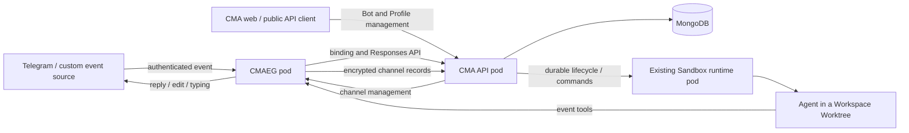

# Event Gateway architecture and provider integration

The normative wire contract is [CMAEG Protocol](CMAEG_Protocol.md). Deployment,
configuration, credential rotation and probes are in
[CMAEG Operations](CMAEG_Operations.md). CMA's implemented public interfaces are
listed in [CMA Public APIs](CMA_Public_APIs.md); exact schemas come from each
service's `GET /openapi.json`.

Start with the public [integration guide](CMAEG_Integration.md), hosted at
<https://bot-gateway.chrono-ai.fun/docs>. It covers creator applications,
event sources, Agent tools and downstream providers. The globally auto-connected
NyxID service is **Agent Event Gateway** (`cmaeg`); its REST proxy is
`https://nyx-api.chrono-ai.fun/api/v1/proxy/s/cmaeg`, already mapped to `/v1`.

## Ownership and topology

CMAEG is a separate event gateway. It verifies event sources, selects a channel
and partition, invokes the configured provider, and delivers explicit replies.
CMA owns Sandboxes, Workspaces, Agents, conversations and provider turns. CMA's
Bot management coordinates a user's existing NyxID Bot with the gateway and CMA
provider. NyxID owns identities, selected service access and external Bot routes.

Every admitted message, command and interaction reaches the configured provider
through the same turn interface. The gateway does not interpret an agent's
business workflow or reserve slash commands. Agents use skills and authenticated
application APIs to guide users and perform product operations. Buttons, choice
controls, media and reply delivery remain generic gateway capabilities.

CMA API and CMAEG each run one replica in namespace `chrono-bot`. Each Sandbox
has its own runtime Pod, separate from both control-plane services. The web has
its own deployment. Replacing an API or gateway Pod does not replace live
Sandbox Pods or change their pinned runtime image.

CMAEG has no local authoritative database. Encrypted channel records live behind
CMA's authenticated record API; caches are disposable. Provider conversation,
turn, event-context and idempotency records belong to the provider. Active HTTP
connections are process-local: a restart can interrupt a connection, and recovery
must use the original durable identity rather than infer that no work happened.

## Event Worker Profiles

`EventWorkerProfile` names the complete provider-neutral configuration sent to
the gateway. It contains `schema_version`, `metadata`, `model`, `permission`,
`context`, and optional provider-specific `environment`. It includes model
selection, reasoning effort, service scope, action mode, instructions, skills,
tool references, and the environment request.

CMA's **Agent Profile** remains the narrower configuration for one Agent.
Workspace Profiles specify workspace location and setup; Sandbox Profiles specify
capacity, model access and environment-wide services and setup. CMA's Event
Worker Profile library composes published revisions of these three into one
complete immutable worker revision. Bots select a revision and retain its full
snapshot. Saving another revision does not update an existing Bot implicitly.

The original v1 `AgentProfileSnapshot` SDK and OpenAPI names remain compatibility
aliases. JSON still uses the `profile` field, `schema_version: 1`, and the same
canonical digest. Renaming the concept does not require recreating channels.
The gateway validates the neutral shape; each provider explicitly reports which
fields it honours or refuses. Accepting the gateway schema alone does not prove
that a provider can execute every requested capability.

## Integration sequence

1. Authenticate to CMA as the owner. Create an Event Worker Profile from published
   CMA configuration, then select its exact revision when creating a Bot. Existing
   clients may continue selecting the three CMA profile revisions directly.
2. CMA's durable Bot operation establishes the dedicated Bot credentials and
   gateway channel. Channel management uses the authenticated creator, an exact
   request identity and a complete profile snapshot. Its response contains the
   provider binding, supported level, endpoints and field-level decisions.
3. CMAEG asks the provider to prepare the binding through
   `PUT /api/v1/cmaeg/bindings/{binding_id}`. The provider validates ownership,
   credential scope, digest, supported fields and environment bounds, and retains
   its immutable provisioning plan. Binding management is independently
   authenticated and cannot grant arbitrary owner access.
4. NyxID relay callbacks enter CMAEG at `POST /v1/callbacks/{channel_id}`. Custom
   CloudEvents use `POST /v1/channels/{channel_id}/events`. The source signature or
   configured custom authentication is checked before admission policy and
   partition selection. Preserve the original event ID for any retry.
5. CMAEG ensures the partition's stable provider conversation and admits the turn
   through the provider Responses contract. CMA persists accepted work, pins the
   environment and dispatches the Agent through its ordinary durable command lane.
6. The Agent can call `replyToEvent`, `updateMessage`, `sendTyping`, and
   `readEventContext` through the gateway's authenticated tools or native `/mcp`.
   The reply policy may also deliver the final provider response. A tool call's
   acceptance and an external delivery's outcome are distinct observations.

Provider extensions, exact request shapes, conformance levels, authentication,
idempotency, field refusals, tool names and uncertain delivery semantics are
specified in [Protocol sections 4–9](CMAEG_Protocol.md). The repository SDKs expose
CMA and CMAEG as separate clients; configure each with its own service origin.

## Full event context and restart recovery

A sealed event reference is bounded to 4 KiB. It carries authenticated identity
and routing information plus a digest of the complete canonical Activity; full activity text may be 32 KiB and cannot fit inside
that reference. CMA persists the complete activity with the provider turn during
ordinary admission. This adds no separate write call on the event ingress path.

`readEventContext` authenticates the Bot and sealed event identity, then obtains
the immutable activity through the provider endpoint:

`GET /api/v1/cmaeg/bindings/{binding_id}/conversations/{conversation_id}/events/{event_id}`

The provider checks the binding credential and the exact binding, conversation
and event. A later gateway replica can retrieve the same full activity after its
cache is gone. It must never manufacture missing text from a truncated event
reference or return another conversation's context. New references attest the
activity digest, so changing an actor or callback selection in provider storage
cannot create valid sender authority. Legacy references are explicitly unverified.

## Durable delayed replies

Providers can exchange a valid, activity-attested event reference for a sealed
reply target lasting at most 24 hours. It retains only the original event's
relay destination and is bound to the current channel record, provider binding
and agent-key hash. The gateway checks live authority on every send and receipt
replay, then uses the channel credential to reply to the original relay message.
The provider owns its pending operation, user authentication and resumption.

An encrypted claim and final delivery receipt use CMA's generic interaction-record
storage. A caller's stable idempotency key admits one delivery attempt before
any external send. Gateway restarts preserve that claim; an abandoned or uncertain
attempt is reported as unknown and is not automatically resent. These records
have their own validated schema and cannot be used as button callback authority.
The gateway stores no application workflow, delegated user grant or user-to-agent
selection policy in this capability.

## Native interactions

CMAEG owns neutral cards, choices, compact button handles, callback validation
and message edits. NyxID owns Telegram credentials and platform transport (including the
`telegram-new` managed adapter alias, normalized by CMAEG to Telegram).
Providers own business decisions such as login, owner selection and provisioning.
The existing four gateway tools carry all native interaction operations.

Interaction records use a distinct encrypted `/api/v1/gateway/interaction-records`
namespace with compare-and-set versions and expiry. Records bind each card to
one channel, route, actor, chat/thread and exact outgoing Nyx message UUID.
They survive gateway replica restarts; stale and cross-user clicks cannot advance
a card. A click consumes one revision, and the provider replies with or edits the
next card. Telegram message IDs alone are insufficient because they are only
unique inside a chat. Full flow and examples are in Protocol §8.

## Credentials and persistence

Kubernetes Secrets inject CMAEG's master-key ring and CMA service credential.
`cmaeg-master-keys` holds the encryption/signing material; the dedicated service
credential in `cmaeg-cma-service-token` grants `cma:gateway:records` and
`cma:provider:bindings`. These service credentials are distinct from each Bot's
own Agent credential. Secret values are not part of a profile or channel response.

CMA provides authenticated encrypted-record CRUD with version preconditions.
CMAEG decrypts and validates the channel and refreshes its bounded caches. A
cached record is not permission to invent a new owner, provider URL or credential.
Current deployment-specific secret names and rotation commands are documented
in the operations guide. Native Kubernetes Secrets are the deployment source.

## Retired integration

The in-CMA Bridge management/callback/worker pipeline is retired. Existing
provenance and retention records remain readable so lifecycle operations cannot
reinterpret old channel authority. New integrations use owner Bots and provider
bindings. See [retired bridge compatibility](CMA_Operations.md#retired-bridge-compatibility)
for the limited historical migration boundary.
