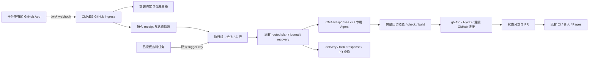
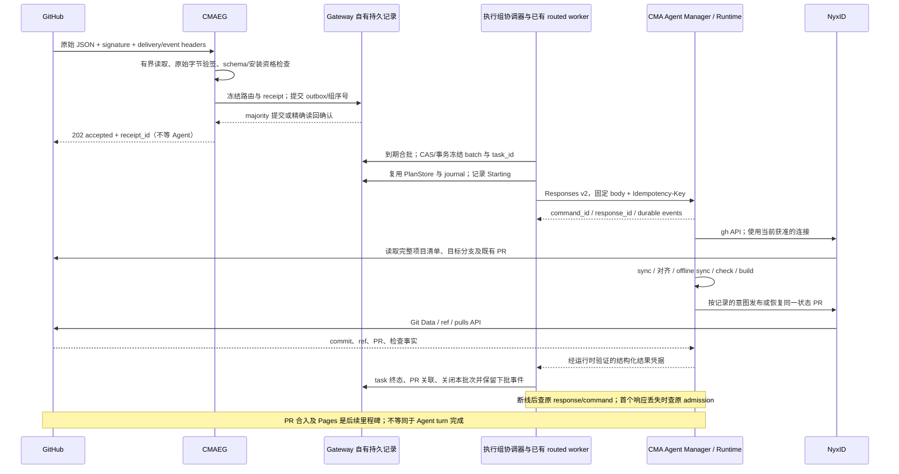

# GitHub 原生事件接入 CMAEG：技术设计与 TDD 计划

日期：2026-11-04，Asia/Singapore。状态：**App 配置与凭证接入方案已被 owner 要求重设计。** 以 [动态 GitHub App integration 设计](CMAEG_GitHub_Integration_Design.md) 为准：注册、secret 保管/轮换、安装核验和 channel 激活必须通过 CMAEG 控制面完成，不能要求修改 Kubernetes ConfigMap/Secret、挂载配置文件或逐个 channel 修改环境变量。此前任务新增的 Kubernetes wiring 已撤回；主聊天第 1–3 切片已实现动态 App 管理、secret 轮换、管理员 App 身份核实和签名 ping/回执恢复，启动不再加载静态 GitHub 文件。长期 installation 绑定、自动核验、动态业务路由和 UI 仍待实现，未部署。第一轮线上验收范围见 [验收清单](CMAEG_GitHub_Online_Verification.md)。

**发布方式更正及实现：** 按用户确认的既有流程，schema/data 变更跟随功能代码，在 feature flag 开启后的服务启动阶段自动执行，不要求 Shining 手动迁移或新增迁移脚本目录。已接入默认关闭的全局 `CMAEG_GITHUB_ENABLED`：开启后启动自动准备缺失或版本 1 的存储，完成后开放 GitHub 接口；关闭不修改或删除已有数据。迁移逻辑仍在服务代码，当前版本只更新 validator、索引和版本标记，不改写 App/receipt 内容。并发初始化、失败恢复、未知版本拒绝和权限限制通过既有 HTTP seam 验证；线上状态仍待实际发布后核实。

现有原生接收、持久任务、合批与恢复代码继续作为复用基础；模型输出的 PR 字段投影不等于副作用已验证。代码、线上部署和端到端验收分别判断。当前旧实现行为见 [GitHub ingress](CMAEG_GitHub_Ingress.md)；它不是获准上线的接入方案。

本设计以本地 CMA `677c27440aa96e428ee50f9801ea886136ea04c8` 为代码调查基线，另外核对了当天线上 OpenAPI，以及较新的 `develop` 快照 `6b8f5a6c524b2e2a6f861317decca4d0245d8798`。三者不相同。下文的“拟新增”均不是现有 API 承诺。

输入为另一个 workspace 中的 `chrono-goals/docs/cma-github-source-requirements.md` 和 `chrono-goals/docs/goal-automation-mvp.md`。调查基线与后续实施状态分开记录；本次重设计不修改运行时代码或线上资源。

## 1. 建议与范围

采用 CMAEG 原生 GitHub App integration，允许平台或用户持有 App，通过相同受保护控制面注册。原生 webhook 直接进入 CMAEG；CMAEG 验签、持久接收、解析可信 installation 绑定，按 owner 配置选择 channel/consumer，再通过已有 routed execution 和 CMA Responses v2 驱动专用 Agent。首个使用方运行完整 chrono-goals 同步，生成状态 PR，继续走原有 CI/Pages。

首个闭环需要补齐四部分：

1. 动态 App 注册与 write-only secret 保管/轮换、原生 `github` source、可信安装绑定和持久 delivery receipt；不依赖 App 专属部署配置。
2. 小范围扩展既有持久执行：同一执行组的合批、串行、排队期间保留新事件，以及首次提交结果不明时的查询。
3. 可查询任务结果与可恢复的 PR 发布凭据；任务结束不能只以模型文本为证。
4. 明确 GitHub 执行授权，并为直接 `fetch` 的同步脚本提供最小认证适配。

不增加独立 webhook 转发部署，不重写整个事件平台，不在 CMAEG 放 goal/check/plan 业务规则，不要求组织仓库自动进入目标板，不做增量同步或业务数据模型重构。第一版一个执行组绑定一个专用 Agent、一个发布目标；复用现有多 consumer 基础，但不把任意 fan-out 或多写入者调度作为前置工作。

## 2. 调查结果：代码、发布契约与线上证据

### 2.1 证据等级

2026-11-03 **15:26 SGT** 直接 GET 线上 `/event-gateway/openapi.json` 返回 200；原始响应 SHA-256 为 `acbaf8983db14ec4ad32975ef0041c174a752a8628e3a2a1e9cb9fd00074e7ef`。`Source` 的公开类型是 `native_lark / whatsapp / telegram / discord / nyxid_relay / custom`，没有 GitHub 路径或 source。该结果证明当前公开契约没有原生 GitHub，不能由此断言服务器内部不存在任何未发布代码。

线上契约包含 `ChannelCreateRequest.durable_custom_execution`、`PublicChannelDefinition.durable_custom_execution` 和 `RelayAuthoringCapabilities.custom_durable_execution_enabled`。本地分支没有这些字段；较新 develop 的 [Custom 持久执行文档][upstream-custom] 和实现已有该能力。**不要在旧分支重复发明或覆盖这项能力。** 后续实施应先对齐实现基线，保留用户已有未提交改动。

本轮直接和经 NyxID 查询 `/channel-capabilities` 均得到 401，故没有独立复核当前开关值。输入文档记录了当天此前认证读取的 `custom_durable_execution_enabled: true`，作为带出处的既有证据保留；较新 develop 的 manifest 仍为 false。这些分别是“此前在线观测”“仓库默认配置”，并不互相替代。本轮没有创建 channel 或发送测试事件；因此没有新增生产执行证明。401 也不表示服务未部署或能力不支持。

### 2.2 能力与缺口

下表文件链接指向本地调查基线；行号用于定位符号，未来实现时应重新核对。

| 领域 | 已有代码／契约 | 本次仍缺什么 |
| --- | --- | --- |
| 原生 source | [Source 枚举](../api/crates/cmaeg-core/src/channel.rs)，第 70 行；[请求类型](../api/crates/cmaeg/src/channels/requests.rs)，第 67 行；[SourceKind](../api/crates/cmaeg-core/src/activity.rs)，第 119 行。当前分支已加入 GitHub 类型和显式 allowlist | 线上发布、安装身份与事件 schema 的真实配置仍待运维；全 App 路由仍是受控配置 |
| 原生接入范式 | [native Lark 验证](../api/crates/cmaeg/src/native_lark/webhook.rs) 先验证原始字节；[接入说明](CMAEG_Native_Lark.md) 要求原生持久接收及独立授权 | 不能照抄 Lark 的每 channel App/tenant 假设；GitHub 是一个 App 对多 installation |
| Custom | [认证代码](../api/crates/cmaeg/src/ingress/custom/mod.rs)，第 44 行，调用 CMAEG webhook 协议；CloudEvents 和原生 GitHub 请求不同 | 不能将 GitHub URL 直接配置为 Custom `/events`，也不能靠改 headers 绕过原生验证 |
| channel / consumer / routing | [RoutingPolicy / RuleMatch](../api/crates/cmaeg-core/src/channel/routing.rs)，第 156 行起；[路由计划](../api/crates/cmaeg/src/ingress/routing_plan.rs) 冻结 consumer 和 provider；[已有 Agent 绑定](../api/crates/layer1-public/src/rest/bindings.rs)，第 207 行起 | 对可信 installation/repository ID/event/action 的精确匹配；GitHub 禁用用户文本 addressing |
| 持久接收 | [GitHub Gateway](../api/crates/cmaeg/src/github/mod.rs)、[GitHub store](../api/crates/cmaeg/src/github/store.rs)：原始 body 分块、delivery 去重、owner 隔离、execution_group CAS 和重启可读状态 | provider admission lookup、binding-key 读回和 retention/清理策略仍待补齐；task 已投影 CMA `response_id` 和可验证的业务结果字段 |
| 执行恢复 | [生产组合](../api/crates/cmaeg/src/serve_routed.rs)，第 36 行；[journal](../api/crates/cmaeg/src/turns/routed/journal.rs)、[dispatcher](../api/crates/cmaeg/src/turns/routed/dispatcher.rs)、[scheduler](../api/crates/cmaeg/src/turns/routed/scheduler.rs)、[GitHub worker](../api/crates/cmaeg/src/github/worker.rs) | 同一 group 30 秒合批、活动期间排队、CAS 抢占和过期租约恢复已实现；完成的 provider response 可投影 `succeeded`/`no_change`、branch、commit、PR，Runtime/NyxID 真实执行仍待线上验证 |
| 不确定提交 | [HTTP adapter](../api/crates/cmaeg/src/turns/routed/adapter.rs)，第 162 行明确 `exact_body_idempotency: false`；较新 develop 同样如此 | 收到 response ID 后可恢复 GET/replay；丢失首次接受证据时可能停在 Unknown，不能宣称任意 POST 自动重试安全 |
| CMA 命令和 Agent 生命周期 | [Responses v2](../api/crates/layer1-public/src/responses/v2/routes.rs)、[命令 admission](../api/crates/layer2-core/src/sandbox/agent_io/admission_service.rs)，第 17、194 行；[现有契约](API_Responses.md) | 已有持久排队、稳定幂等域、暂停唤醒、响应/命令查询。队列 64 个等待项、排队期限 5 分钟；不能将全部 burst 提前压入此队列替代合批 |
| activity | [公开 GET/SSE](../api/crates/cmaeg/src/http/activity.rs)；[模型](../api/crates/cmaeg/src/activity/model.rs)，第 5–6、42 行 | 最近 50 项、7 天，含 response ID 和执行状态；不是无限审计日志，没有 no-change、owner-action、PR 结果凭据 |
| 存储 | [Gateway Mongo store](../api/crates/cmaeg/src/records/mongo.rs)，第 14 行起，自有 collection、majority、CAS；[retention](../api/crates/cmaeg/src/records/retention.rs) | 普通 interaction 最多 7 天且单记录密文 64 KiB；长期安装绑定和未解决任务锁不能直接塞进会 TTL 删除的记录 |
| GitHub 认证 | [runtime proxy](../api/crates/layer4-runtime/src/github_proxy.rs)，第 19–58、145 行起，`gh` Unix socket → NyxID `api-github`；[upstream](../api/crates/layer4-runtime/src/upstream.rs) 持有真实 NyxID credential | `GH_TOKEN` 是占位符；没有 `SYNC_TOKEN` 安全注入，没有 Node fetch 自动认证；host 限制不是 repo/method 授权 |
| GitHub 获取与发布 | [既有工作流](CMA_GitHub_API_Workflow.md)：固定 SHA 的 API tarball、Git Data/Contents、非 force 更新 ref；[运行时说明](CMA_GitHub_Runtime.md) | 文档有读取源码的历史生产证明；不能推出 chrono-goals 全同步、写 PR、冲突恢复均已验证。发布还缺可机器查询的任务关联凭据 |
| 调度 | routed scheduler 是执行恢复扫描器；本地公开 REST/Responses 契约没有通用 cron authoring 接口 | 复用已有外部定时任务，改为提交同一执行组；不能把恢复扫描器称为 cron 服务 |

`CMAEG_Routed_Admission.md`、`CMAEG_Routed_Execution.md` 的早期段落仍有 foundation/default-off 描述；判断是否组合上线时，以实际组合代码、当前 discovery 和验收记录为准。`infra/`、源码、OpenAPI、一次认证读取和完整生产演练各自证明不同事实。

### 2.3 chrono-goals 的实际行为

本机 `/Users/liuyitian/code/chrono-goals` 的调查点：

| 文件 | 行为和设计影响 |
| --- | --- |
| `scripts/sync-work.mjs:17–35,80–104` | 直接 `fetch https://api.github.com`；仅 `SYNC_TOKEN` 提供 Bearer；有 Link 翻页及 `/repositories/<id>/` 路径归一化；不是 `gh` 调用 |
| `scripts/sync-work.mjs:85,96` | 同时过滤单项和列表中的 `user.type === 'Bot'`。事件平台保留其他 bot，不等于目标板会显示它们 |
| `scripts/sync-work.mjs:112–152` | 遍历完整项目清单，取 open 和近 14 天 closed/merged，所有仓库读取完成后才重写缓存；按全量结果删除不在范围内的 mapping。不能只传一次事件涉及的 repo 来伪装全量同步 |
| `projects.yaml` | 当前 15 个源仓库，含其他组织的仓库；明确排除安全问题仓库，另有 skip_labels。两个事件试点仓库仍触发这 15 个仓库的完整同步 |
| `plugins/chrono-goals/skills/sync/SKILL.md:10,26,69–84` | 只处理同步和建议排期，不修改目标定义和验收证据；执行 check/build；只改同步时刻不发 PR；反馈评论/关闭和合并属于额外写权限 |
| `.claude/skills/pre-meeting/SKILL.md` / `post-meeting/SKILL.md` | 会前取证和会后决策是独立任务；普通 webhook 不自动授权改验收或代替高层决定 |
| `package.json` / `.github/workflows/pages.yml` | `npm ci`、sync/check/build 可复用；PR 检查，main push 后部署 Pages。没有需要替换的 CI 体系 |
| `config.json` | 时区 Asia/Singapore，周一/周五 16:00 会议；未定义每日同步时刻。每日时间需要单独选择，不能声称已从配置读到 |

## 3. 建议架构与完整时序

只有三个实施区域：CMAEG 的 source/执行记录；Agent Manager 的通用查询/结果投影；Runtime/NyxID 的 GitHub 访问和发布能力。服务之间继续通过公开接口通信，不跨读 collection，不引入 CMAEG 与 CMA crates 的依赖。Layer 2 只出现通用 execution/result/receipt 概念，GitHub 协议与 API 操作留在 Gateway source 或 Runtime adapter。

## 4. App、installation 与租户授权

### 4.1 App 的持有和入口

App 的持有账号与安装账号分别管理。平台和用户持有的 App 都必须通过动态 integration 接口注册，webhook secret 通过受保护表单写入既有 gateway 加密存储；不写入 gateway 的 Kubernetes Secret/ConfigMap。App private key、安装 token broker 和 Agent GitHub 连接属于另外的权限与凭证生命周期。支持 organization 的 All repositories，覆盖当前和以后加入该安装范围的 repo；这不自动扩大某个 Agent 的路由或执行权限。

拟定入口：`POST /v1/github/apps/{app_ref}/webhooks`。`app_ref` 是服务端生成的非秘密 integration 引用，完整 URL 由注册接口返回，一个 App 的全部 installations 共用此 URL。由路径查询当前持久 integration，**不按 body 提供的 App ID 选择 secret**。host 第一版固定 `github.com` / `api.github.com`；不接受 payload 指定 API host，也不宣称支持 GHES。

App 验签 secret 不进入 Agent 或 channel 公共 definition、日志、模型上下文。当前内部试点由获准管理员一次性核验安装归属，绑定长期保存，不要求每小时人工续期。后台持续自动核验当前执行资格是首轮功能要求；需要独立受保护托管的 App signer，默认通过动态 integration 接口托管 App private key 并使用既有加密存储，不复制到 Agent，不改 Kubernetes；职责见第 8 节及重设计。

控制面自动核实使用 App JWT 查询 App/installation 元数据，并以显式缩权的 metadata-only installation token 完整分页读取 `/installation/repositories`，核实数字 ID/account、暂停状态与仓库资格。JWT 本身不是通用 repository API token。初次租户归属批准仍依赖管理员获准会话；公开仓库元数据或 App 签名能力本身不证明申请者具备目标组织管理权限。只维护安装范围的资格库存，不做全组织项目发现，不修改 projects.yaml；控制面只读 token 与 agent 执行读写 broker 是不同用途，不能互用。

### 4.2 绑定必须包含独立的授权证明

持久绑定至少包含：`host, app_ref, app_id, installation_id, account_id, account_type, owner_subject, owner_kind, status, authority_revision`，以及 GitHub 验证时间、授权者和证明引用。owner 使用 CMA 现有个人/组织身份，不另造一个与其脱节的 tenant ID。一个 `(host, app_id, installation_id)` 第一版只归属一个 CMA owner；同 owner 可配置多个 channel，跨 owner 复用明确拒绝。

推荐自助流程：

1. 已认证 CMA owner/admin 发起安装绑定意图；服务端生成一次性、短期 nonce，绑定 owner、App、浏览器/操作及预期组织，不允许客户端自填 owner。
2. 完成 GitHub 安装及用户授权。setup callback 的 `installation_id`、`setup_action`、nonce 都只是候选信息。GET callback 不激活任务。
3. 服务端用 App 身份确认 installation 属于该 App、目标 account 数字 ID、未 suspend；用经过 GitHub 验证并与该 CMA 操作者关联的用户授权，确认该用户可访问该 installation，且按本产品规则具备目标组织管理员身份。**仅列出可访问 installation 还不足以证明是组织管理员。**
4. owner 明确确认后，create-only/CAS 提交绑定；再单独配置事件路由及执行授权。回调重放必须返回原结果。

GitHub 官方明确警告 setup URL 的 installation ID 可被伪造。[G3] 初始内部试点采用 **经认证 owner 发起、平台管理员独立核实 GitHub 组织管理证明并通过控制面记录首次批准** 的绑定接口，省去新 OAuth UI；不接受启动文件中的 attestations，也不能提供“填一个 installation ID 就认领”的接口。绑定本身不按时间过期；当前执行资格通过自动核验刷新，临时故障自动恢复，真实撤权或归属变化才要求修复/重新授权。自助 OAuth 可后续接到同一证明/提交接口，不影响 ingress 模型。

安装早于绑定时，保存最小安装元数据为 `unbound`，业务事件持久标记 `ignored: installation_unbound`，不排队等未来自动授权；绑定后执行一次获准的完整对账。安装后来被重新认领、转移租户时，旧 receipt 和任务不迁移、不重新路由。

这里区分“已核实尚未绑定”和“验证暂时不可用”：前者 ignored，后者可持久 pending_verification。后台不能借此在 owner 未来首次批准后补跑原本无权执行的旧事件；重新对账必须有新的获准触发身份。

### 4.3 仓库资格与匹配

新增 `Source::Github` / `SourceKind::Github`，推荐字段为受信 `app_ref`、同 owner 的 `installation_refs`、仓库 allow/deny、events/actions；复用 channel 的 consumer/routing。repo 名称仅用于显示；授权键为数字 repository ID，并校验其当前 owner/account 与 installation 关系。

路由顺序固定为：App → 已验证且 active 的 installation/owner → 当前仓库资格 → deny → allow → event/action → 已配置 consumer → 既有 Agent binding。匹配规则只能使用入口产生的 typed facts，可在既有 `RuleMatch` 添加 `github` 条件，无需引入一套通用表达式语言。跨安装关联同一执行组必须由同一 owner 显式配置。

- 初始 allow 仅两个 repo ID；deny 优先，即使采用 allow-all，也先排除敏感 repo。
- GitHub source 不采用 `addressing.event_field`、mention、`/to`、issue body/label 选 consumer；业务正文只作为不可信数据。
- 不将 GitHub sender 映射成 CMA owner、运行权限、服务 scope、目标仓库或执行组。bot/human 类型只供信息展示和已配置的窄过滤。
- 初始同步模板固定为“重新读取获准来源的当前事实”，不把 webhook 中的代码、链接或正文作为命令。外部事件不授权运行 PR head 的不受信脚本。
- installation 控制面事件只更新安装资格，不落入默认业务 consumer；字段不完整或事件 schema 不符时拒绝，不能 fallback 到 Custom。

### 4.4 生命周期与撤权

| 事件／变化 | 接收及资格更新 | 对任务的处理 |
| --- | --- | --- |
| `ping` | 验证签名和结构，记录接入诊断；不要求已有 installation | 200，`ignored: connectivity_probe`，零业务任务 |
| `installation.created` / `new_permissions_accepted` | 核实 App/account，刷新权限和仓库资格；未经 owner 绑定不激活 | 不自动授予执行权限 |
| `installation_repositories.added/removed` | 更新安装库存；加仓库不改 allowlist，不改 projects.yaml | removed 立即使相应未开始任务失去资格 |
| `repository.created/renamed/transferred/deleted` | 已接收并持久记录必要生命周期信号；移转/删除撤销旧 ID，重命名保留 ID，新建不自动加入 allowlist | 仍需线上 GitHub App 投递和必要时的当前 GitHub API 复核；新安装资格和显式配置完成前不投递 |
| `installation.suspend/deleted` | 立即失效并递增 authority revision，保留 tombstone；后台核实当前事实 | 拒绝新业务接收/执行；撤销未开始任务；运行中尽力请求现有取消，但不能把请求取消当作已停止 |
| `installation.unsuspend` | 必须重新读当前安装和权限；旧的 delayed unsuspend 不能覆盖较新的实际 suspension/deletion | 恢复新任务资格，不盲目重放旧的撤权任务 |
| owner 删除 route/channel/consumer 或撤掉 GitHub 连接 | 每次 start 和外部写入前重新核对 | 未发出的效果拒绝；已发出结果不明的效果进入恢复/owner-action，不能补造权限 |

webhook 可能乱序或漏投：允许撤权信号立即收紧；任何“恢复/扩大”都必须依赖当前 GitHub API 核实。后台周期刷新安装资格；新 repo 或转移状态不明时 fail closed 并查询，而不是按旧名称继承。查询故障时保留已接收任务为待恢复，不能把“不知道”解释成“已授权”。

具体自动核验、凭证、状态和恢复契约以 [动态 integration 设计第 5 节](CMAEG_GitHub_Integration_Design.md#5-durable-ownership-and-automatic-eligibility-checks) 为准：建议每五分钟核验、成功观测最长十五分钟有效，这是机器维护的新鲜度策略，不是租户绑定有效期。缺失生命周期事件、过期核验、完整分页和自动恢复都是首轮验收项，不能以人工每小时续期替代。

运行中撤权的实际边界：CMAEG 撤路由不能收回独立 OAuth/PAT 的 GitHub 权限。CMA 必须撤销该任务的执行/发布 grant，NyxID 或共同的受信出站边界必须据此拒绝后续调用。已经到达 GitHub 的请求无法撤回，需按第 7 节查询结果。若试点尚不能阻断独立凭证后续写入，就不满足撤权验收，不能只改 gateway 状态宣称完成。

## 5. 原生接收、去重与可查询接收结果

### 5.1 验签和处理时限

入口读取原始 body bytes，用 App webhook secret 计算 HMAC-SHA256，并恒定时间比较 `X-Hub-Signature-256: sha256=<hex>`。验证前不 JSON 重编码、不改空白、不解压后代替线上收到的字节；拒绝重复签名/事件/delivery 头、错误编码和非法媒体类型。secret 轮换允许有界的 current/previous 两个版本，持久记录命中的版本号，不保存 secret。

签名覆盖 **body，不覆盖 `X-GitHub-Event`、delivery ID 等 headers**，也没有可用于本地任意五分钟拒绝的签名时间戳。因此 event header 只是解析提示，必须与 body 的类型、action 和嵌套身份一致；路由权限只能来自已签 body facts + 当前安装绑定。不能复用 Custom 对“所有 routing attributes 都签名”的假设。[G1][G2]

第一版建议保持既有 **256 KiB 原始事件上限**，在现有 PlanStore 的 1 MiB 总表示和 chunk 限制内工作；总入口 deadline 5 秒，为 GitHub.com 的 10 秒响应要求留余量。[G2] 超限返回 413 和计数/告警，不截断成成功。大型 installation 仓库列表可能超过上限：用安装库存 API 对账补齐，而不是让有限的 webhook 列表成为唯一事实。扩大原始上限应是后续单独容量切片；目前不宣称能接收 GitHub 的所有最大尺寸 payload。

验签和本地绑定/路由读取后持久提交 receipt/outbox，再回 202。入口不等待 provider conversation 建立、Agent 唤醒、模型响应或 GitHub API 回查。对原已批准绑定和明确允许的 source/repository，若只是当前资格观测过期，可返回已持久保存的 `pending_verification` receipt；尚未保存则 503。它不等于获准执行，后台核验当前权限后才能进入 accepted/queued。未知或未绑定安装仍按 `ignored: installation_unbound` 处理，不能等未来首次授权后补跑。

### 5.2 身份、冲突和保留期

- delivery 身份：`(github_host, app_id, X-GitHub-Delivery)`，不可包含路由目标，否则同一次投递换 route 就能逃过去重。
- fingerprint：原始 body SHA-256 + event header + 已验证的 installation/repository/object/action 摘要。保留原始 body 的加密引用；不把日志中的正文当作审计依据。
- 同 delivery、同 fingerprint：返回同一个 receipt、原始路由快照和 task 关联。修改配置不将重投改投另一个 Agent。
- 同 delivery、不同 body/身份：409 `github_delivery_conflict`，保留原记录；不能覆盖或生成新的任务。
- 新 delivery ID、相同已签 body：保留各 delivery 的追踪记录，可关联到同一有界 occurrence/batch；最终幂等仍靠执行组、事实读取及发布意图。不要声称签名保护了 delivery header。
- GitHub 正常 redelivery 使用原 delivery ID；不同 ID 的语义重复、乱序和旧事实通过完整同步读取当前状态处理。[G2]

接收 root 最后提交，丢失提交响应时读回精确 fingerprint/version；只有确认 commit 才返回 accepted。部分 chunk、数据库故障或读回仍不确定返回 503 `receipt_commit_unknown`，带非秘密 request/receipt 关联信息；恢复只能查询或重投原 bytes 和 ID，不能换 ID“试一下”。无效签名不产生可信 delivery/执行记录，只产生限量安全审计；其拒绝结果由 HTTP problem 表达，不让未认证调用者伪造某租户的 receipt。

建议原始正文最多保留 7 天，复用 sealed interaction chunks；紧凑 receipt、任务终态及 body hash 保留 30 天。30 天内同 ID 去重；更老的重投不承诺 exactly-once，由稳定 PR/发布标记和当前事实对账兜底。**未解决的任务、Unknown 发布意图和执行组锁不得随普通 TTL 自动删除。** 正文过期后不凭空重造已过期 event_ref；可查历史，必须由获准的新对账触发继续工作。

### 5.3 最小存储增量

继续使用 Gateway 自有 Mongo、加密封装、create-only、CAS、majority 与现有恢复扫描范式。当前实现已在 `eg_automation_records` 中加入 `execution_group` 类型，保存固定 owner/app/channel/record、pending 成员、活动 batch、稳定 batch ID、启动租约和紧凑结果状态；不新建数据库或消息中间件。原始 body 仍通过现有 Interaction chunks 保存。当前 group 设有 64 个成员和 4 MiB 序列化上限，避免把无限 pending 列表塞进单条记录。

当前 receipt 与 installation binding 仍沿用已有提交事务；execution group 使用带版本前置条件的 `replace_one` CAS。下一切片再把 receipt 到 group 的 outbox/sequence watermark、结果提交和清理策略补成事务或明确的恢复记录。若部署 Mongo 不支持所需事务，相关 writer 必须保持关闭，不能用几次非原子更新代替。

## 6. 合批、串行与执行恢复

### 6.1 执行组是发布串行单位

当前最小实现使用 owner 配置的 opaque channel/record 作为执行组目标，组 ID 由 owner、App、route channel 和 record 稳定派生；CMAEG 不解释目标板字段或 GitHub 路径。每组保存 pending 成员和一个活动 batch，默认合批窗口为 30 秒，批次启动前使用 60 秒 CAS 租约，过期后允许新 worker 接管查询或重提同一稳定 batch ID。`max_wait_seconds`、显式 sequence watermark 和独立 task/result record 仍是后续增强。

同一目标板全部 installation/repo/channel 事件以及每日/会前任务显式提交同一个 group。推荐初值 debounce 30 秒、max wait 120 秒；固定 conversation partition 可保留上下文，但 **conversation ID 不是执行锁**。禁止给同一发布分支配置第二个独立 group/Agent。定时任务不绕过 group 直接向 Agent 发消息；人工操作专用 Agent 也不能绕过发布 grant。

1. 接收事务给该 group 分配递增 `sequence`，receipt/outbox 同时提交。
2. 协调器到时从 `covered_sequence + 1` 冻结一个连续前缀，生成一次 `task_id`；上界不超过 accepted_sequence，并在不同 task template 或 256 个成员处截断。不能跨过一个尚未处理的会前任务，只合并前后的 sync 后推进高水位。已撤权/过期成员须各自保存明确终态，不能无记录跳过；quota 超限在 commit 前明确 429/503。
3. 同组只有一个 current task。创建一个受信 batch Activity，引用该批 delivery receipts；用同一 PlanStore/Journal/Dispatcher 执行，不给每个原 delivery 启动一个 Agent turn。
4. 冻结后新事件序号更大，进入 pending；完成时只推进到本批 `high_watermark`，不得把“当前 dirty=false”当作完成，丢掉运行期间的新事件。
5. success/no-change 后释放本批；失败保留可查任务和未覆盖工作。显式恢复必须先确定原运行和外部效果已终结；已证明从未执行的过期/撤权成员可记录 settled-without-execution 并推进连续高水位，新的获准对账承担补漏。Unknown 保持阻塞。新事件不会把 Unknown 悄悄覆盖成新任务。

不同模板（sync / pre-meeting）不能任意合并：同 group 共享串行约束，只合并同一种固定 task template。普通事件不自动升级成 post-meeting 决策任务。每批保留原始 delivery 集合，数量多时通过分页查询，不把无限 payload 塞进 prompt。

排队期限与存储保留期分开：建议 receipt 获准后最晚 24 小时开始，冻结批次采用成员中最早的截止时间；过期明确 `failed: start_deadline_exceeded` 并由新的完整对账补漏。首次创建 task event_ref 时冻结该期限，不在重启时续期。只在 group 可执行时向 CMA 提交，尊重其原有 5 分钟命令排队期限；已接受的 command 过期必须查到终态后再决定是否由 owner 重试。已开始任务的观察/结果查询可以晚于入口授权期限，但新的 GitHub 效果始终需要当前 grant。

### 6.2 复用已有执行链，补两个具体缺口

**批次到 routed plan。** 采用受信 receipt → 规范化 Activity → 现有 plan/journal 的入口。持久化 `task_id → admission_id/target_id`；协调器重复醒来必须复用原 plan。GitHub source 创建时强制选择持久执行模式和支持恢复的 provider；依赖不可用则拒绝新接收/保持待恢复，不降级到 live launcher。沿用较新版本 Custom 的“创建时不可变选择”原则，但 GitHub 不要求用户虚构一个 Custom source。

路由在每个原始 receipt 上完成；batch 使用这些冻结选择的共同 group/consumer，不能再次从合并正文选择路由。增加窄的受信 batch admission 输入，验证成员 receipt hash、owner、target 和权限修订，再交给现有 plan 持久化；不把服务端拼接的 batch JSON 伪装成 GitHub 原始签名 body，也不借用 Custom 的 unsigned-header 信任开关。每个原始 delivery 的完整证据仍可单独查询。consumer 对此类外部事件的接收同意显式记录，不能为了允许 GitHub bot 而放开全部来源的非人类事件。

GitHub 第一版没有自动 issue-comment reply sink；`auto_final=false`，以任务查询呈现结果。复用 `ReplyAddress::None` 路径，同时测试终态 NoEffect 仍能关闭 durable guard。必须证明不会为了满足已有 sink 校验偷偷发一条源 issue 评论。

**首次响应丢失。** 新增公开、只读的 admission lookup，复用 L2 已有 `lookup_admitted` 的作用域与 fingerprint 检查：调用方带原 conversation/body/Idempotency-Key，查询原 command/response。找到了就接回原 snapshot/events；409 表示输入冲突；503 保留 Unknown；404 只表示当前查无，不能单独证明旧请求不可能稍后提交。

默认仍不启用 `exact_body_idempotency`。对 CMA provider 在 seam B 证明完整重提契约后，才可对**同 authority 域、同 frozen body、同 key**重提；404+原请求尚不确定时继续查询/owner-action，不能换 key。其他 provider 不因 CMA 测试通过自动获得同能力。缺失 admission lookup 能力时，明确给 owner `submission_unknown`，不是无限重试。

### 6.3 稳定身份与 fencing

| 身份 | 用途与重试规则 |
| --- | --- |
| `receipt_id` | 一次 GitHub delivery 的接收结果；原身份不变 |
| `task_id` | 一个冻结批次；关联所有 receipts、模板版本、group 和权限修订 |
| `attempt_id` | 仅在已证明前次终态且副作用已对账后新增；不能用它逃避 Unknown |
| provider idempotency key | 由 owner/group/task/attempt/consumer 的服务端身份派生；同一次不确定提交永远不变 |
| `command_id / response_id` | CMA 持久执行查询、事件 replay 和取消控制 |
| `publication_id` | 同一受限目标上的一次确定 diff/父 SHA 发布意图；重试先查它的 commit/ref/PR |

复用 journal 的 30 秒租约和 epoch 保护本地变更；group lease 不能代替外部效果 fencing。旧 worker 的网络请求可能已经发出：lease 过期只允许新 worker **接管查询**，不允许启动第二个发布者。必须观察原 CMA command/turn 终结、处理中的发布意图已确定，才能开始下一批。

发布前校验当前 task/group epoch 和执行 grant；已发送但结果不明的 GitHub 写入继续占住 group。runtime 重启、超时或租约失效本身都不是“已停止”的证据。执行策略禁止脱离受管任务的后台发布进程；恢复不能在旧 turn 尚可能执行时启动另一套工作副本。

### 6.4 状态语义

分别公开接收结果和执行结果，避免复用一个 `accepted` 表示所有阶段。

| 层次 | 状态 | 含义 |
| --- | --- | --- |
| receipt | `pending_verification` | 已持久保存但安装/当前资格尚未确认；无执行权限 |
| receipt | `accepted` / `ignored` / `rejected` | 已承诺交给后续工作；或按明确策略忽略；或拒绝。重复投递是 `duplicate=true`，不改变原状态 |
| task | `queued` / `running` / `recovering` | 已冻结待执行；CMA 确认开始；按原身份查询不确定结果 |
| task | `succeeded` | 受信结果验证通过，状态 PR/ref 等交付物存在；不隐含已合并/Pages 已发布 |
| task | `no_change` | 完整同步和检查成功，剔除允许的同步时刻变化后无业务 diff；不是读失败或空响应 |
| task | `failed` | 已知终态失败，有类型化错误与可重试说明 |
| task | `needs_owner` | 撤权、人工分支改动、未知外部效果、批准等待等需要人处理；含阻塞原因及可查证据 |

增加 `execution_phase / outcome / error / retry_state / artifacts`，保留旧 activity enum 语义；不把 `Produced` 或 `Completed` 自动映射为业务成功。activity 只链接 receipt/task 摘要，完整查询不依赖 SSE 长连。

## 7. 发布结果、幂等副作用和回环

### 7.1 一个可恢复的发布意图

复用 `CMA_GitHub_API_Workflow.md` 的 API 发布方式；新增一个小的 **受管 Runtime 发布命令/能力**，把已有步骤包成可查询 operation，供同步技能调用。工作输入为固定目标 repo、base/ref、预期 head SHA、允许文件 diff 和 task context；不做目标业务判断，不要求原生 git push。它是 seam C 的公开执行接口，不是新的 webhook 服务。

此命令是 Agent 可调用的受限本地能力，不新增任意 exec/PTY 公共接口。受信运行入口验证固定业务源码/检查脚本的 digest、真实子进程退出结果和 diff；Agent 可写目录中的 result JSON 仅为候选输入，不能自证成功。副作用意图及其授权在服务端确认，远端 ref/PR 通过实际 API 读回验证，不依赖 Agent 可改写的本地日志。

在首次 GitHub 写入前，持久记录 `publication_id`、目标数字 repo ID、base/head、diff digest、预期 branch、task/epoch 和阶段。Runtime 用既有 operation receipt/持久 home 机制保存执行证据，CMA 以 provider-neutral result receipt 暴露；任务锁和最终结果仍在服务端保留，不能只依赖工作目录一个临时 JSON 文件。恢复由同一命令的 inspect/reconcile 操作读取远端事实。

可借鉴的 Runtime 基础是 [mutation journal](../api/crates/layer4-runtime/src/mutation_journal.rs) 和 [workspace journal](../api/crates/layer4-runtime/src/workspace_journal.rs) 的持久操作模式，**并非已存在通用 GitHub 发布 receipt**；后者及其 L3/L2 中性投影均属本次新增。发布 grant 的校验必须在模型不能替换的受信执行入口，不能仅由工作目录脚本自行声称 epoch 有效。

建议每个 group 使用一个专属分支，例如 `cma/goal-sync/<group-short-id>`，同一时刻最多一个 open PR。PR 关联 marker 包含非秘密 group/publication ID；marker 只是查找线索，必须同时校验 repo、head/base、创建身份和记录的 commit/ref，不能信任别人复制的正文。

发布规则：

1. 先读取 base、当前受管 branch 和既有 PR；不得覆盖未知人工改动。多文件用 Git Data API，以观察到的 head 为 parent，更新 ref 时 `force:false`。
2. ref 更新丢失响应：GET ref，若为期望 SHA则确认；若已有未知推进则 `needs_owner: branch_changed`；否则先确认前次效果而非立即重新生成不同 commit。
3. PR 创建丢失响应：按精确 repo/head/base 查询并验证既有 PR；找到后关联原任务。查询尚不能证明不存在时保留 Unknown，不能改 branch/title 再创建。
4. 有人修改、关闭或合并当前 PR：读回该事实后再决定下一代 publication；人工改动保留并请求 owner，不能 force push。合并后可从新 base 开下一代，旧 publication/PR 关联不删除。
5. check/build 成功、期望 ref/PR 已读回才可报告 `succeeded`。读取 401/403/404、解析失败、分页不完整都不得转成 `no_change`；PR checks pending/failed 单独记录。

新增结构化结果如 `outcome, task_id, response_id, publication_id, repository_id, branch, base_sha, head_sha, pull_request_number, verified_at, checks`。模型提交的是候选结果；Runtime/发布能力读回确认的 receipt 才是证据。CMA Responses snapshot 以新增通用 result extension 暴露，Gateway task 仅投影已验证结果。裸自然语言“已完成”、任意 URL 或 agent 自报 exit code 都不能关闭任务为成功。

对 `no_change`，受管执行记录必须证明完整读取、实际 check/build 结果及允许忽略的时间字段 diff。哪些文件/字段允许变化由 chrono-goals 任务配置和已有技能定义，CMAEG 不编码这些规则。

### 7.2 权限和回环策略

初始 route 仅源仓库 `cma`、`NyxID`，不把目标板 `chrono-goals` 放进普通业务触发规则；因此自身状态 PR 默认不会产生下一轮同步。需要观察目标板 checks/merged/Pages 时，配置单独的只读结果核实路径，不将其当新业务任务。

以后需要目标板反馈 issue 时，用明确 event/action 规则接入，过滤由本执行组发布凭据确认的 own PR/commit，而不是过滤全部 `Bot`、全部 bot sender 或所有带某标签的事项。同步时在其他仓库创建的有效业务工作也不能全丢。来自外部的 marker/label 不能自行授予或取消执行权限。

chrono-goals 目前的全 Bot 过滤是**另一个业务问题**：若试点验收包含其他 bot 创建的工作，需小改 `fetchOne` 和 `fetchRepo` 两处，改为按明确自身自动化身份/事项规则排除；保留其他 bot 工作。若暂不包含该场景，必须把目标板展示限制写进验收，不能说端到端已支持全部 bot。

## 8. GitHub 凭证、脚本兼容与责任分配

### 8.1 四类授权不能互推

| 授权／凭证 | 保管与执行者 | 允许的事情 | 不代表 |
| --- | --- | --- | --- |
| App installation 范围、webhook secret | GitHub 组织管理员、CMAEG 运维 | App 可以收到哪些 repo 的事件，验证来源 | CMA 租户归属、Agent 可以读写这些 repo |
| CMA owner/admin 授权与 source route | CMA 身份/资源授权、CMAEG | 认领安装、配置哪些事件进入哪个 consumer | 下游 GitHub 连接权限 |
| channel/provider binding key、Sandbox NyxID Agent Key | CMAEG/CMA 密封记录、Runtime credential holder | 调用获准 provider/服务；CMAEG key 和 Sandbox key 也有不同用途 | GitHub Bearer、App JWT、可放入 SYNC_TOKEN 的材料 |
| GitHub OAuth/PAT 或将来的 installation token | NyxID/broker 注入，GitHub 最终授权 | 指定账号和 repo 的实际读写 | 自动获得全部 CMA route、其他 tenant 或目标板写权限 |

有效执行权限取 owner task grant、Sandbox/service grant、NyxID 连接/策略与 GitHub 权限的交集。源仓库读取和目标仓库写入分别核验；组织全仓库安装不能推出 worker 有全组织写权限。

### 8.2 当前受支持执行路径

已核实的代码路径是：Agent 执行 `gh api` → Runtime 私有 Unix socket → 当前 NyxID Agent Key → `api-github` → NyxID 注入已获准的 OAuth/PAT → GitHub。新 Agent 的源码获取指导也是该路径，原生 git clone/pull/push 不因此获得认证。Runtime 镜像有 Node/npm，但具体运行实例、依赖安装、网络和该 Agent 的授权仍需试点验证。

**原脚本在当前检查到的运行时中没有已受支持的零改动认证路径。** `SYNC_TOKEN` 不会被该 proxy 自动设置；`NODE_USE_ENV_PROXY=1` 不会把普通 fetch 自动转换为 `gh` 的 Unix socket 协议；将 `GH_TOKEN` 或 NyxID Agent Key 填进 `SYNC_TOKEN` 都不成立。本轮是静态核实，未声称在真实 CMA Agent 上跑过该脚本。

推荐最小业务改动：在 `scripts/sync-work.mjs` 的两个 GitHub HTTP 读取位置增加窄适配，CMA 模式使用真实 `gh api --method GET --include <受限 REST path>`，通过进程 API 传参数、无 shell 拼接；解析 HTTP status、Link 和 JSON，保持原分页、缓存、404/410 单项语义、normalize 和输出。保留原 `SYNC_TOKEN` fetch 模式供现有环境使用，CMA 显式选择 gh 模式；不 monkey-patch 全局 fetch，不导出秘密，不增加事件状态库。

适配必须拒绝非 api.github.com 的 next link 和越界 path，保留 `/repositories/<id>/` → 已批准 repo 路径的映射。分页/仓库级失败终止全量结果，不能用空数组降级；单项 404/410 仍按原规则处理，但发布前重新检查源 repo 当前可读性，权限不确定时不发布删减结果。运行期间权限变化无法靠一次初始 probe 完全排除。

技能作为 Agent 的受信任务材料读取/安装，不要求 CMA 支持 Claude 插件机制。技能中的 clone/push 步骤按既有 CMA GitHub API 工作流执行；增加任务配置说明即可，不改目标判断规则。若稍后平台另有经公开契约证明的 Node 无秘密认证方式，可以省去适配；目前没有这项证据。

### 8.3 试点所需的访问约束

试点沿用已有获准 NyxID GitHub 连接，写入者是该连接实际 GitHub 账号，不是接收事件的 App。先核实账号、有效 repo 权限和现有连接选择，不能因为 slug 同为 `api-github` 就假定是同一个连接。

- 读：目标板代码及 `projects.yaml` 全部 15 个源 repo 必要的 metadata/issues/PR。两个事件源的 allowlist 不可错误地当成完整同步的读集合。
- 写：目标板受管分支和 PR；第一版不默认批准源 repo 写操作、反馈评论/关闭、改 workflow、合并 PR 或修改目标定义。
- 推荐独立 Sandbox/专用连接，防止 Sandbox 级 service scope 被同居 Agent 共享；用户原有个人连接/权限不得静默全局改窄。
- 现有 Runtime GitHub proxy 只控制目的 host/path 逃逸，不负责 repo/method 业务授权。NyxID 现有精细审批文档有 method/path deny/allow，但是否对试点的确切 UserService 生效、默认拒绝、替代访问路径和撤权时效，必须实测。
- 若现有连接/策略可满足约束，复用即可；否则上线前补齐 **NyxID 的具体连接授权或 Runtime 共同出站边界上的执行 grant**。它必须覆盖 gh socket、通用平台代理、REST/GraphQL 和其他可用调用路径，不能只加一个可绕过的 gh wrapper。试点优先允许有限 REST，禁用任意 GraphQL mutation、跨 repo URL/重定向和未批准的写路径。
- method/path 规则只能限制到 repo/端点，不能证明 Git Data body 内的 branch/file 范围。发布能力还需验证固定 repo ID、专属分支、diff 文件清单及 task epoch；main 仍依赖保护规则/审核。安全边界和权限检查在受信代码/broker 中执行，不能只依赖 prompt。

这些是首个自动写闭环的上线条件，不把“已有 api-github scope”当成已完成 repo 级缩权。需要扩大评论/合并等权限时，走已有 owner access 流程；原事件正文不能启动自动授权。

### 8.4 “安装 App 后即可使用”的后续能力

| 责任方 | 需要新增／确认的能力 |
| --- | --- |
| CMAEG | 继续拥有安装→owner 和路由关系；向 broker 同步当前安装状态/authority revision，不持有运行时 installation token |
| CMA Agent Manager | 将 owner 明确的 repo/operation grant 绑定到专用 Sandbox/Agent 和确切连接；生命周期续授权、撤权和可查询失败；不把 App 安装当 consent |
| NyxID | 新的 GitHub installation credential source；安全关联 host/App/installation/owner；托管 App signer 引用；按请求用途签发/缓存/刷新 token，代理时注入，模型不取 token |
| NyxID / App signer | App JWT 调 GitHub `/app/installations/{id}/access_tokens`，显式指定 `repository_ids` 和 `permissions`；缓存键必须包含 installation、repo 集、权限集和授权修订；按返回 expires_at 提前刷新，不能把安装 ID 当永不过期 credential |
| NyxID | 源读取 token 与目标写 token分别缩权；常规 installation token 约 1 小时、repo 缩权最多 500 个。[G4] 不能一个全组织写 token 覆盖所有用途；跨 installation 分别签发 |
| CMA + NyxID | suspend/uninstall/remove repo 时先停止新准入，撤销/失效缓存及可撤销 token；阻断下一次代理请求，清理独立 Agent Key 授权。App 卸载和 NyxID key 撤销是两条链 |
| 运维 | App 权限升级、私钥轮换、GitHub 失败投递巡检及审计；现有安装尚未批准新权限时明确等待批准 |

建议 MVP 不把 installation 执行 broker 放进关键路径；agent 使用现有连接做首轮。控制面自动核验所需 signer 和 metadata-only token 刷新则属于本次必需能力，默认由 CMAEG 动态 integration 的受保护私有记录托管，不依赖部署密钥；后续可接入经确认可用的 NyxID/KMS/Vault signer，不能把私钥复制给每个 Agent。执行 broker 仍须每次请求检查本地授权 revision，不能仅等待 token 自然过期。

## 9. 拟新增／修改的公开接口与恢复契约

所有字段/路径在本节为提案。App 注册、credential rotation、capabilities 和安装核验接口以 [动态 integration 设计第 7 节](CMAEG_GitHub_Integration_Design.md#7-proposed-public-contract) 为准；本节其余任务/结果契约不因此变成已实现功能。CMAEG 路径相对公开 `/event-gateway` 基址，遵守 `/v1` additive 原则；Agent Manager 继续自己的版本空间。secret 不在查询响应中返回。

| 接口 | 最小行为 |
| --- | --- |
| `POST /v1/github/apps/{app_ref}/webhooks` | GitHub 原生请求，不要求 CMA bearer；验签和持久接收后返回 receipt，绝不等待执行 |
| `POST /v1/github/installation-bindings`；`GET /v1/github/installation-bindings/{binding_id}` | owner 发起 pending 安装候选；独立核验由管理接口提交，不能用静态 proof_ref 激活。重复意图返回原绑定，跨 owner 冲突不泄露对方数据 |
| `PATCH /v1/github/installation-bindings/{binding_id}` | 以版本前置条件暂停/撤销或请求核实；客户端不能自称 GitHub installation 已恢复 |
| 现有 channel create/GET/PUT、routing、source test | 添加 `github` source、typed filters、`execution_group_id`、无回复结果模式和 immutable durable 标记；source test 只诊断配置/权限，不伪造已收到 webhook |
| `POST /v1/execution-groups`；`GET /v1/execution-groups/{group_id}` | owner 配置固定执行目标/模板和合批策略；查询 backlog/current task/阻塞原因；更新遵循版本前置条件，不改已有批次 |
| `POST /v1/execution-groups/{group_id}/triggers` | 已有定时器/人工提交固定模板，必带 Idempotency-Key；不能从 body 指定另一 Agent 或 GitHub 权限。`schedule_id + scheduled_for` 作为稳定触发身份 |
| `GET /v1/github/deliveries/{receipt_id}`；按 app/installation/delivery ID 的 owner 受限查询 | 返回接收状态、重复/冲突摘要、route revision、task IDs、retention；不泄露其他安装/租户或原始正文 |
| `GET /v1/tasks/{task_id}`；owner 受限任务列表 | 返回 batch 成员分页、attempt、command/response、状态、验证结果、PR/commit/checks；不依赖最近 activity 是否已滚出 |
| `POST /v1/tasks/{task_id}/recover` | 只触发原任务对账/恢复；必须有版本前置条件和幂等 key。未知效果未解不能创建新执行身份；明确终态后的重试记录新 attempt 和授权 |
| `POST /api/v2/responses/lookup`（只读查询） | 原 frozen request + 原 Idempotency-Key；CMA 当前 binding/owner 授权和 fingerprint 核实后返回原 command/response 或查无。不启动 Agent、不恢复被撤销权限 |
| 既有 Responses snapshot/activity 的 additive result extension | 暴露 Runtime 验证的通用 result receipts；GitHub payload 位于受类型控制的 artifact 中。旧客户端仍能读原 response |
| Runtime 受管发布接口：`publish / inspect / reconcile` | 接收已绑定 task 的发布意图，通过既有 gh/NyxID 路径执行；输出可持久验证 receipt。确切 CLI/tool 命名在 seam C 确认时冻结 |
| 既有 `/channel-capabilities` | 添加 `github_native_ingress`、`github_installation_binding`、`execution_groups`、provider lookup/result 支持等 discovery；写入开关不等于平台验收通过 |

通用错误使用现有 problem envelope，增加稳定 code，不返回堆栈或秘密：

| HTTP／状态 | 语义与后续动作 |
| --- | --- |
| 200 `ignored` / 原 receipt | 已验证但 ping、过滤或重复；无新的业务执行。未知 event/action 在明确 unsupported 策略下持久忽略并计数 |
| 202 `accepted` / `pending_verification` | 接收记录已 commit；只代表接收层承诺，执行阶段另查 |
| 400 / 401 / 413 / 415 | 无效 schema/header、验签失败、超限、媒体类型不符；无可信可执行任务 |
| 403 / owner 侧隐藏为 404 | owner/install/repository/consumer 资格不符；不能跨租户枚举。已签但路由排除用 ignored，配置权限错误用拒绝 |
| 409 | delivery 内容冲突、不同 owner 绑定冲突、task 恢复与现状冲突；保留原记录 |
| 412 | 管理操作版本过期；重新 GET 后由 owner 决定，不覆盖并发修改 |
| 429 / 503 | 容量、存储、验证依赖、恢复 worker 不可用；保留原投递身份。GitHub 不会替我们自动重试 |
| `recovering / needs_owner` | 503、超时、断连之后可能已有副作用；先查原身份。404 lookup 不是无副作用证明 |
| 410（已知超出结果保留期） | 不能恢复原正文/完整结果；不冒充从未接受。有长期阻塞记录时仍提供最小证据和处理入口 |

接收查询需有 owner 授权，native webhook 响应只给最小 receipt，不暴露 Agent ID、内部 URL 或密文。必要管理变更使用现有版本/CAS 习惯；新增事务和查询也要纳入 OpenAPI、两个 SDK、协议文档和兼容性测试，不能只做门户私有接口。

## 10. 首个使用方的最小接入

1. **选定试点与权限。** 推荐源为 `ChronoAIProject/cma`（ID `1330597394`）和 `ChronoAIProject/NyxID`（ID `1156110603`），目标为 `ChronoAIProject/chrono-goals`（ID `1424587860`）。这些 ID 在 2026-11-03 通过 GitHub repo API 只读核实；安装时仍要核实 account/installation/current access。
2. **创建专用 Agent。** 经现有 Agent Manager admission，在独立 Sandbox/Worktree 创建 `chrono-goals-sync`；固定受信技能/业务代码版本、Node/npm、模型和服务访问。授予现有获准 GitHub 连接，验证全部项目读取和仅目标板必要写入。下载固定 main SHA 的目标板源码，保留原工作区和 Git 元数据。
3. **先做执行验收。** 运行完整 sync → mapping/建议排期 → offline sync → check/build；在真实 CMA Agent 验证脚本认证。当前路径预计需要第 8.2 节小适配，不能拿本机 gh 成功代替此证明。结果仅通过受管发布能力形成 PR，第一阶段人工合并。
4. **安装和绑定。** 组织 All repositories 安装 App；完成安装→owner 可信绑定，设置统一 webhook URL 和 Issues/PR 读取所需的事件订阅/权限。接事件的 App 不因试点发布而先要求全组织 Contents write。
5. **创建 group 与 GitHub channel。** reserve channel record ID，绑定现有 Agent；native GitHub 持久模式，固定 group、两个 repo allowlist、敏感 repo denylist，关闭 payload addressing 和自动 issue 回复。
6. **初始事件集。** `issues` 的 opened/edited/closed/reopened/assigned/unassigned/labeled/unlabeled/milestoned/demilestoned；`pull_request` 增加 synchronize/ready_for_review/converted_to_draft 等需要的动作。实际 schema/可订阅权限由 App 合同校验；closed 同时保留 merged 字段。未订阅 review/comment 等不承诺及时响应，由完整补偿对账兜底。
7. **既有发布链。** 状态 PR → 原 check/build CI → 按现行授权人工合入 → Pages。不得因技能包含自动合并说明就推断此 Agent 已获合并权限；首次不改 CI。
8. **接定时补偿。** 先查明现有外部定时任务及写入者，迁移为调用同一个 group。建议每日一次全量对账，具体时刻待定；会前任务依据 `config.json` 的会议时区/时间计算，并共享串行约束。原写入者停用/切换完成才启用新触发，避免双写。

All repositories 只解决接入覆盖，`projects.yaml` 继续决定业务读取范围；新增仓库要进目标板仍需明确配置 PR。不要为两个源仓库事件试点把项目清单删成两个，否则会触发原全量清理逻辑。若不能获得清单内全部读取权限，任务失败并请求 owner；不发布部分结果。

## 11. 运维、补漏与发布顺序

GitHub **不自动重投失败 webhook**。[G5] App 运维负责巡检 delivery failures，按 App 官方 delivery API/控制台请求原投递重放；CMAEG 提供 receipt/task 对照和按安装的最近成功/积压/冲突指标。试点可先人工巡检，正式无人值守前应有平台定时巡检；它不是业务 webhook 转发器，也不替代每天完整业务对账。

关键监控：验签失败、unknown installation、deny/ignore reason、413、commit-unknown、接收延迟、oldest pending、group blocked duration、provider Unknown、凭证失效、PR 发布不确定、最近验证成功。告警只送 owner 预先授权目标，不默认评论源 issue。

上线顺序为兼容 reader/schema → 动态 App/credential/verification 接口 → 验证 storage/recovery/lookup/result 能力 → 控制面 source 激活 → CMA 单仓库真实验收 → 扩大路由与定时迁移。产品能力随服务版本发布，但 App 接入不得修改 `infra/cmaeg` ConfigMap/Secret/volume 或要求重启服务，不部署新服务。旧运行中 Sandbox 不因上线被重启，缺少受管发布能力的 runtime 返回明确 unsupported，按现有 idle/owner 更新流程升级。

回滚先停新 installation/channel authoring 和新任务准入，保留 receipt 查询、原 source reader、执行组锁和 recovery；不能让旧 binary 把保留 GitHub records 解释为 Custom/live 路径。密钥轮换不改变已冻结任务身份。30 天查询保留和未解决记录治理由平台运维负责，不能用删除 Unknown 来清空积压。

## 12. TDD seam：先确认，后写测试

遵循指定的 [tdd skill](/Users/liuyitian/.codex/skills/tdd/SKILL.md)：“Test only at pre-agreed seams.” 原版曾获准开发，但本次新增动态管理 seam 与改变后的安装绑定契约必须按 [重设计第 9 节](CMAEG_GitHub_Integration_Design.md#9-tdd-seams-and-vertical-implementation-slices) 重新确认，再写对应测试。下列既有接收/执行/结果 seam 继续作为参考，不代表静态配置方案获准上线。测试通过公开接口观察行为，不 mock 内部协作或断言调用顺序。

| Seam | 公开接口及捕获的问题 | 明确不覆盖 |
| --- | --- | --- |
| A：原生接收及查询 | App webhook HTTP + 安装绑定管理 + receipt GET。原始字节验签、body/header 一致性、安装认领、owner 隔离、重复/冲突、持久 commit 与接收时限 | Agent 是否执行、模型判断、真实 GitHub 投递网络和真实组织批准 |
| B：接收到任务及状态查询 | A → execution-group trigger/task GET → 真实 CMA Responses admission/lookup/snapshot/events。固定路由、跨源串行、合批窗口、运行中新事件、重启、权限撤销、首次响应丢失、Unknown 和终态投影 | 真正 GitHub 权限、业务 mapping 准确性、GitHub 外部写入是否完成 |
| C：获准访问及发布结果 | 实际 Runtime `gh api` 与受管发布命令/查询 + task result；若改业务脚本则加它的公开 CLI。repo/method 约束、Node 认证、完整分页、过期撤权、PR/ref 幂等及恢复、机器可验证结果 | 目标验收是否达到、真实 GitHub 分支保护/CI/Pages、真实模型质量 |

测试组合：使用真实 Gateway、Agent Manager、对应 Runtime 路径、真实 Mongo 临时库及进程重启；只替换系统外部的 GitHub、NyxID、模型 provider、基础设施 API、时钟/随机源。seam B 不把同仓库 CMA provider 替换成一个“总是成功”的 mock；状态经真实公开接口确认。既有轻量 record fixture 可用于快反馈，但事务、竞态、commit 丢响应、TTL 和重启结论必须另经真实 Mongo 验证。

所有成功断言来自 GET receipt/task/response、公开发布 inspect 或外部 GitHub fixture 的资源查询；不直接 SELECT Mongo 断言存了哪一行，不 mock 内部 router/journal/publisher 方法，不检查内部调用顺序。统计模型请求次数不是唯一正确性证据，应验证同一个可见 response、互不覆盖的任务及唯一的公开 PR 结果。

首个闭环的结果 schema 已固定为 `succeeded`/`no_change` 加可选 branch、commit、pull request；C 的真实 CLI/tool 认证仍通过公开命令和 task 查询验收，不以私有 helper 单测锁死接口。若继续扩大 chrono-goals 适配脚本，测试其 CLI 输入/输出、失败退出和生成文件；不为事件接入先给业务仓库引入大测试框架。

### 12.1 纵向实施切片

每行是一轮“选定一个失败行为测试 → 观察失败原因 → 最小实现 → 同一测试通过”。若后续发现该行需多个独立行为，拆成多轮，不能先批量写完整表测试。开始前冻结 A/B/C 和必要的脚本 CLI seam，并对齐较新持久 Custom 基线。

| 顺序 | 当轮失败测试的可观察行为 | 只补到能通过的实现 |
| --- | --- | --- |
| 1 / A | 通过公开 owner setup 建立受信绑定后，一个合法签名 issue 可查到 accepted receipt | 最小 App 配置、绑定正向证明、github source、原始验签与 durable receipt；暂不跑 Agent |
| 2 / A | 改动同一原始 body 后，入口拒绝且没有可查任务 | 严格 signature/bytes 校验和无执行授权的错误路径 |
| 3 / A | 另一 owner 不能认领已有 installation | 唯一绑定、身份和权限验证、非泄漏错误 |
| 4 / A | 重投同 delivery/body 返回同 receipt | create-only 身份与精确读回 |
| 5 / A | 同 delivery 换 body 返回冲突，原 receipt 不变 | 原始 fingerprint 冲突检查 |
| 6 / A | ping 可成功诊断但不创建任务 | 控制事件与业务事件分流 |
| 7 / B | 含伪造 agent 指令的 issue 只到达 owner 配置的 Agent | typed route、禁用 payload addressing、现有 binding/plan 接入 |
| 8 / B | 运行期第二个 repo 事件最终产生后续任务 | group watermark、冻结 batch、关闭本批不清空新事件 |
| 9 / B | 定时触发与事件触发不会同时发布同一目标 | 同一 group 准入与 current task 锁；复用 CMA 单 Agent 执行 |
| 10 / B | 重启接收进程后仍能执行已回 202 的任务 | outbox 扫描和现有 journal 恢复；没有内存队列唯一责任 |
| 11 / B | 首次 CMA 接受响应丢失仍查回原 response | 只读 admission lookup；原 body/key，不制造第二任务 |
| 12 / B | 未能判定首次提交时，任务保持 recovering/needs_owner | Unknown fencing，不把超时当未执行 |
| 13 / B | suspension 后一个尚未开始的任务不能执行 | 资格 revision、start 前 fresh checks、明确终态 |
| 14 / C | 在真实 Runtime 路径中，业务 CLI 能读到获准私库 | gh transport 验收；必要时两个 fetch 点的最小适配 |
| 15 / C | 同一运行尝试越界 repo 写入被拒绝 | 确切连接/grant和共同出站限制；不靠 prompt |
| 16 / C | PR 创建响应丢失后可查到同一 PR | publication intent、固定 branch、query-before-retry、验证 receipt |
| 17 / C | 人工推进 branch 后任务不覆盖该推进 | 预期 SHA、非 force update、needs_owner |
| 18 / C | 同步时刻外无变化时得到 no_change 且无新 PR | 真实命令结果、语义 diff 和结果投影 |
| 19 / C | 一个源仓库失去权限时得到失败而非删减 PR | 全量完整性、错误传播、发布前权限复核 |
| 20 / B+C | 自身状态 PR 事件不再启动业务任务 | 目标 route 排除/发布凭据过滤；与 Bot 全局过滤分离 |
| 21 / A+B | repo 从旧组织转移后旧 route 不再获准 | 生命周期失效和当前安装资格回查 |
| 22 / C（如纳入验收） | 其他 bot 的有效 issue 可进入目标板候选 | 仅调整业务脚本的两处 Bot 过滤，保持其余全量逻辑 |

补充故障用例按风险逐条进入下一轮：commit 后断连、并发 delivery 冲突、旧 epoch 写入、初始空 cursor、receipt/正文过期、超大 payload、禁用 writer 后旧任务恢复、token 轮换、跨租户查询、安装生命周期乱序。不要为本次文档变更运行完整编译/测试；未来代码切片按所改 seam 运行聚焦集，再运行对应 crate、公开契约/SDK、存储迁移和所改部署校验。

### 12.2 真实端到端验收

使用测试 App/真实安装、获准的专用 CMA Agent 和目标 PR，独立于上述替身测试验收：

1. 两个源 repo 中一个已关联工作项发生 issue 变化；GitHub 原生投递 → 10 秒内持久接收 → 可查询同一 receipt/task/response → 完整同步生成正确状态 PR。同步延迟建议目标为无积压时 5 分钟内开始，实际完成时延以模型/同步耗时计量。
2. 源 PR 合入后下一次同步显示 merged；验收项证据状态仍按原业务规则，不自动算验收通过。
3. 相同 delivery 重投、不同 ID 相同事实、乱序都不产生重复逻辑发布；查询能解释各 receipt 属于哪一批。
4. 第一次同步运行期间另一个 repo 和定时器都触发；最终结果包含最新事实，始终一个发布者，无互相覆盖。
5. 在 receipt commit、provider admission、ref/PR 写入这些点分别断连或重启；原身份可查，有证据才恢复，不通过新 key 绕过 Unknown。
6. 源权限丢失、目标板写权限丢失、installation suspend/uninstall、repo 移转都不误报 no_change；已排队和运行中处置符合第 4.4 节，越界访问被真实拒绝。
7. 自身 PR 不回环，其他 bot 业务工作按已确认范围保留；仅时间变化不发 PR，人工 branch 改动不被覆盖。
8. 原 PR checks 运行并通过，按已有授权合并后 Pages 更新；task succeeded、PR merged、Pages published 分别有可查询证据。若后两项尚未完成，报告 pending，不伪装为端到端完成。

## 13. 分工、待决策项与默认方案

| 归属 | 本次实施责任 |
| --- | --- |
| CMAEG | 原生 GitHub source/验签/receipts，安装绑定、路由和生命周期；执行组与合批；复用 routed journal/recovery；公开 task/activity 和新 schema 的兼容发布 |
| CMA Agent Manager / Runtime | 现有 Agent 生命周期/队列；补 admission lookup 和通用结果凭据；受管 GitHub 发布能力、task fencing、可靠退出与读回；保持层级及公开接口边界 |
| NyxID | 试点复用确切获准 OAuth/PAT 连接，确认/补足 repo/operation 和撤权约束；后续 installation broker、签发/刷新/缩权/撤销；从不把托管凭证交给模型 |
| chrono-goals | 复用全量同步、技能、数据、CI/Pages；已加入显式 gh 读取和 Git Data API 状态 PR 适配。若要求展示其他 bot 工作，另做两处窄过滤改动；不接收 webhook、不新增事件库 |
| 平台/业务 owner | App 持有、可信安装批准、授权清单、原定时任务归属与迁移、首次 PR 合并策略和生产验收 |

需要拍板的事项控制在四项；其他实现细节按本文默认值推进评审：

1. **App 与安装绑定治理：** 推荐 ChronoAIProject 持有生产 App，内部试点使用 owner 发起 + 平台管理员核实，随后补自助 GitHub 用户授权；一个 installation 归一个 CMA owner。
2. **试点权限与仓库：** 推荐 cma + NyxID 两个事件源，保持 projects.yaml 全量读取；采用现有 NyxID 连接，目标板仅发 PR，首次人工合并。接受认证的窄适配；其他 bot 是否纳入首轮展示验收决定是否同时改过滤。
3. **执行默认值和运维：** 推荐单专用 Agent/group，30 秒合批、最长等待 120 秒、原始数据 7 天/紧凑终态 30 天、未解 Unknown 不自动释放；每日补偿时刻和原调度迁移由 owner 确认。
4. **确认测试 seam：** 推荐 A/B/C；C 包含受管发布命令和必要的业务 CLI。确认前不写测试，确认后按第 12.1 节逐条 red → green，先完成最小闭环再扩覆盖。

不要求本次同时建设 installation token broker、通用 cron 平台、组织项目发现、增量同步、跨 Agent 并行发布或全新的 workflow 引擎。剩余的必要新增都对应一个现有缺口和公开可验证行为。

## 14. 外部合同与调查索引

GitHub 外部约束于 2026-11-03 核对官方文档及 `github/docs` 对应源码；内部代码结论以第 2 节定位为准。公开文档不证明本租户已经授权、已安装或已成功执行。

- [G1：验证 webhook 原始签名](https://docs.github.com/en/webhooks/using-webhooks/validating-webhook-deliveries)。
- [G2：10 秒响应、event/action 检查和 delivery 重放身份](https://docs.github.com/en/webhooks/using-webhooks/best-practices-for-using-webhooks)。
- [G3：setup URL 的 installation_id 不能作为授权证明](https://docs.github.com/en/apps/creating-github-apps/registering-a-github-app/about-the-setup-url)。
- [G4：installation access token 签发和缩权](https://docs.github.com/en/apps/creating-github-apps/authenticating-with-a-github-app/generating-an-installation-access-token-for-a-github-app)。
- [G5：失败 webhook 不自动重投](https://docs.github.com/en/webhooks/using-webhooks/handling-failed-webhook-deliveries)。
- [线上 Gateway OpenAPI](https://bot.chrono-ai.fun/event-gateway/openapi.json)，本轮只读响应摘要见第 2.1 节。
- [较新 develop 的持久 Custom 说明][upstream-custom]、[其配置默认值][upstream-config]、[其 provider 恢复实现][upstream-adapter]，均固定 SHA，不能代替线上开关证据。
- [CMAEG 协议](CMAEG_Protocol.md)、[routed execution](CMAEG_Routed_Execution.md)、[durable delivery](CMAEG_Durable_Delivery.md)、[资源授权](CMA_Resource_Authorization.md)、[GitHub API 工作流](CMA_GitHub_API_Workflow.md)。
- 本地 NyxID skill `references/notifications.md` 说明 method/path 策略；这是待针对实际连接验收的能力依据，本文没有修改这些策略或检查任何托管 secret。

[upstream-custom]: https://github.com/ChronoAIProject/cma/blob/6b8f5a6c524b2e2a6f861317decca4d0245d8798/docs/CMAEG_Custom_Durable_Execution.md
[upstream-config]: https://github.com/ChronoAIProject/cma/blob/6b8f5a6c524b2e2a6f861317decca4d0245d8798/infra/cmaeg/configmap.yaml
[upstream-adapter]: https://github.com/ChronoAIProject/cma/blob/6b8f5a6c524b2e2a6f861317decca4d0245d8798/api/crates/cmaeg/src/turns/routed/adapter.rs
