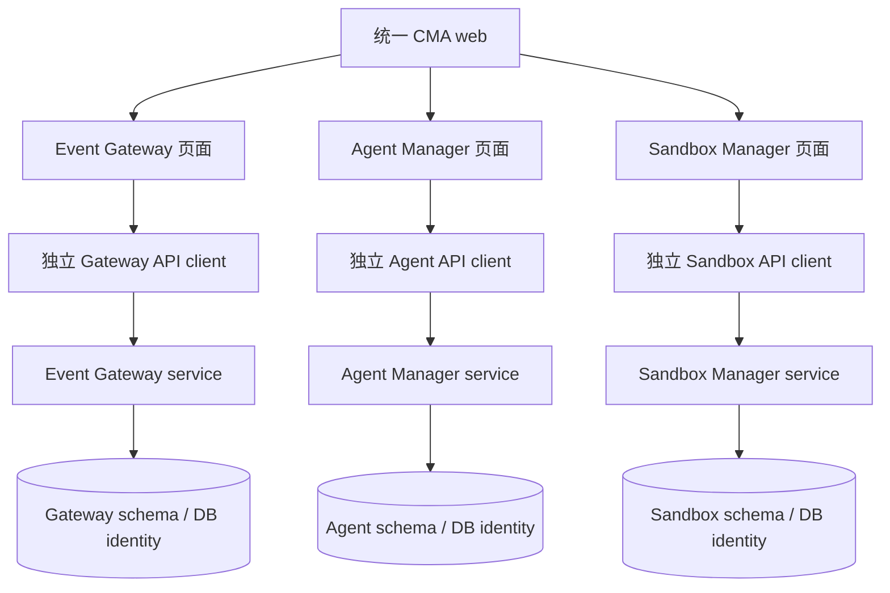

# CMA 服务隔离、NyxID 与统一前端

状态：2026-10-12 的架构约束与实施草案。服务隔离方向已经由本次讨论明确；具体
service slug、permission 命名和 collection 清单是待实施核对的建议值，不表示已在
NyxID 或数据库中创建。配套见 [总方案](CMA_Service_Split.md)。

## 1. 已明确的边界

- Event Gateway、Agent Manager、Sandbox Manager 是三个独立 microservice。
- 每个服务在 NyxID 单独注册，定义并管理自己的 permissions 和 roles。
- 保留现有 `web/`，统一 CMA 登录体验和 UI，提供三个顶层入口。
- 三个前端功能区连接三个独立后端；统一 UI 不合并后端的数据或权限。
- Agent Manager 与 Sandbox Manager 可以使用现有 MongoDB，但 collection/schema
  必须分离，互相没有任何直接读写权限。
- schema、validator、index、migration、runtime DB credential 均由对应服务独立拥有。

独立意味着每个服务能够单独构建、启动、发布和恢复，并只能迁移自己的 schema。
跨服务操作通过 API；即使两个服务部署在同一集群，也不能引用对方的 store 或 domain
实现来绕过接口。

## 2. NyxID 注册和权限模型

建议注册：

| 服务 | 建议 service slug | permission namespace | role 示例 |
|---|---|---|---|
| Event Gateway | `cma-event-gateway` | `cma-eg:` | `cma-eg-viewer`、`cma-eg-user`、`cma-eg-admin` |
| Agent Manager | `cma-agent-manager` | `cma-am:` | `cma-am-viewer`、`cma-am-user`、`cma-am-admin` |
| Sandbox Manager | `cma-sandbox-manager` | `cma-sm:` | `cma-sm-viewer`、`cma-sm-user`、`cma-sm-admin` |

现有 Gateway 已使用 NyxID service slug `cmaeg`。保留旧 service identity/slug 作为
兼容注册，是否最终改名单独迁移；更换显示名称不能撤销现有 channel 的 service scope。
新命名不能覆盖或误复用旧 client credentials。

每个服务拥有自己的 OAuth/OIDC client 配置、受信任 resource/audience、permission
清单、role 到 permission 的映射、服务调用身份和密钥。每个服务校验签发方、有效期、
token 类型、目标服务、permission 和资源归属。具体 token 验证遵循 NyxID 支持的
JWT/introspection 契约，不猜测尚未核实的 claim 或 token-exchange 能力。

Role 是本服务 permission 的组合。后端以明确 permission 授权，再检查 owner/share/
organization 等资源边界。一个服务的 admin 只拥有该服务明确授予的管理权限；
不能用通用 `admin` 字符串或现有 `cma:*` 自动授予全部三个服务权限。

### 建议 permission 集合

| 服务 | permissions |
|---|---|
| Event Gateway | `cma-eg:channels:read`、`cma-eg:channels:write`、`cma-eg:events:invoke`、`cma-eg:deliveries:read`、`cma-eg:replies:send`、`cma-eg:admin` |
| Agent Manager | `cma-am:agents:read`、`cma-am:agents:create`、`cma-am:agents:update`、`cma-am:agents:control`、`cma-am:agents:delete`、`cma-am:messages:write`、`cma-am:approvals:answer`、`cma-am:provider:bind`、`cma-am:admin` |
| Sandbox Manager | `cma-sm:sandboxes:read`、`cma-sm:sandboxes:create`、`cma-sm:sandboxes:control`、`cma-sm:sandboxes:delete`、`cma-sm:snapshots:manage`、`cma-sm:exec`、`cma-sm:terminal`、`cma-sm:files:read`、`cma-sm:files:write`、`cma-sm:env:read`、`cma-sm:env:write`、`cma-sm:identity:bind`、`cma-sm:runtime:connect`、`cma-sm:pools:manage`、`cma-sm:admin` |

viewer 只组合本服务可读资源的 read 权限；user 组合本服务普通自有资源所需权限；
admin 的跨所有者操作需明确审计。Warm pool 和 provider binding 等专用管理权限
不因拥有普通 user role 自动获得。webhook 验签和 event_ref/reply capability 继续
遵循 Gateway 协议，不能用上表普通 user role 取代来源验证。

最终 role 定义和 API operation 到 permission 的映射应随各服务源码版本管理，再
通过受控的 NyxID 注册流程同步。每个服务管理自己的权限目录及其授权管理界面，
不能在运行时获得修改其他服务 role/permission 的 NyxID 管理权。
用户/组织 role assignment 是 NyxID 的权威数据；本地缓存不是第二套授权事实。

### 服务之间如何授权

| 调用 | 调用方身份与接收方检查 |
|---|---|
| Gateway → Agent Manager | 独立服务调用身份；Agent Manager 验证 provider/binding 或明确委派的 Agent 权限；不能默认拥有所有用户的 Agent |
| Agent Manager → Sandbox Manager | 专属 client/service account；Sandbox Manager 授予环境编排需要的权限，同时验证目标资源或创建委派 |
| Nyx Machine → Sandbox Manager | 单独身份和权限集合，不复用 Agent Manager 的凭证 |
| Browser → 三个服务 | 当前用户对各目标服务的授权；前端没有服务间 client secret |

用户创建 Agent 不必拥有 Sandbox Manager 的直接操作权限。Agent Manager 在确认用户
的 Agent 权限和配额后，使用自己的受限服务身份加资源委派申请 sandbox。
委派必须包含可验证的 actor/owner、目标范围和有效期；普通 caller 提交的
`owner_id`/`agent_id` JSON 不是授权凭证。更换 token subject 也不能改变资源所有权。

权限撤销必须在后续请求和后台执行前重新生效。已经受理的后台任务保留原调用者/
委派证据并重新校验；不能因为 worker 使用高权限服务 token 就忽略用户权限撤销。

## 3. MongoDB schema 和数据库账号

允许使用同一个现有 database，例如：

```text
existing_database
  eg_channels                 # Event Gateway
  eg_channel_credentials
  eg_inbox
  eg_deliveries
  eg_outbox
  eg_idempotency
  eg_audit
  eg_schema_migrations

  am_agents                   # Agent Manager
  am_profiles
  am_turns
  am_messages
  am_approvals
  am_events
  am_commands
  am_provider_bindings
  am_environment_bindings
  am_outbox
  am_idempotency
  am_audit
  am_schema_migrations

  sm_sandboxes                 # Sandbox Manager
  sm_workspaces
  sm_runtime_instances
  sm_volumes
  sm_snapshots
  sm_warm_pools
  sm_identity_bindings
  sm_execs
  sm_operations
  sm_leases
  sm_events
  sm_outbox
  sm_idempotency
  sm_audit
  sm_schema_migrations
```

这是目标所有权示例，不是已完成的完整迁移清单。现有 bots、Trigger、Marketplace、
订阅认证、用户缓存和 settings 必须在实施时逐表确定所有者；不能留下一个所有服务
都可访问的 shared collection。必要的缓存由各服务独立保存，通过权威 API 更新。

| 账号 | 允许访问 | 明确禁止 |
|---|---|---|
| `cma_eg_runtime` | 列明的 `eg_...` collections | 所有 `am_...`、`sm_...` 和旧单体 collections |
| `cma_am_runtime` | 列明的 `am_...` collections | 所有 `eg_...`、`sm_...` 和旧单体 collections |
| `cma_sm_runtime` | 列明的 `sm_...` collections | 所有 `eg_...`、`am_...` 和旧单体 collections |

MongoDB 使用按 collection 明确列举 resource 的 custom role。表中的前缀只用于命名，
不能当作 MongoDB 支持 collection 前缀 wildcard 授权。禁止给运行服务授予整个
database 的 `read`、`readWrite`、`dbOwner` 或 admin 权限，禁止共享同一连接凭证。

每个服务独立配置自己的 MongoDB URI secret、schema migration 和加密 key。
migration identity 只能更改本服务明确列出的 collections/validators/indexes；运行
identity 不需要 `collMod` 或管理用户/role 的权限。初次创建 Mongo custom role 和
跨旧 schema 的迁移使用独立一次性管理作业，迁移完成后撤销该作业权限，绝不把
迁移权限留在服务运行账号里。

如果当前 MongoDB 托管环境无法提供 collection 级 custom roles，则在同一集群使用
三个 logical databases，分别授权各自 database；不能降级为同账号访问所有集合。
共享基础设施可以，共享可写业务 schema 不可以。

### Schema 必须实际独立

`am_agents` 可保存 Agent 的配置、当前 turn 和 opaque `sandbox_id`，但不会嵌入一份
可直接修改的 sandbox aggregate。`sm_sandboxes` 保存镜像、资源、期望状态和环境
所有权，但不保存可供控制 Agent 的 model、prompt、turn、approval 对象。

双方只能通过 API 读取/修改另一方资源。允许各自在自己的 collection 保存通过 API
得到的投影视图，须标明来源资源 revision/观察时间；这类视图不能成为操作对方资源
的授权或存活事实。禁止跨服务 `$lookup`、直接查询、change stream 和跨集合事务。
跨服务事件从服务的 API/事件接口消费，不能订阅对方数据库。

任何唯一性、幂等或乐观锁约束都局限于自己的 schema。跨服务创建、暂停或删除通过
持久化工作步骤、outbox、幂等 API 和收据完成；某一步未知时读取原操作结果，不做
跨服务回滚事务。两边都应能在对方暂时不可用时保留并恢复自己的待处理任务。

## 4. 一个 web，三个入口

保留现有 `web/` 项目、设计系统、登录入口和部署。顶层导航固定提供三个产品入口：

| 入口 | 建议 UI 路径 | 页面内容 | API 前缀 |
|---|---|---|---|
| Event Gateway | `/event-gateway` | channels、sources、providers、投递与回复、此服务权限管理 | `/api/event-gateway/` |
| Agent Manager | `/agent-manager` | Agent 列表、创建、会话、profile、暂停/恢复、此服务权限管理 | `/api/agent-manager/` |
| Sandbox Manager | `/sandbox-manager` | 环境列表、镜像/资源/PV、快照、terminal、文件/env、warm pool、此服务权限管理 | `/api/sandbox-manager/` |



Ingress 只做目标服务路由。例如浏览器
`/api/agent-manager/v1/agents` 转发为 Agent Manager 的 `/v1/agents`。
不能将三个前缀都代理到原 `cma-api` 再称为独立服务。
SSE/WebSocket 的代理超时、升级 headers、健康检查和配置与代码一并更新。

前端维护三份 client 和独立 capability/query cache，公用设计组件与登录 UI。
不再让 Agent 页启动依赖 `listSandboxes` 或 workspace 树加载；Agent 页的数据由
Agent Manager 提供。sandbox 故障和无权限不会阻止用户打开 Gateway/Agent 历史。
跨入口跳转携带 opaque resource ID，由目标服务重新授权。

每个服务提供自己认证后的权限视图（建议新接口 `GET /v1/me`），至少含 subject、
roles 和 effective permissions。前端分别请求，不把一个全局 `cma:*` capability
对象复制给三个功能区。三个入口可显示，未授权入口显示该服务的访问说明；具体
操作按钮按对应服务的能力控制，后端独立完成同样的授权。

统一登录依赖 NyxID SSO。每个服务可保留各自的 OIDC callback、独立 HttpOnly session
cookie 和 refresh 存储，通过已有 NyxID 登录会话完成 SSO；API 客户端也可使用面向
目标服务的 token。是否使用 resource token 或 token exchange 以实际 NyxID 协议
为准，不能先假设已支持。不同服务不共享 session collection、签名/加密 secret 或
万能 refresh credential；前端无需持有任何 service client secret。

若采用 service session，建议认证路由位于各自 `/api/<service>/auth/*` 前缀下，
cookie 使用独立名称与对应 API path，callback、refresh、logout 都属于该服务。
统一退出会清除三份 service session，并按 NyxID 已支持的会话退出流程处理 SSO；
清除某一服务 session 不代表另外两个已经退出。

## 5. 现状到目标的必要改动

| 现状 | 重构要求 |
|---|---|
| `cma/src/store/mongo.rs` 一次构造全部 `MongoStores` | 每个服务只构造自己的 repositories；删除全局可写 store 注入 |
| `MongoSandboxStore` 同时承载层级、Agent 和事件 | 实际拆 aggregate/schema，不能只换 collection 前缀 |
| `cma/src/permissions.rs` 一套 `cma:*` 映射 | 三份服务专属 permission 映射、role 定义与 NyxID 注册 |
| `web/src/api/rest.ts` 一个 `Cma` client 混合所有接口 | 三个服务 client，独立 base URL、认证与错误边界 |
| `web/src/shell/navigation.ts` 先读 sandbox/workspace 层级 | 顶层三个入口；各入口独立加载自己的资源列表 |
| Gateway 的加密 records 由 CMA store 托管 | 迁移为 Gateway 自有存储；旧 opaque 引用通过兼容 API 恢复，不能交叉读 Agent DB |

迁移期间旧进程可以继续负责旧 schema，但新服务运行账号始终不能读旧单体 schema。
通过明确的兼容 API 访问尚未交接的资源，或用一次性迁移作业搬迁；不能为了迁移
方便，暂时给新 Sandbox Manager Agent collection 的读取权限。

## 6. 完成拆分的验收

1. 三个服务各有独立二进制/镜像、Deployment、Service、health、config、secret 和
   NyxID 注册，可独立升级。Runtime worker 镜像继续独立存在。
2. 使用 Sandbox Manager runtime DB identity 对 `am_agents`/`am_messages` 做
   find/insert/update/delete 均被 MongoDB 拒绝；Agent Manager 对 sandbox 集合同理。
   跨服务 aggregate/$lookup/change stream 同样被拒绝。
3. 启动任一服务的 migration，只改动其自有集合及索引。其源码和依赖不导入另一个
   服务的数据库 model/store。
4. 只授予 Agent Manager user role 的用户能使用 Agent 功能，但不能直接 exec 任意
   sandbox 或管理 Gateway channel；一个服务的 admin 不自动成为另外两个的 admin。
5. 错误 audience/resource、撤销委派、其他租户资源和伪造 owner 均被接收服务拒绝。
6. 统一 web 三个入口确实访问三个后端，各自无权限/断线/失败状态互不阻塞。
7. Agent 创建、消息、暂停恢复通过跨服务 API 完成；任一服务在步骤之间重启可从
   自己数据库的收据恢复，不能依赖内存或跨服务 Mongo transaction。
8. 原有运行中的 sandbox、Agent、conversation、pending approval 和脏文件在交接
   期间保持身份与内容；旧/新 controller 不同时修改同一 runtime。

这些是实际隔离的验收条件，不能以目录重命名、进程数量或新增三个前端 tab 代替。
