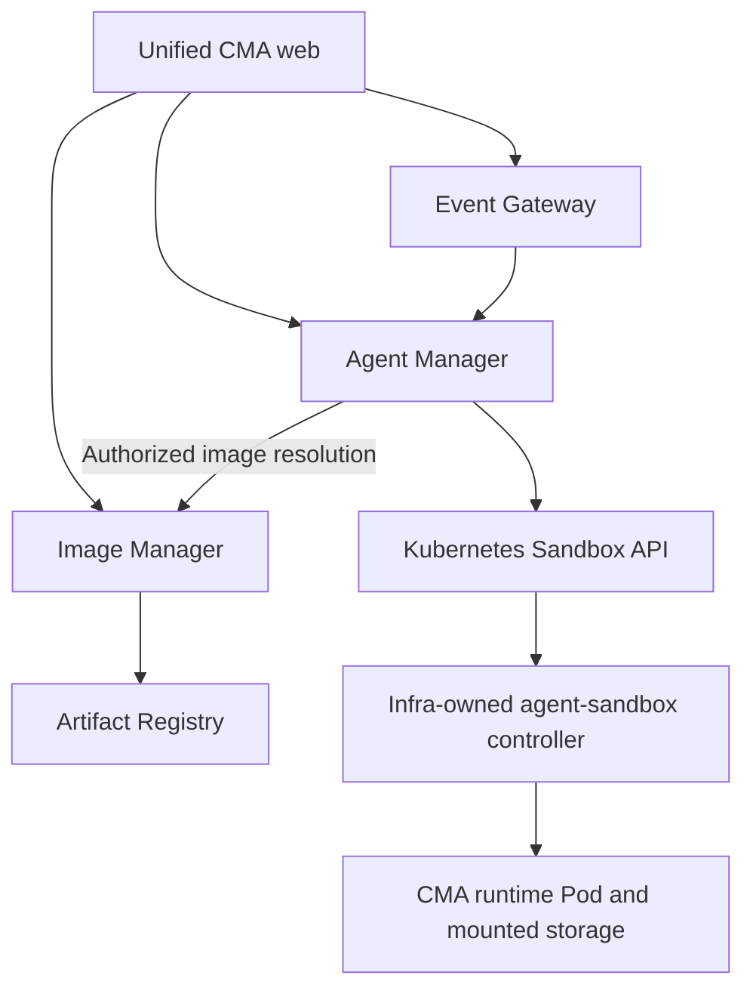

# CMA independent services

Status: revised implementation target, 2026-10-12. This replaces the earlier
Sandbox Manager design. Local code is not evidence of production deployment.

## Services and ownership

| Service | Owns |
|---|---|
| Event Gateway | Channels, sealed credentials, ingress normalization, routing, reply delivery and its durable records |
| Agent Manager | Agents, inline configuration, messages, turns, approvals, runtime bindings, workspaces, native pool targets, persistent homes and recovery |
| Image Manager | Image catalog, builds, immutable versions, lifecycle, sharing and Artifact Registry integration |

Each is separately deployable with its own NyxID client, permissions, roles,
schema, migrations and MongoDB credential. Shared MongoDB infrastructure does
not grant cross-service collection access. Existing `web/` provides three
entrances with separate backend clients. Agent Manager stays simple for users.

There is no CMA Sandbox Manager service. Infra deploys the upstream
`kubernetes-sigs/agent-sandbox` controller and CRDs. Agent Manager integrates
directly with its Kubernetes API (`agents.x-k8s.io/v1beta1`), submitting image,
command, CPU/memory and persistent-volume mounts. The controller creates the
Pod. CMA does not deploy or manage the upstream controller.

## Runtime authority

Agent Manager keeps the logical CMA Sandbox ID separate from the upstream
Sandbox CR name/UID and the current Pod name/UID. A Pod can be replaced without
changing the logical Agent. Resource names alone do not authorize mutation.

Inventory requests carry a server-side CMA deployment selector. Each object is
independently checked for ownership before interpretation. Pod access verifies
its controller owner reference against the Sandbox UID. Sharing a namespace is
not ownership. Mutations use UID/resourceVersion preconditions; unknown outcomes
are reconciled against the original identity. CMA never adopts, pauses or
reclaims another application's Sandbox, Pod or PVC.

Creation uses deterministic resource names and persisted specification identity,
so a lost create response cannot create a second environment. Runtime bindings
pin image digests. Publishing or changing image defaults never rotates live
Agents. CPU/memory, runtime class, workload service account and storage are
explicit. Registry pull identity is separate from the image build identity;
neither credential is delivered to Agent processes. Persistent-home ownership
and writer fencing remain required. Native pause/resume retains the original
PVC; CMA no longer schedules or manages Sandbox snapshots or S3 archives.

Agent Manager owns CMA runtime requirements (Codex, supervisor, ACP bridge and
optional tools). Model, prompt and conversation state never enter Image Manager.

## Images

Registry: `asia-northeast1-docker.pkg.dev/chronoai-501608/chronoai-registry`.
Image Manager uses its own Google service identity. No account key is committed
or accepted as a user API field. Source revisions and output digests are pinned.
Mutable catalog tags are not runtime identity. The catalog provides authorized
resolution to an immutable digest. Agent creation, Trigger publishing and
consumer authoring resolve selected Image Manager versions using the caller's
delegated authorization before storing their immutable configuration. The
system image remains available as the default. Private immutable profile
snapshots are internal compatibility records; users no longer select or manage
profiles in these creation flows. Sharing grants catalog use, not Artifact
Registry IAM to end users.

Retirement prevents new use while preserving pinned versions for running Agents
and recovery. Physical deletion requires evidence that no retained use/recovery
reference needs the digest. See [Image Manager API](CMA_Image_Manager_API.md),
[Agent Manager API](CMA_Agent_Manager_API.md) and
[service isolation](CMA_Service_Isolation.md).

## Migration and verification

Existing OpenSandbox resources retain their original provider authority until
normal termination or a verified migration. New controllers do not silently
adopt BatchSandbox objects. Reconnect uses the persisted provider binding, not
just a new deployment default. No migration may lose IDs, conversations,
approvals, admitted work or dirty files.

Implementation requires actual APIs/binaries, separate DB identities/migrations,
image build workers/registry integration, direct agent-sandbox integration,
frontend clients, manifests and tests. Local protocol/ownership tests precede
cluster checks against infra-pinned CRDs for mounting, readiness, reconnect,
teardown and recovery. Code first; production cutover follows verified behavior.
Prior Sandbox Manager foundation code is superseded, not a fourth service.
See [deployment handoff](CMA_Deployment_Readiness.md) for infra-owned API
prerequisites, application image/configuration preparation and live acceptance.
