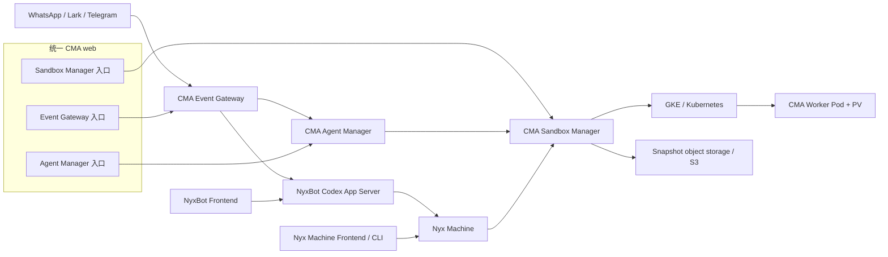
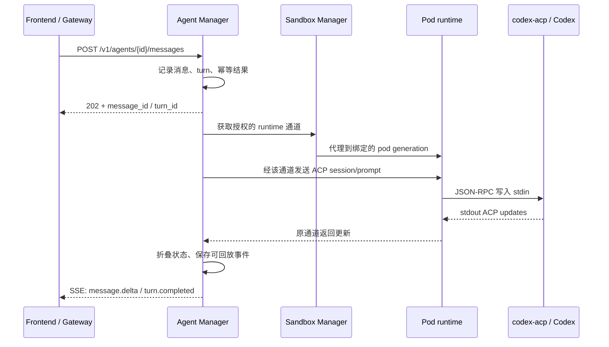

# CMA 三服务拆分方案

状态：设计草案，2026-10-12。本文定义目标架构，不代表相关接口已经实现或部署。
输入是本次讨论的架构图及两张绿色能力卡片；代码现状以当前仓库为准。

配套契约：

- [Agent Manager API](CMA_Agent_Manager_API.md)：面向用户和应用的简单 Agent 接口。
- [Sandbox Manager API](CMA_Sandbox_Manager_API.md)：面向任意容器工作负载的通用运行环境接口。
- [服务隔离、NyxID 与统一前端](CMA_Service_Isolation.md)：独立权限、schema/账号和三个 UI 入口。
- [现有 Event Gateway 协议](CMAEG_Protocol.md)：已实现协议及兼容性要求。

## 1. 目标和设计假设

CMA 拆成三个可以独立部署、独立恢复的服务：CMA Event Gateway、CMA Agent
Manager、CMA Sandbox Manager。三个服务各自在 NyxID 注册，管理自己的 permission
和 role；统一的现有 `web/` 提供三个顶层入口，分别连接三个独立后端。
Agent Manager 的普通用户只需要创建 Agent、调整配置、发送消息和查看结果。

独立 microservice、各自 NyxID 权限、统一前端三个入口、Agent/Sandbox 数据库
collection 和 schema 完全隔离是已明确要求，不属于下面的待定假设。

Sandbox Manager 是通用 sandbox management 服务。用户指定自己的容器镜像、启动
命令、资源和挂载即可使用，不需要创建 Agent，也不需要镜像安装 CMA supervisor、
Codex、WebSocket bridge、NyxID CLI、gh 或 Chromium。上述软件组合只是 Agent Manager
选择的一种环境配置，不能成为所有 sandbox 的必装组件或就绪条件。

这版草案的假设如下，均可在实施前调整：

| 事项 | 本版选择 | 原因 |
|---|---|---|
| 新建 Agent 的隔离 | 默认一个 Agent 独占一个 sandbox | 暂停、文件、资源及 NyxID 授权拥有一致边界；用户无需理解环境层级 |
| 已有共享 sandbox | 原地保留原有映射和运行进程 | 拆服务不能改变既有 Agent 的身份、文件或会话 |
| 源码组织 | 初期同仓库、独立二进制和部署 | 方便原子修改契约与调用方；以后可以独立仓库 |
| 新公开接口 | Agent Manager 自己的服务根路径 `/v1` | 既有 CMA `/api/v1`、`/api/v2` 路由保留兼容，不能原地改变含义 |
| 用户侧流式输出 | HTTP 命令 + SSE 事件 | 普通客户端容易接入，也能重连回放；pod 内的 WebSocket 继续使用 |
| SSH | 待定，不计入首版承诺 | 原图标为 `ssh?`；先完成 Kubernetes exec 和 terminal |

新 API 不要求用户先创建 Sandbox Profile、Workspace Profile 或 Worktree。
已有 Profile、Marketplace、Trigger、共享和 SDK 能力通过兼容入口继续工作；这些资源的
产品调整需要单独迁移，不能随着拆服务被隐式删除。

## 2. 调用拓扑

Event Gateway 按 channel 的 provider 配置将事件交给 NyxBot 或 Agent Manager。
图中的两条 provider 路径保留，不强制所有 NyxBot 工作都进入 CMA Agent Manager。
Nyx Machine 可以只使用 Sandbox Manager，不需要创建 CMA Agent。

Pod 使用用户选择的镜像及其默认启动命令，或调用者明确提供的启动命令。普通 Python
任务、浏览器自动化、开发环境和自定义 server 都是合法用例。
现有 Agent 用例保留其 runtime supervisor、NyxID CLI、gh、Codex 和 WebSocket bridge；
Agent Manager 负责选择该镜像并校验自己的协议要求。Sandbox Manager 不解析 ACP，
也不把 runtime contract 3 作为通用 sandbox 的前置条件。Chromium、Heca Daemon 等
组件仅在选定的镜像或显式安装步骤提供时存在。

## 3. 三个服务分别拥有什么

| 服务 | 拥有的责任和数据 | 对外接口 |
|---|---|---|
| Event Gateway | channel/source/sink、验签、平台事件规范化、来源事件去重、channel partition 路由、回执及对外回复投递 | 渠道管理、webhook、reply tools、provider 协议 |
| Agent Manager | Agent 身份与所有者、有效 profile、用户授权意图、消息/turn/审批/历史、命令幂等、执行排序、Agent 到运行环境的映射 | 用户 Agent API、SSE；兼容 AG-UI/Responses 和 CMAEG provider |
| Sandbox Manager | sandbox 身份与所有者、pod incarnation、用户镜像与命令、资源、卷与挂载、通用初始化步骤、授权 secret 引用、快照、warm pool、exec/terminal/files/env、端口连接及资源清理 | Sandbox Manager UI 和通用容器环境 API |

各服务管理接口均由 NyxID 授权。容器里的应用是否使用 NyxID、GitHub 或其他外部
服务，由该用例的调用方配置。Agent Manager 验证并记录 Agent 的授权意图，通过
可验证的身份/secret 引用请求交付；Sandbox Manager 只执行目标环境被授权的通用
交付机制。请求 JSON 中的 owner 或 services 数组不能替调用者扩大权限。

Agent Manager 持有 Codex 配置、ACP 握手、会话恢复和 turn 语义。
Sandbox Manager 接收通用进程/文件/工作目录计划并维护执行环境，不解释用户 prompt、
模型选择或 Codex transcript。实际安装执行归 Sandbox Manager；Agent profile 中选中了
哪些 skills 及其版本归 Agent Manager。

## 4. 数据与服务边界

每类资源只有一个服务负责读写。Agent Manager 和 Sandbox Manager 可以使用现有
MongoDB 集群及同一个 database，但必须分别拥有 collection/schema 和数据库身份。
运行账号通过 MongoDB collection 级权限禁止访问对方集合；包括只读查询、聚合及
change stream。服务之间通过 API 交换结果，不能依赖跨服务 Mongo 事务、共享 store
或共享用户/session/settings 表。具体 collection 及账号约束见隔离方案。

| 资源 | 最终写入方 | 说明 |
|---|---|---|
| channel 定义、加密凭证、路由、外部回复 outbox | Event Gateway | 当前加密 channel records 寄存在 CMA，需迁移记录存储及恢复路径 |
| provider binding、partition 到 Agent 映射 | Agent Manager | 来源上下文由 Gateway 提供；Gateway 不写 Agent 表 |
| Agent/profile/消息/turn/approval/历史 | Agent Manager | 用户可见的会话与事件由此服务提供 |
| sandbox/workspace 准备/PV/pod/snapshot/安装收据 | Sandbox Manager | 保留精确 runtime generation、pod UID 和操作收据 |
| NyxID 服务授权与凭证 | NyxID；Sandbox Manager 管理交付引用 | Agent Manager 保存已授权范围及授权版本，不向浏览器返回密钥 |

服务间请求必须同时关联调用服务身份、最终资源所有者、稳定 request ID 和目标资源。
仅有 service token 不表示可以访问任意租户资源。面向 Kubernetes 的凭证只授予
Sandbox Manager；Agent Manager 和 Event Gateway 不获取 Kubernetes 管理权限。

分布式操作采用持久化步骤和可重试收据。例如 Agent 创建：

1. Agent Manager 持久化 Agent ID、解析后的 profile 和创建请求。
2. 以该创建请求派生的稳定幂等键向 Sandbox Manager 申请环境。
3. Sandbox Manager 独立完成通用容器、卷与挂载，并执行显式提交的初始化计划。
4. Agent Manager 通过授权 exec/端口连接准备 repository、Agent home 和用例所需
   NyxID CLI/代理，然后启动并恢复/创建会话；这些不是所有 sandbox 的默认行为。
5. 会话身份及环境映射落库后，发布 `agent.updated`，状态转为 `ready`。

某一步超时只表示结果尚未观察到。查询原 request 的结果后才能重试，不能再次创建
一套环境。创建补偿只删除该请求创建的资源，不得删除已被其他请求接管的资源。

## 5. 消息与运行时连接

初期复用现有 runtime contract 3、WebSocket、输出 acknowledgement 和 ACP 桥。
Agent Manager 与 pod 的通信通过 Sandbox Manager 授权及代理的通道，服务凭证不下放
到浏览器。Agent Manager 对 ACP payload 负责，Sandbox Manager 对目标绑定、连接及
传输负责。用户 API 不暴露 ACP `sessionId`、Kubernetes pod 名或 stdio framing。

已经存在的 pod 连接不会因切换 HTTP 路由而自动交接。旧连接持有者必须在已知的
输出确认位置释放控制权，新持有者按原会话身份重连；未完成的 turn 不能被重发。
可回放事件只在 Agent Manager 持久化后确认；流式 UI 临时 delta 与持久化消息必须
区分，不能把内存缓冲伪装成已持久化历史。

## 6. 暂停、配置更新和快照的协调

Agent Manager 知道 turn、审批、排队消息；Sandbox Manager 知道写入进程、PV 和 pod。
两者通过持久化暂停操作协调：Agent Manager 关闭新 turn 的投递，当前 turn 到达安全
结束点，runtime fencing 阻止所有写入者，Sandbox Manager 保存文件快照并暂停环境。
只有快照和进程状态均有收据时，Agent Manager 才能报告 `paused`。

文件快照不等于保存正在执行的进程内存。恢复使用原 Agent 身份、文件和 Codex 会话；
不能承诺从任意 CPU 指令或工具进程的中间位置继续。

新增 terminal、exec 和文件写入同样受 snapshot writer fence 约束。仅冻结 Codex
而允许 terminal 继续改文件，会产生不一致快照。Sandbox Manager 的自动休眠也必须
服从有效的使用/写入租约；租约或控制面连接暂时失联不能触发直接杀 pod。

已有共享 sandbox 中，暂停单个 Agent 只停止该 Agent 的工作；只有所有使用方都允许
暂停后，才能暂停整个 sandbox。其 NyxID key 仍具有现有 sandbox 级边界，迁移文档和
API 必须如实标明；不能宣称同 UID 下的目录隔离已经提供了独立凭证安全边界。

## 7. 现有代码如何迁移

下列路径是当前实现位置，不是按目录整块移动的指令。当前 `SandboxAdapter` 同时
包含 pod、workspace、Agent 和 conversation，必须先按语义拆开。

| 当前代码 | 目标 |
|---|---|
| `api/crates/cmaeg*` | 保留 Event Gateway；分离其对 CMA record store 的依赖 |
| `layer1-public` 的 Agent、AG-UI、Responses 接口 | Agent Manager 的公开与兼容入口 |
| `layer2-core` 的 Agent 命令、turn、审批、会话折叠 | Agent Manager domain |
| `layer3-adapter/src/codex/`、`hosted/acp*` | Agent Manager 的 provider adapter |
| `cma/src/sandbox/agent_worker*`、`live_agents*` | Agent Manager 的 Agent worker 与连接恢复 |
| `cma/src/sandbox/worker*`、`reconciliation*`、`warmup*`、`checkpoint_maintenance*` | 按资源所有权抽出 Sandbox Manager worker |
| `layer3-adapter/src/provider/`、PV、snapshot、provider transport | Sandbox Manager 的基础设施 adapter；ACP 解释仍留在 Agent Manager |
| `layer4-runtime` | 保留独立 worker 镜像和通用 supervisor |
| `cma/src/store/` | 按 collection 的唯一写入方逐项拆分；不能整体复用可写 store |
| `cma/src/composition.rs` | 逐步拆成独立服务 composition 和兼容路由装配 |

目标源码仍遵守每个服务内 public → domain → adapters 的方向。
新增独立服务 crate、依赖规则、二进制、Dockerfile、Service、Deployment、RBAC、
config/secret 引用和 CI 检查必须同时落地；届时同步更新 `CLAUDE.md` 的固定目录和
四层规则，使其准确描述目标架构。当前草案不改变已运行代码的架构约束。

## 8. 分阶段实施及完成标准

| 阶段 | 交付 | 必须证明 |
|---|---|---|
| A. 契约 | 本方案、两份 API 草案、字段到现有功能的映射 | 绿色卡片每项有明确归属；区分已实现与目标能力 |
| B. 独立 Sandbox Manager | 通用环境 domain、独立 schema/DB identity、NyxID 注册与权限、部署和客户端 adapter | 环境操作可独立运行；数据库拒绝读取 Agent collections；Agent 代码不能直接调 Kubernetes |
| C. 独立 Agent Manager | 简单用户 API、Agent domain、独立 schema/DB identity、NyxID 注册与权限、ACP transport、独立部署 | 只通过 Sandbox Manager API 完成创建、发消息、重连和恢复；数据库拒绝读取 Sandbox collections |
| D. Gateway 解耦 | Gateway record store、provider 目标迁移 | 外部重复事件去重、partition 路由、回复与重启恢复保持协议语义 |
| E. 用户入口迁移 | 现有 web 提供三个入口、三个 API client、独立服务权限视图；SDK 支持新接口 | 各入口连接独立后端，权限/错误互不串扰；普通 Agent 用户无需管理环境层级；旧历史仍可访问 |
| F. 运行中资源交接 | 按 sandbox 交接 controller authority | 旧/新控制器不同时写同一 pod；升级期间不丢 turn、审批、文件或身份 |

阶段 B/C 必须把独立 service API 与真实客户端集成跑通；只新增 Router、重命名
binary 或让三个服务共享同一个可写 store，不能算完成拆分。

迁移以 sandbox 为最小控制权交接单位，因为已有 Agent 可能共享同一个 home/PV。
交接记录需包括旧/新 controller、generation、租约 fence 和完成状态。先让旧 worker
停止领新任务并释放写入权，再由新 worker 恢复原记录。回滚同样移交控制权，不能只
改流量入口。任何切换都不能重新生成已有 Agent、native conversation 或幂等标识。

验证覆盖创建超时重试、同一消息重复投递、运行中 steer、审批时断线、Agent Manager
重启、Sandbox Manager 重启、输出回放、保留脏文件的暂停恢复、旧共享 sandbox、
warm pool 所有权移交、快照与 exec 并发以及跨租户拒绝。终端、私有 GitHub clone、
profile 更新和环境变更是新增能力，分别验证后才能对外启用。

## 9. 实施进度（2026-10-12）

本次任务已明确授权实施和线上部署，不再等待设计阶段确认。目前仍未进行生产切换。

- 新建独立 `cma-sandbox-manager` crate，通用镜像/命令/资源/env 模型不依赖 Agent
  或 Gateway 的实现 crate；CI 检查这一依赖边界。
- 独立的 `sm_sandboxes`、`sm_schema_migrations`，严格 validator、幂等唯一索引，
  runtime/migrator 两套显式 collection grants；runtime 启动拒绝跨集合或迁移权限。
- 新建、运行实例绑定和终止的 revision/identity 校验；未知创建结果保留原 dispatch，
  防止重启后重复分配。通用 image、entrypoint 不要求 CMA supervisor 或 Agent。
- NyxID introspection 适配检查目标服务 resource、issuer、token 类型、有效期和本服务
  permission；尚未在生产 NyxID 创建新 service/client/roles。
- 本地已通过单元测试、Clippy，以及真实启用鉴权的 MongoDB 测试：跨集合读写拒绝、
  迁移权限拒绝、并发幂等、并发 revision 冲突和重启恢复。

该进度是阶段 B 的基础部分，尚不是可独立部署的完整服务。生产 provider adapter、
完整生命周期与交互 API、Agent Manager 拆分、Gateway 存储迁移、web 三入口、存量
资源交接和生产部署仍在实施范围内。线上 OpenSandbox 接口已核实要求镜像创建请求
明确给出 entrypoint；使用镜像默认命令需要由适配层解析补齐后验证。

## 10. 与本次图对应的待定项

- 一个 Agent 独占 sandbox 的默认策略是否作为正式产品约束。
- Sandbox Manager 是否首版直接管理 Kubernetes pod，或先适配现有 OpenSandbox
  provider 再替换调度后端。两种方案都由 Sandbox Manager 独占基础设施权限；
  Kubernetes exec/terminal 是独立的能力要求，不能靠换服务名获得。
- SSH 和 Heca Daemon 保留待定；原图未将其定义为必选能力。

绿色卡片已明确要求的 agent profile 更新、终端、文件与环境变量操作属于目标范围，
即使当前实现不支持，也不能从重构清单中省略。
