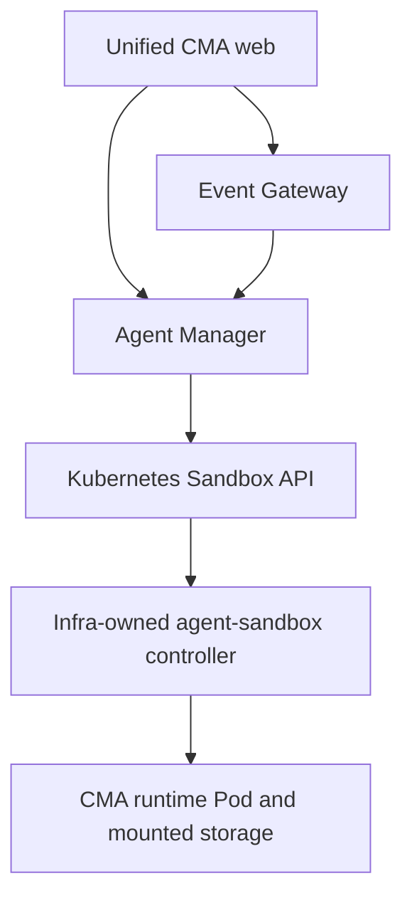

# CMA independent services

Status: revised implementation and deployment target, 2026-10-13. This replaces the earlier
Sandbox Manager design. Local code is not evidence of production deployment.

## Services and ownership

| Service | Owns |
|---|---|
| `cma-event-gateway` | Channels, sealed credentials, ingress normalization, routing, reply delivery and its durable records |
| `cma-agent-manager` | Agents, inline configuration, messages, turns, approvals, runtime bindings, workspaces, native pool targets, persistent homes and recovery |

Each is separately deployable with its own NyxID client, permissions, roles,
schema and migrations. The current deployment shares the existing `chrono-bot`
database and credential through explicit `shared-schema` mode while each service
uses only its own collection catalog. Default `isolated` mode requires separate
collection-scoped credentials; see [service isolation](CMA_Service_Isolation.md). Existing `web/` provides two
entrances with separate backend clients. Agent Manager stays simple for users.

There is no CMA Sandbox Manager service. Infra deploys the upstream
`kubernetes-sigs/agent-sandbox` controller and CRDs. Agent Manager integrates
directly with its Kubernetes API (`agents.x-k8s.io/v1beta1`), submitting image,
command, CPU/memory and persistent-volume mounts. The controller creates the
Pod. CMA does not deploy or manage the upstream controller.

## Runtime authority

Agent Manager keeps the logical CMA Sandbox ID separate from the upstream
Sandbox CR name/UID and the current Pod name/UID. A Pod can be replaced without
changing the logical Agent. Resource names alone do not authorize mutation.

Inventory requests carry a server-side CMA deployment selector. Each object is
independently checked for ownership before interpretation. Pod access verifies
its controller owner reference against the Sandbox UID. Sharing a namespace is
not ownership. Mutations use UID/resourceVersion preconditions; unknown outcomes
are reconciled against the original identity. CMA never adopts, pauses or
reclaims another application's Sandbox, Pod or PVC.

Creation uses deterministic resource names and persisted specification identity,
so a lost create response cannot create a second environment. Runtime bindings
pin image digests. Publishing or changing image defaults never rotates live
Agents. CPU/memory, runtime class, workload service account and storage are
explicit. Registry pull credentials are never delivered to Agent processes.
Persistent-home ownership
and writer fencing remain required. Native pause/resume retains the original
PVC; CMA no longer schedules or manages Sandbox snapshots or S3 archives.

Agent Manager owns CMA runtime requirements (Codex, supervisor, ACP bridge and
optional tools), models, prompts and conversation state.

## Images

Registry: `asia-southeast1-docker.pkg.dev/chronoai-501608/chrono-pod`.
Agent creation, Trigger publishing and consumer authoring use the system default
runtime image. Custom image selection is unsupported. Public `image` fields and
persisted image references remain readable; new requests selecting an image are
refused before persistence or side effects. Agent lifecycle returns
`422 image_selection_unsupported`; Trigger authoring returns
`422 trigger_image_selection_unsupported` for `target.inline.image`.

Running Agents and historical Trigger launches retain their pinned images and
recovery behavior. Private immutable profile snapshots remain internal
compatibility records; users do not select or manage profiles in these creation
flows. See [Agent Manager API](CMA_Agent_Manager_API.md) and
[service isolation](CMA_Service_Isolation.md).

## Migration and verification

Existing OpenSandbox resources retain their original provider authority until
normal termination or a verified migration. New controllers do not silently
adopt BatchSandbox objects. Reconnect uses the persisted provider binding, not
just a new deployment default. No migration may lose IDs, conversations,
approvals, admitted work or dirty files.

Implementation requires actual APIs/binaries, separate DB identities/migrations,
direct agent-sandbox integration, frontend clients, manifests and tests. Local protocol/ownership tests precede
cluster checks against infra-pinned CRDs for mounting, readiness, reconnect,
teardown and recovery. Code first; production cutover follows verified behavior.
Prior Sandbox Manager foundation code is superseded, not another service.
See [deployment handoff](CMA_Deployment_Readiness.md) for infra-owned API
prerequisites, application image/configuration preparation and live acceptance.
