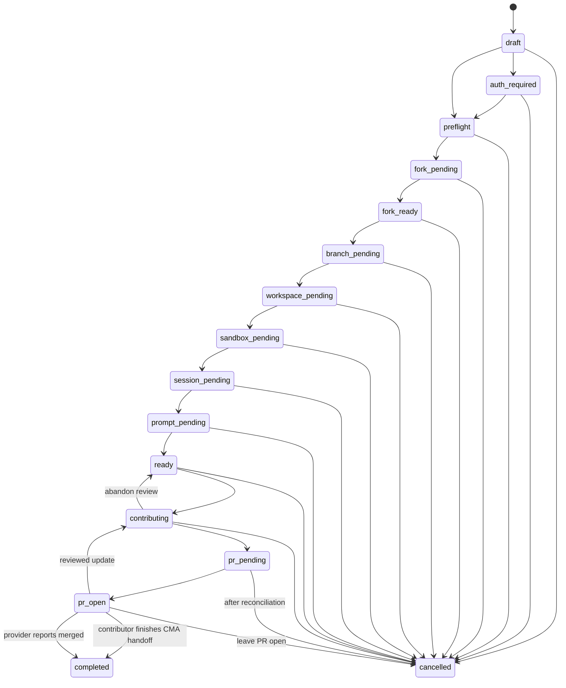

# CMA GitHub Trigger design

This document is the implementation authority for the public-repository MVP
tracked by milestone `cma-trigger` and epic #653. It records the product,
security, ownership, state, retry, and architecture decisions required by #654.
If an implementation issue disagrees with this document after this document is
approved, the implementation issue must be corrected before code is merged.

Status: **accepted for implementation**. On 2026-08-26 the project maintainer
approved this design, assigned the milestone to `chronoai-shining`, waived a
milestone due date, and authorized implementation to proceed while the live
evidence campaign runs in parallel. Evidence remains mandatory before the
corresponding end-to-end, security, or release claim is accepted.

Within this document, **selected** identifies the accepted implementation
branch so later issues do not invent a different one. A new implementation may
not weaken that branch without an amended maintainer decision and the review
appropriate to the affected product or security boundary.

Repository publishers and contributors should start with
[CMA_Trigger_Publishing.md](./CMA_Trigger_Publishing.md). Operators use
[CMA_Trigger_Operations.md](./CMA_Trigger_Operations.md), while release evidence
and public-exposure gates are tracked in
[CMA_Trigger_Release_Readiness.md](./CMA_Trigger_Release_Readiness.md).

## 1. Product boundary

A publisher creates an immutable Trigger revision for a repository they are
authorized to represent. The publisher places a public CMA link in a README.
Opening the link is a side-effect-free preview. After CMA sign-in, the
contributor selects a NyxID GitHub connection, reviews the immutable revision
and permitted overrides, and explicitly presses Start. CMA then prepares the
contributor's fork and launch branch, imports a workspace, provisions a Codex
session, and dispatches the configured task. The contributor later reviews the
complete diff and explicitly publishes or updates a pull request.

The MVP includes:

- public GitHub repositories whose policy currently permits forking;
- user-owned NyxID GitHub OAuth UserServices linked to the canonical
  `api-github` catalog service;
- Codex sessions that advertise the required capabilities;
- GitHub REST and Git Data operations through NyxID;
- one contributor-owned fork per GitHub fork network;
- durable Launch progress, recovery, workspace checkpoints, and explicit PR
  confirmation; and
- publisher defaults with contributor changes only where the revision allows
  them.

The MVP excludes:

- private or internal upstream repositories;
- unrestricted kernel permission mode;
- raw GitHub, NyxID, model-provider, or sandbox credentials in a Trigger,
  browser, prompt, workspace, or sandbox;
- Git smart HTTP clone or push credentials;
- automatic merge, review, approval, branch-protection bypass, force-push, or
  writes to the upstream repository;
- automatic execution from an anonymous GET or OAuth callback;
- sponsored developer credentials until #671's post-MVP policy gate and the
  #445/#524/#528 and #675 evidence are complete; and
- logical exactly-once prompt delivery without recipient-side deduplication or
  the wire-level origin identifier tracked by #705.

Deferred policy tracks are explicit rather than partially enabled:

- #671 owns sponsored publisher credentials, grants, spend, and abuse policy;
- private/internal repositories require broader GitHub consent and an approved
  organization/repository-isolation policy;
- publisher-authored setup commands require a separately approved executor
  policy;
- workflow-file writes require the elevated scope and same-path/same-content
  rules owned by #665/#666;
- a GitHub App requires the replacement ADR described in section 8; and
- #705 may strengthen recipient-side prompt deduplication after the MVP.

Native Layer 2 sponsorship models, encrypted Mongo persistence, REST routes,
and four secret-free TypeScript SDK page reads now exist. The checked-in binary
composes the provider, billing, pricing, scheduler, worker, runtime, and
private-gateway paths when a complete enabled tuple is supplied. Its production
manifests intentionally keep the runtime absent with
`CHRONO_SPONSORSHIP_ENABLED=false` and
`CHRONO_SPONSORSHIP_KILL_SWITCH_ENGAGED=true`; every evidence, policy, limit,
adapter, worker, fence, and secret-file key is empty. Any partial, malformed,
mismatched, or above-ceiling staging tuple fails CMA startup, and a disabled
tuple cannot disengage the kill switch. This is dormant fail-closed
configuration, not production sponsorship enablement. The current deployment
still lacks usable sponsorship, release or deployment evidence, or the
aggregate expiry/revocation and restart-recovery evidence required from
#445/#524/#528 and #675; it does not satisfy #671.

The current `ChronoAIProject/cma` repository is internal and has
forking disabled. It is not an MVP fixture. #673 owns a disposable public
fixture and public-release evidence.

### Forking-disabled repositories

The initial rollout is guarded by a server-owned `public_forkable_v1` policy,
not by a client checkbox. Trigger publication requires a fresh producer result
whose visibility is `public` and whose policy permits forking. Start repeats
that check before creating any Launch effect. The stable semantic refusal is
`upstream_not_forkable`; it is a `policy_user_action` result and includes the
observed visibility and safe remediation, but no guessed claim that the
contributor can change organization policy.

A revision published while the repository was eligible may still be previewed
after policy changes, but preview shows it as unavailable and Start refuses it.
CMA never bypasses the policy, silently targets another repository, or asks for
the broader `repo` scope as a workaround. A fork-network collision is a
different `fork_network_occupied` outcome and must not be reported as disabled
forking.

Private/internal repositories, organization installation approval, and
repositories whose policy forbids forking enter only through a later approved
policy revision, new provider evidence, and the staged release gate. Enabling a
feature flag alone cannot admit them.

## 2. Resources and ownership

| Resource                  | Authority and owner                                                                                | Lifetime and immutability                                                                                                       |
| ------------------------- | -------------------------------------------------------------------------------------------------- | ------------------------------------------------------------------------------------------------------------------------------- |
| Trigger                   | CMA publisher resource, owned by the authenticated publisher subject                               | Mutable draft container. It does not run work.                                                                                  |
| Trigger revision          | Published by a subject whose repository authority CMA verified through the exact NyxID UserService | Immutable content and digest. Retirement prevents new Launches but cannot alter existing ones.                                  |
| Public Trigger identifier | Opaque, non-sequential identifier for one published revision                                       | Contains no credential, repository URL authority, callback URL, or mutable configuration.                                       |
| Launch                    | Durable CMA aggregate owned by the contributor subject                                             | Survives browser close, refresh, API restart, and runtime replacement. It snapshots one exact revision plus approved overrides. |
| GitHub connection         | Reusable user-level NyxID UserService owned by the contributor                                     | Never copied into or permanently bound to a Launch. A Launch stores identity, scope, and authority provenance only.             |
| Fork                      | GitHub resource owned by the contributor's selected GitHub account                                 | CMA may create or reuse it. CMA never deletes, resets, synchronizes, or transfers it.                                           |
| Launch branch             | GitHub ref in the contributor's fork, named and fenced by the Launch                               | CMA never force-pushes it and never treats an unrelated existing branch as disposable.                                          |
| Workspace                 | Launch-owned CMA state materialized inside one sandbox at a time                                   | Checkpointed before an entitled sandbox is terminated. Retention cleanup never deletes GitHub work.                             |
| Session                   | CMA session owned by the contributor and linked to the Launch                                      | Keeps normal CMA continuity guarantees. Trigger flags cannot interrupt it.                                                      |
| Initial dispatch          | One durable Launch/session delivery record                                                         | The automatic path is at most once. Ambiguity requires disclosed explicit recovery.                                             |
| Pull request              | GitHub cross-fork resource created only after contributor confirmation                             | Maintainers own review and merge policy. CMA may update the linked contributor branch after another reviewed diff.              |

Repository authority is canonicalized as a tuple, never as display text alone:

```text
(repository_id, repository_node_id,
 owner_id, owner_node_id,
 canonical_owner, canonical_name,
 visibility, allow_forking,
 default_branch, selected_ref,
 fork_parent_id, fork_source_id)
```

The fields that do not apply to a non-fork are absent rather than filled with
sentinels. The upstream and fork are re-resolved from producer responses at
every boundary stated in ADR-003. Browser-supplied owner, name, URL, branch,
or service slug is never authority.

## 3. Trigger revision contract

A Trigger is a mutable publisher-owned container with optimistic concurrency.
Publishing copies a validated draft into a new immutable revision; editing a
published revision is impossible and publishing another version creates a new
revision and public identifier. A separate availability record may move from
`published` to `retired`. That record is not part of the immutable content, and
retirement never mutates an existing Launch snapshot.

The logical revision schema is provider-neutral at the Layer 2 boundary:

```text
TriggerRevisionContent
  schema_version
  trigger_id, revision_number
  publisher_subject_id, publisher_display_identity
  upstream
    repository_id, repository_node_id
    owner_id, owner_node_id
    canonical_owner, canonical_name
    visibility, allow_forking
    source_ref, source_mode, observed_source_sha
    contribution_base_ref
  task
    public_summary
    prompt_template, renderer_version
    input_fields[] { key, type, required, bounds, default, editable }
  session
    required_capabilities[]
    permission_ceiling
    sandbox_profile
    resource_defaults, resource_ceilings
    timeout_default, timeout_ceiling
  github
    credential_route
    required_scope_classes[]
    allowed_operation_classes[]
    workflow_change_policy
  setup
    executor_policy
    steps[]
  contribution
    branch_prefix_policy
    commit_attribution_policy
    pull_request_defaults
  commercial_policy
    billing_mode, price_or_zero_cost_reference, quota_policy_reference
  override_policy
    editable_fields[], field_bounds
  public_projection
    explicitly_publishable fields only
```

The Mongo and public API schemas defined by #655 may split these nested values
into typed records, but may not weaken their ownership or add browser-supplied
authority. Every collection and string is size-bounded. Unknown schema
versions, unknown renderer versions, unknown operation classes, and unknown
editable fields fail closed.

Mongo persistence versions the draft and immutable-revision envelopes
independently from the logical revision content. New records write
`document_schema_version=1`. Records created before that field existed are
read as version zero and upgraded idempotently when CMA reads or mutates that
exact resource. List reads migrate only the IDs in their bounded result page;
store startup never scans either collection. The migration predicate targets
only a missing discriminator or a scalar integer zero and never rewrites the
immutable revision content or digest. Draft replacement, publication, and
revision retirement also require the current discriminator in their atomic
write predicates. Malformed, negative, and future document schema versions
fail closed instead of being interpreted or overwritten as current data. This
bounded lazy upgrade is the #655 migration path; there is no separate migration
runner.

`source_mode` is a closed choice:

- `pinned_commit` always launches the recorded commit SHA; or
- `branch_head_at_launch` re-resolves the canonical ref at Start and stores the
  resulting SHA in the Launch snapshot.

The review states which mode applies. Either way, the Launch stores an exact
source SHA and all later workspace, diff, branch, and reconciliation operations
use that snapshot. A branch name alone is never reproducibility evidence.

The prompt renderer accepts only declared typed input fields. It performs no
shell evaluation, URL fetching, secret interpolation, or hidden substitution.
The rendered prompt and effective-config digest are shown before Start and are
captured in the Launch. Sensitive values are server-side policy references and
can never be prompt fields.

Publisher-authored setup is disabled in the public MVP
(`executor_policy=disabled`, empty `steps`). The schema reserves an enumerated
form for a later policy, but #655 must reject non-empty steps until that policy
has its own approval. System-owned repository import, sandbox preparation, and
session provisioning are orchestration steps, not publisher setup commands.

The revision digest is computed from a documented canonical encoding of
`TriggerRevisionContent`, including defaulted values, renderer version, and
policy identifiers. It excludes the public identifier, mutable availability,
view counters, and other operational metadata. Publish atomically records the
content, digest, creator, publication time, schema version, and opaque public
identifier. A Launch copies the content and verifies the digest rather than
following a mutable Trigger pointer. Mongo retries a bounded number of complete
transactions after a transient conflict, so a losing concurrent publisher is
reconciled to the winner's durable draft revision. An unknown commit result
retries that same commit before consulting the immutable revision and draft;
transport ambiguity alone never causes CMA to replay the publication write.

To publish for a repository in the MVP, the selected GitHub identity must be
the personal repository owner or have GitHub `admin` or `maintain` permission
on the exact numeric repository at publication time. Generic `push`, `triage`,
or organization membership is insufficient. A future custom organization role
must be named and evidenced before it is accepted. Losing the role later does
not rewrite an immutable revision; repository identity/policy is still
revalidated at Start, the README owner can remove the link, and an authorized
publisher or operator can retire the revision.

Anonymous preview is an explicit allowlist derived from `public_projection`.
It includes publisher identity, repository identity, public summary, permission
and resource ceilings, commercial summary, and availability. The full prompt,
private policy handles, internal audit metadata, and setup representation are
authenticated-review fields even when the upstream repository is public.

The commercial summary includes one closed `estimated_cost` state. A valid
zero-cost policy produces `exact_zero`; this is an exact statement independent
of mutable deployment pricing. Contributor billing produces
`contributor_estimate` only when the current deployment rate card can price the
revision's default size and timeout through the same arithmetic used at Launch
review. That amount is explicitly provisional because authenticated review
recalculates and pins the contributor's effective choices. A missing, unreadable,
overflowing, or otherwise unusable rate card produces `quote_unavailable` with
no numeric amount. Anonymous preview stays available and never converts lack of
a quote into zero cost.

## 4. User-visible flow

1. A README GET resolves one public revision and displays its publisher,
   upstream, task summary, required permissions, resource estimate, and
   availability. No subject or GitHub write is required.
2. CMA sign-in returns to that exact revision through a short-lived,
   single-use, server-bound state value. The callback never starts work.
3. CMA resumes an existing Launch for the same contributor and revision when
   its marker matches. Otherwise it creates an editable draft only.
4. The contributor selects or connects a GitHub account through NyxID. CMA
   displays the exact account, scopes, service state, and preflight result.
5. The review shows publisher defaults, allowed overrides, locked safety
   fields, pricing/quota, workflow-file warnings, and the final effective
   configuration.
6. Start is an explicit idempotent POST. Only then may the durable worker
   create or reuse a fork, create a branch, import a workspace, allocate a
   sandbox, create the session, provision scoped reach, and dispatch the task.
7. The browser renders replayable server progress. Closing it changes no work.
8. When the session is ready, the normal session surface opens with repository,
   branch, checkpoint, reach, and delivery status.
9. Contribute first captures and validates the complete workspace diff. It is
   read-only with respect to GitHub.
10. Publish branch and Open or Update pull request are explicit contributor
    confirmations. PR review and merge stay on GitHub.

The public MVP imports at most 100,000 files and 2 GiB of repository payload,
with an additional 16 MiB limit on any one Git blob. The per-blob limit exists
because GitHub's JSON blob route returns the complete base64 object; CMA checks
the tree's declared size and returns the typed unsupported-repository result
before requesting an oversized blob. CMA checkpoints accepted blobs as
immutable 4 MiB storage chunks. After a restart, complete provider objects are
reused without another GitHub blob call. If only part of one object was staged,
that whole object is fetched again and converges on the existing exact chunks;
CMA does not claim that GitHub supports ranged blob resume. A different byte or
identity at any retained key fails closed.

Repeated clicks have stable behavior:

- Anonymous clicks always return the same inert preview or a retired/unavailable
  result.
- A signed-in click resumes the matching active Launch; it does not create a
  second fork, branch, session, or prompt.
- A click after completion opens the existing session/PR summary.
- A separate attempt requires the visible New launch command, a new Launch ID,
  a new idempotency key, and a warning about the additional branch/session.
- Multiple tabs and devices reconcile from server state and event cursors.

## 5. Consent, credentials, and audit

| Action                      | Actor                              | Required consent or authority                                              | Credential path                                                                                 | Required audit fact                                                                                                                                            |
| --------------------------- | ---------------------------------- | -------------------------------------------------------------------------- | ----------------------------------------------------------------------------------------------- | -------------------------------------------------------------------------------------------------------------------------------------------------------------- |
| Open preview                | Anonymous visitor                  | None                                                                       | None; CMA may use only the dedicated credential-free NyxID public repository observer           | Rate-limit decision, opaque revision outcome, current forkability result, and proof that no subject, bearer, UserService, or provider credential was forwarded |
| Draft Trigger               | Publisher                          | CMA sign-in                                                                | CMA subject credential                                                                          | Trigger ID, publisher subject, schema version                                                                                                                  |
| Verify and publish revision | Publisher                          | Explicit Publish and verified upstream role                                | JIT CMA subject access to exact NyxID GitHub UserService; NyxID injects GitHub credential       | Canonical repository identity, UserService ID/version, safe scope set, revision digest                                                                         |
| Sign in to CMA              | Contributor                        | Explicit sign-in                                                           | CMA/NyxID auth flow with durable CSRF/PKCE state                                                | Subject and state-consumption result, without codes or tokens                                                                                                  |
| Connect or replace GitHub   | Contributor                        | Explicit GitHub OAuth consent                                              | NyxID owns access and refresh tokens                                                            | Exact UserService ID, GitHub account IDs/login, scopes, consent time, state version                                                                            |
| Save Launch draft           | Contributor                        | Signed-in ownership                                                        | CMA subject credential                                                                          | Revision digest, allowed overrides, validation result                                                                                                          |
| Start Launch                | Contributor                        | Explicit Start, effective config, cost/quota, and workflow acknowledgement | CMA subject credential plus JIT NyxID preflight                                                 | Idempotency key, Launch ID, confirmation, authority snapshot                                                                                                   |
| Create/reuse fork           | CMA worker                         | Valid Start and current preflight                                          | Current CMA subject delegation to exact UserService; NyxID injects current GitHub credential    | Intent, reconciliation key, source/parent/fork numeric identities, result                                                                                      |
| Create Launch branch        | CMA worker                         | Valid Start and compatible fork                                            | Same JIT control-plane path                                                                     | Expected source SHA, branch identity, result/ref SHA                                                                                                           |
| Provision session reach     | CMA worker                         | Valid capability policy and active service                                 | Per-session expiring NyxID agent key scoped to exact UserService; signed Layer 4 policy         | Key handle, generation, policy digest/generation/expiry, no key value                                                                                          |
| Call GitHub from session    | Codex or another sandbox process   | Request admitted by signed Layer 4 policy                                  | Inert loopback placeholder; Layer 4 supplies session agent key; NyxID injects GitHub credential | Session, Launch, operation class, redacted resource IDs, allow/deny code                                                                                       |
| Dispatch initial task       | CMA Trigger dispatcher             | Prerequisites ready and Layer 2 single-writer fence                        | Normal session message channel, no GitHub credential                                            | Origin key, payload hash, seven-state delivery transition                                                                                                      |
| Review diff                 | Contributor                        | Launch ownership                                                           | CMA subject credential; checkpoint storage is CMA-authorized                                    | Snapshot/manifest IDs and hashes, validation result                                                                                                            |
| Publish reviewed branch     | CMA worker                         | Explicit diff publication confirmation                                     | JIT CMA/NyxID control-plane writer                                                              | Expected and resulting refs, object IDs, author policy, reconciliation result                                                                                  |
| Open/update PR              | Contributor through CMA            | Explicit Open or Update PR                                                 | JIT CMA/NyxID control-plane writer                                                              | Confirmation, marker, upstream/base/fork/head IDs, PR number/URL                                                                                               |
| Review/merge PR             | Repository maintainer              | GitHub policy                                                              | GitHub, outside CMA                                                                             | Outside CMA; CMA records only observed public-safe status                                                                                                      |
| Cancel/revoke               | Contributor or authorized operator | Ownership or operator policy                                               | CMA control plane; NyxID agent-key revoke and Layer 4 tombstone                                 | Requested action, pending/effective state, acknowledgements                                                                                                    |

The anonymous preview observer is not the publisher's retained UserService and
is not a contributor OAuth path. CMA issues only
`GET /public/s/{deployment-owned-slug}/repositories/{one nonzero numeric ID}`
without a subject, bearer, UserService selector, query, or body. NyxID strips
identity and credential propagation on its public proxy. Missing configuration,
an unavailable public route, exhausted observer quota, malformed evidence, or a
transient read failure keeps the HTTP preview side-effect-free and returns the
typed `repository_policy_unavailable` state. A positive current policy denial
returns `upstream_not_forkable`; it never falls back to retained publisher
OAuth.

The participant permission boundary is:

| Participant                             | May do                                                                                                                                                                                                             | Must not do                                                                                                                       |
| --------------------------------------- | ------------------------------------------------------------------------------------------------------------------------------------------------------------------------------------------------------------------ | --------------------------------------------------------------------------------------------------------------------------------- |
| Publisher/developer                     | Draft, validate, publish, and retire their Trigger revisions after repository-role verification; set defaults inside deployment ceilings                                                                           | Start a Launch for another user, supply a credential in a revision, select another user's connection, or write a contributor fork |
| Contributor                             | Select their NyxID GitHub connection, edit permitted fields, Start/cancel their Launch, use their session, review a diff, confirm branch/PR effects, and explicitly finish CMA orchestration after open-PR handoff | Change locked authority/policy, write upstream, bypass review, or operate another subject's Launch/workspace                      |
| CMA control plane                       | Validate identities and policy, own durable Launch/effect state, perform typed fork/branch/PR calls, provision/revoke bounded session reach                                                                        | Hold a GitHub bearer, infer authority from browser names, merge/approve, force-push, or delete user GitHub work                   |
| Codex session and all bot-pod processes | Read/write only operation classes and repository/ref resources admitted by the current signed Layer 4 policy                                                                                                       | Call an unparsed route, use upstream/admin/PR operations, access another Launch, or obtain raw NyxID/GitHub credentials           |
| NyxID                                   | Own OAuth/provider credentials, verify the exact UserService and agent key, refresh provider access, inject the current credential, and proxy admitted requests                                                    | Decide CMA Launch/repository/ref policy or expose a provider token to CMA/the sandbox                                             |
| GitHub                                  | Authoritatively resolve repository/account/ref/fork/PR state and enforce provider scopes and repository policy                                                                                                     | Supply CMA's Launch ownership, idempotency, workspace, or user-confirmation semantics                                             |
| Repository maintainer                   | Review, request changes, close, or merge a PR under GitHub policy                                                                                                                                                  | Become a CMA contributor/session actor without their own authenticated action                                                     |
| CMA operator                            | Use least-privilege support, pause orchestration, reconcile evidence, and retire abusive revisions under audited policy                                                                                            | Read raw credentials or repository contents without separate authority, manufacture user confirmation, or delete user GitHub work |

README links never carry a Trigger API key. Developer key registration is a
separate authenticated CMA operation. A revision may contain a reference to an
approved credential policy or server-side handle, but never the value. The
public-repository MVP uses the contributor's GitHub connection; a publisher's
sponsored connection is not silently substituted.

CMA discovers the GitHub OAuth provider through NyxID's authenticated provider
inventory at connection start. It requires exactly one `slug=github` entry with
a canonical non-nil UUID, `provider_type=oauth2`, `is_active=true`, usable OAuth
configuration, and a platform-capable `admin` or `both` credential mode. CMA
uses that UUID in the OAuth route and fails closed without a slug fallback.
A missing, inactive, OAuth-unconfigured, or user-credential-only GitHub
provider is `trigger_provider_authentication_unavailable` (`503`): the
deployment has no usable managed GitHub authentication path. Duplicate GitHub
providers, a noncanonical/nil/invalid UUID, the wrong provider type, or a
malformed inventory is `trigger_provider_response_invalid` (`502`): NyxID
returned contradictory or malformed evidence.

CMA separately resolves the canonical `api-github` catalog entry and exactly
one catalog service with that slug. The catalog entry must identify
`https://api.github.com`, bearer authorization, OAuth2, and the same canonical
provider UUID. An eligible per-user UserService is recognized by its
`catalog_service_id` lineage, not by its mutable per-user slug. CMA captures the
exact catalog service ID, UserService ID, per-user slug, same-origin resource
URI, backing key, and state version. A valid slug may be `api-github`,
`api-github-2`, or another NyxID-assigned suffix; the slug is signed routing
evidence, never GitHub authority by itself. A custom or PAT-backed service with
a similar slug cannot substitute for the canonical OAuth lineage.

Every credentialed GitHub call uses NyxID's catalog-ID route and exact
UserService selector:

```text
/api/v1/proxy/{catalog_service_id}/{github_path}
    ?_nyxid_via={user_service_id}
```

Putting the UserService ID directly after `/proxy/`, or using
`/proxy/s/{user_service_slug}`, is not the Trigger route. Catalog and service
identity are freshly revalidated at preflight and effect boundaries; duplicate,
missing, cross-origin, malformed, or lineage-mismatched evidence fails closed.

The public MVP also applies a scope ceiling, not only a minimum. `public_repo`
is required; `read:user` and `user:email` are the only allowed ancillary scopes.
The broad `repo` scope, `workflow`, organization/admin/write/delete/package or
gist scopes, and every unknown scope are refused as
`trigger_scope_unapproved`. Missing `public_repo` remains the distinct
`trigger_scope_insufficient` result. CMA never widens or silently accepts a
broad grant to make a Launch proceed.

Because NyxID's UserService listing is active-only, Launch preflight first reads
the exact service authorization by ID: an exact inactive record is
`connection_inactive`, an exact 404 is `connection_not_found`, and active
evidence must still match the subject's active-list service, backing key, and
state version before any GitHub request.

Inactive exact-service reconnect is intentionally unavailable against NyxID
remote `main` at `245600cb15110c43aafed77c8a8ee73f655ac060`. OAuth completion updates
the backing `UserApiKey`, but does not reactivate the associated `UserService`
or advance its `state_version`; starting that OAuth flow would therefore appear
to succeed while leaving CMA preflight permanently closed. CMA returns
`trigger_provider_authentication_unavailable` before issuing an OAuth handoff
for an inactive exact service. Active-service reauthorization remains
available. Removing this refusal requires NyxID to bind the successful callback
to the exact OAuth attempt, reactivate that exact `UserService`, and advance its
`state_version` only after the replacement credential is durable.

CMA never retains a GitHub OAuth token. NyxID owns provider-token retention,
refresh, and deletion. CMA's subject access/refresh credentials remain only in
the encrypted durable auth store selected by #489 and follow that store's
session/revocation lifecycle; Launch rows hold only authority provenance. A
session agent-key value may exist only in encrypted credential custody and the
active control/runtime channel, is never projected, and is revoked at
entitlement end with provider expiry as the backstop once #524 is proven.
Audit, event, and support records retain only IDs, generations, digests, and
redacted outcomes. Cleanup failure leaves a typed revoke debt and alert rather
than deleting the only evidence of an active credential.

Workspace retention is owned by a versioned deployment policy selected by
product/security operators, not by a publisher. Each Launch snapshots the
policy ID and concrete `delete_after` values shown at review. Active Launches
retain their latest complete checkpoint and the immediately preceding valid
checkpoint; terminal Launches enter the configured recovery grace period.
Explicit user deletion and expiry create fenced deletion intents, verify Launch
ownership, delete CMA-owned snapshot objects, and leave safe audit tombstones.
They never enumerate a sandbox or any GitHub fork, branch, commit, or PR. No
legal-hold capability is claimed. #672 owns the workers, dry-run, observability,
and privacy/export procedure; #662 owns snapshot manifests and integrity.
The concrete rollout, alert, support, cleanup, privacy, and rollback procedure
is [CMA Trigger operations](./CMA_Trigger_Operations.md).

## 6. Locked and editable configuration

The immutable revision locks:

- upstream numeric and node identities, visibility, allowed source ref, and
  contribution target;
- maximum permission mode (`autonomous` for MVP; `unrestricted` is invalid);
- kernel capability requirements and credential route;
- sandbox profile and GitHub reach ceiling;
- billing/sponsorship policy; and
- the public-MVP rule that publisher-authored bootstrap commands are disabled.

The publisher may declare these contributor-editable:

- task wording inside a bounded template field;
- a display-only work label that never changes the server-owned
  `cma/<launch-id>` Git ref;
- resource size and timeout within publisher/deployment ceilings.

Configured checks are outside the public MVP until a reviewed runner can prove
that they execute in the provisioned sandbox with explicit resource and network
bounds. Revisions that declare checks, and Launch overrides that select one,
fail validation rather than producing an empty result that looks successful.
The reviewed timeout is provider-enforced and remains pinned when the session's
runtime is replaced.

Every change produces a new effective-config digest and reruns validation,
pricing, quota, capability, and GitHub preflight. Repository identity,
credential route, kernel, permission ceiling, or policy cannot be changed by
an override.

## 7. Capability contract

Launch creation requires the selected kernel/runtime cohort to advertise:

- conversation input and output;
- durable conversation snapshot/runtime carry;
- complete workspace capture/restore through the selected #662 transport;
- the Layer 4 `github_capability_v2` policy evaluator;
- credential refresh and revoke-tombstone acknowledgement; and
- the selected, closed GitHub operation classes.

The MVP is Codex-scoped because the product requires an underlying Codex
session. Review discloses the locked `codex-trigger-native-v1` kernel from
authoritative Trigger admission configuration, and Start plus provisioning
reject kernel drift. The versioned identity selects the dedicated native
provider lane; the ordinary `codex` kernel is not a fallback. Capability
admission remains an independent check: neither the runtime image name nor its
capability inventory is used to infer the kernel. An unknown configured kernel
or a missing capability is a typed pre-provision refusal. No old runtime image
is given GitHub service reach it cannot filter.

The control plane and session have separate writers:

- Session-originated GitHub requests cross the signed Layer 4 policy and can
  only use its closed operation classes.
- Fork, branch publication, and pull-request effects are typed CMA workers.
  PR creation/update never becomes a session capability.
- Both paths use the exact NyxID catalog service ID plus UserService ID tuple.
  Session calls use the catalog-ID route with `_nyxid_via` set to that exact
  UserService ID. Neither path receives a GitHub bearer.

### Layer and crate ownership

The implementation follows the repository's existing port-and-adapter shape:

- `api/crates/layer2-core/` owns provider-neutral Trigger, revision, Launch,
  workspace, delivery, authority-provenance, and capability vocabulary. It
  validates commands and owns state transitions, effect fences, outbox
  admission, and the persistence/provider ports. It contains no GitHub, NyxID,
  HTTP, MongoDB, AG-UI, or Codex identifiers.
- `api/crates/cma/` implements those ports with MongoDB, owns the durable
  workers and reconcilers, and contains the typed NyxID/GitHub adapters,
  policy signer, retention workers, and deployment configuration. Provider
  responses are canonicalized here before provider-neutral facts cross into
  Layer 2. No bearer is serialized into a job or Launch document.
- `api/crates/layer1-public/` projects the same Layer 2 commands, snapshots,
  events, and typed refusals through AG-UI and REST. It contains no workflow
  decisions. PTY, MCP, and A2A expose only the explicit subsets in section 9.
- `api/crates/layer3-adapter/` remains the kernel/runtime adapter boundary. It
  advertises demonstrated capabilities and transports an opaque authenticated
  runtime-policy control envelope, update, acknowledgement, or tombstone; it
  does not interpret Trigger state or GitHub policy.
- `api/crates/layer4-runtime/` authenticates policy control frames and owns the
  deny-by-default policy evaluator and typed GitHub operation parsers above
  credential injection. The evaluator is kernel-neutral; no kernel bridge may
  bypass it or receive the NyxID agent key.
- `web/` is a reference client of the public Layer 1 projections only. It may
  not call a dashboard-private Trigger or Launch route.

No new service, pod role, scheduled workload, or root-level crate is implied.
Workers run in the existing control-plane binary with database fencing, and
deployment-surface changes update only the repository's fixed manifests in the
same implementation change.

## 8. GitHub credential architecture

The MVP selects the contributor's user-owned NyxID GitHub OAuth UserService by
canonical `api-github` catalog lineage. The per-user slug is not authority and
may carry a NyxID-assigned suffix. The choice is not based on OAuth being
repository-scoped; it is not. Repository and branch isolation come from the
signed Layer 4 policy for session calls and typed CMA writers for control-plane
effects, while the public-MVP scope ceiling refuses any broader grant.

| Property                        | NyxID GitHub OAuth                                                    | GitHub App installation                                                                 |
| ------------------------------- | --------------------------------------------------------------------- | --------------------------------------------------------------------------------------- |
| User experience                 | Reuses the contributor's NyxID GitHub consent and account             | Requires an App installation and, for organizations, possible owner approval            |
| Provider custody                | NyxID owns access/refresh tokens and injects the current credential   | NyxID/CMA would need a new installation-token and user/installation binding contract    |
| Provider-level repository scope | OAuth scope can cover every public repository the user can access     | Installation can be selected-repository scoped and short-lived                          |
| CMA isolation requirement       | Exact UserService plus ADR-003 policy and typed writers               | Still needs Launch/session/ref binding; installation scope alone is not a branch policy |
| Fork ownership                  | Naturally performs writes as the contributor to their user-owned fork | Installation must exist on or be permitted for that fork; this is not universal         |
| Refresh and revocation          | Uses the demonstrated NyxID service/key model and ADR-002 bounds      | Adds installation suspension, token minting, webhook, and installation-transfer states  |
| MVP readiness                   | Existing integration path; evidence gates remain explicit             | No implemented or demonstrated CMA/NyxID path in the current milestone                  |

OAuth is therefore selected for the public user-fork MVP, conditional on the
ADR-003 deny-by-default evidence. A GitHub App is the preferred later option
when organization policy requires selected-repository installation or when
provider-level isolation is required. If #676 cannot demonstrate the selected
Layer 4 policy against the pinned runtime, implementation pauses; it does not
silently widen OAuth access. Replacing OAuth with an App would require a new
ADR and changes to consent, identity, refresh, fork, and recovery contracts.

## 9. Interface projection

REST is the canonical resource projection and the sole mutation path. AG-UI
provides a read-only `cma:trigger` companion for preview, owned snapshots,
progress replay, and diff review. It does not project a second write path:
browser commands use the same public REST/TypeScript SDK contract and landed
OperationStore as third-party clients. An interface marked absent must return a
typed unsupported-operation/capability result if called; no dashboard-private
route may fill the gap. A Launch identifier never appears as an AG-UI session
`threadId` or turn `runId`.

| Operation                               | REST                                    | AG-UI                                            | PTY                          | MCP                          | A2A                          |
| --------------------------------------- | --------------------------------------- | ------------------------------------------------ | ---------------------------- | ---------------------------- | ---------------------------- |
| Anonymous Trigger preview               | Full, subject-free GET                  | Read-only companion snapshot                     | Absent                       | Absent                       | Absent                       |
| Publisher draft/publish/retire          | Full authenticated resource API         | Absent; browser uses REST/SDK                    | Absent                       | Absent in MVP                | Absent in MVP                |
| GitHub connect/callback                 | Full auth start/callback/status         | Absent; browser uses REST/SDK                    | Absent                       | Absent                       | Absent                       |
| Launch draft/review/Start/cancel/finish | Full authenticated commands             | Read-only review snapshot; commands use REST/SDK | Absent                       | Absent in MVP                | Absent in MVP                |
| Launch progress/replay                  | Cursor-based resource/event API         | Read-only cursor replay                          | Absent                       | Absent                       | Absent                       |
| Session conversation                    | Existing REST subset                    | Existing full conversation projection            | Existing terminal projection | Existing protocol projection | Existing protocol projection |
| Repository/checkpoint/reach status      | Full safe projection                    | Read-only companion snapshot                     | Absent                       | Absent                       | Absent                       |
| Diff review and branch publication      | Full read plus explicit publish command | Read-only diff; publish uses REST/SDK            | Absent                       | Absent                       | Absent                       |
| Open/update PR                          | Explicit idempotent command             | Absent; browser uses REST/SDK                    | Absent                       | Absent                       | Absent                       |

The README path is a frontend deep link backed by the subject-free Layer 1
preview handler. The OAuth return and authenticated review use the existing SPA
fallthrough. #656 records the concrete paths; #677 amends `docs/Web_Style.md`;
#678 adds OpenAPI and SDK fixtures before a client relies on them.

## 10. Launch state and progress

API enum values use `snake_case`. A Launch has one top-level state and ordered
step records. The top-level states are:

```text
draft
auth_required
preflight
fork_pending
fork_ready
branch_pending
workspace_pending
sandbox_pending
session_pending
prompt_pending
ready
contributing
pr_pending
pr_open
completed
failed_retryable
failed_terminal
cancelled
```

`feature_paused`, `owner_credential_unavailable`, `recovery_required`, and
session rotation/recovery are reasons that block a current step; they do not
silently erase the last valid top-level state. #659 may project them as a
separate `blocked_reason`/recovery record or as guarded substates, but clients
must receive the same typed distinction.



Returning from `contributing` to `ready` abandons only the current diff-review
attempt; it leaves the session, workspace, fork, and branch available for more
work. Cancellation during `pr_pending` first reconciles the external effect: if
no PR exists it may settle as `cancelled`, and if a PR was created it records
`pr_open` before cancellation. Cancelling from `pr_open` ends CMA orchestration
and reach but leaves the user-owned branch and open PR untouched.

Positive pull-request creation settles at `pr_open`; opening the PR does not
complete the Launch. While the provider PR remains open and rollout permits it,
the fenced worker performs a browser-independent read-only status observation
at most once per durable 60-second interval. A contributor can also queue one
immediate observation with
`POST /api/v1/launches/{launch_id}/pull-request/refresh`, supplying the current
`expected_revision` and an idempotency key. The command itself performs no
provider call. Repeating its exact key and body replays the original `202`
response; a later refresh uses a new key and the latest Launch revision.

Each observation updates the public PR `state`, `mergeability`, `checks`, and
three nullable status fields. `status_failure` is the latest safe read failure,
`provider_request_id` is the provider correlation identifier for the latest
status request, and `head_matches_launch` says whether the observed head still
equals CMA's retained contribution head. A false head match leaves the PR
readable but disables CMA Update; CMA never overwrites a manually changed head.
`pull_request_status_changed` and
`pull_request_status_refresh_requested` are durable Launch events available
through both REST progress and the read-only AG-UI Launch event companion.

`completed` is intentionally reachable only through `pr_open`, by either of two
closed paths. A positively identified provider observation of `merged` completes
it automatically. While the provider PR is still open, the contributor may
instead explicitly finish CMA orchestration with
`POST /api/v1/launches/{launch_id}/complete`, the current Launch revision, the
exact effective snapshot digest, and an idempotency key. That command performs
no provider call, starts convergence of remaining session reach to revocation,
and leaves the contributor fork, Launch branch, commit, and open PR untouched.
Until one completion path commits, `pr_open` remains readable and may return to
`contributing` for another reviewed same-Launch Update; status refresh likewise
remains available. Completion closes those CMA contribution commands but never
merges, closes, or rewrites GitHub work.

A provider report of `closed_unmerged` remains top-level `pr_open`, ends that
contribution attempt without reopening or mutating the PR, and offers New Launch;
it is not eligible for the open-PR handoff command. A Launch whose contributor
never publishes remains usable at `ready` or `contributing` until they cancel it
or its retention policy creates a fenced cleanup intent; it is never silently
reclassified as completed.

Any active state may enter `failed_retryable`, `failed_terminal`, or an
explicit blocked/recovery reason according to the taxonomy below. A successful
retry or recovery returns to the same durable step, not to an inferred earlier
state. A session that is rotating or recovering is waiting and non-interactive;
it is neither ready nor failed, and no retry budget is spent while it is in
that condition.

Every progress step records:

```text
stable step key, monotonic sequence, status,
started/completed timestamps, attempt number,
safe detail and remediation, external resource IDs,
worker fencing token, correlation ID
```

Launch events use an independent Launch aggregate stream because pre-session
events have no Session ID. Its cursor/replay behavior is identical to the
existing public session stream. Sequence 1 is a creation event carrying the
complete stable step table. Every event also captures the compact authoritative
state, blocked reason, failure, resume state, reach, and delivery projection.
Replaying the creation table plus later step deltas reconstructs the retained
progress exactly; identical duplicate delivery is harmless, while gaps,
conflicting duplicates, and mixed Launch IDs fail closed. The implementation
uses the parallel Launch-document CAS allocator, avoiding changes to the live
Session event write path. Clients never set Launch state.

The canonical stream is stored one event per `(LaunchId, sequence)` in
`trigger_launch_events`. A Launch mutation appends its new envelopes and
replaces the aggregate in one MongoDB transaction. The aggregate carries a
durable event high-water and at most 512 recent envelopes, which is enough for
the 500-entry support timeline without allowing long-running capability
renewal to grow the Launch document without bound. Progress reads take the
aggregate tail first, then the canonical collection, and merge identical
sequences. This order keeps legacy embedded streams readable while their first
post-upgrade mutation lazily archives and compacts them; gaps and conflicting
duplicates still fail closed.

### Reviewed branch publication contract

Branch publication is a CMA-owned server-side effect. The runtime/session
policy does not carry these write routes. Before every Git Data write CMA
reloads the exact NyxID UserService, resolves the retained fork by numeric
repository ID, validates its repository, node, owner, parent/source, and push
authority against the Launch, and uses only the canonical owner/name returned
by that lookup. The only writable ref is the retained `cma/<launch-id>` branch
in that exact contributor-owned fork.

One confirmed review produces one digest-sealed object recipe and one commit:

1. CMA requires the branch head to equal the reviewed expected head, reads its
   commit and base tree, and persists a `PublicationObjectWrite` digest before
   admitting an object write.
2. Deletions become tree entries with `type: "blob"` and `sha: null`.
   Non-binary UTF-8 files are included directly as tree `content` only when the
   change is not mode-only, the file is at most 128 KiB, and all inline content
   in the request remains at most 4 MiB. A mode-only change references its
   already-reviewed blob SHA. Binary files and text outside either inline bound
   are sent as individual base64 blob requests, and the returned SHA must equal
   the reviewed content-addressed blob ID.
3. The worker crosses one durable object boundary at a time. After all required
   blobs exist, it creates one tree with `base_tree`, then one commit with the
   explicit reviewed parent and author plus CMA's fixed committer identity.
   The retained recipe digest seals the blob inventory, tree body, and commit
   body, so recovery may reconstruct only that exact immutable request.
4. No ref moves during object preparation. CMA rereads the branch and patches
   it only if it still equals the reviewed head, using `force=false`. It then
   rereads the ref, commit, base tree, and complete recursive result tree and
   verifies every reviewed path, mode, and blob identity.

An unknown blob response is reconciled by its content-addressed SHA. GitHub has
no request-body lookup for immutable tree and commit creation, so an unknown
tree or commit response may be resumed only from the same sealed recipe; this
can leave harmless unreachable objects but cannot move a ref. An unknown ref
response is read back before any decision. The intended commit means success,
the old reviewed head remains ambiguous/reconciling, and any other head is
`conflict_stale_head`. CMA never force-updates the divergent branch.

The publication broker has this closed provider-route surface, in addition to
the NyxID authority calls needed to obtain current subject and service state:

| Method  | GitHub route                                                     | Purpose and restriction                                                                 |
| ------- | ---------------------------------------------------------------- | --------------------------------------------------------------------------------------- |
| `GET`   | `/repositories/{numeric_fork_id}`                                | Rebind the retained fork to current canonical identity before writes and reconciliation |
| `GET`   | `/repos/{fork_owner}/{fork_repo}/git/ref/heads/{cma/launch-id}`  | Read only the retained Launch branch head                                               |
| `GET`   | `/repos/{fork_owner}/{fork_repo}/git/commits/{sha}`              | Verify the reviewed parent or prepared commit                                           |
| `GET`   | `/repos/{fork_owner}/{fork_repo}/git/blobs/{sha}`                | Reconcile a content-addressed blob write                                                |
| `GET`   | `/repos/{fork_owner}/{fork_repo}/git/trees/{sha}`                | Reconcile a tree; final verification alone uses `recursive=1`                           |
| `POST`  | `/repos/{fork_owner}/{fork_repo}/git/blobs`                      | Create one non-inline reviewed blob using base64                                        |
| `POST`  | `/repos/{fork_owner}/{fork_repo}/git/trees`                      | Create the one sealed tree with `base_tree`                                             |
| `POST`  | `/repos/{fork_owner}/{fork_repo}/git/commits`                    | Create the one sealed commit with an explicit parent                                    |
| `PATCH` | `/repos/{fork_owner}/{fork_repo}/git/refs/heads/{cma/launch-id}` | Guarded branch advance with `force=false`                                               |

This writer has no upstream write, arbitrary owner/repository, ref deletion,
force-push, admin, or pull-request route. Pull-request creation/update is a
separate explicitly confirmed effect with its own route contract.

Implemented publication bounds are closed safety limits, not statements of
current GitHub capacity:

| Boundary                          | Enforced limit                                                                                                |
| --------------------------------- | ------------------------------------------------------------------------------------------------------------- |
| Deployment-selected changed files | `CHRONO_TRIGGER_CHANGED_FILE_LIMIT`, startup-bounded from 1 through 1,000 and captured in the review artifact |
| Publication changed bytes         | 512 MiB                                                                                                       |
| Retained review artifact          | 64 MiB                                                                                                        |
| Inline tree content               | 128 KiB per UTF-8 file and 4 MiB cumulatively                                                                 |
| NyxID/GitHub JSON response        | 32 MiB                                                                                                        |
| Complete recursive GitHub tree    | Not truncated and at most 100,000 entries                                                                     |

The value 1,000 is the review-schema and configuration ceiling. It has not been
proven as a safe deployment value against the pinned NyxID/GitHub provider.
Section 14 of [CMA_Trigger_Operations.md](./CMA_Trigger_Operations.md) defines
the required authorized measurement; public publication remains gated until a
selected value has that evidence.

Named review and provider outcomes remain distinct:

| Condition                                        | Public outcome                     | Class and behavior                                                                           |
| ------------------------------------------------ | ---------------------------------- | -------------------------------------------------------------------------------------------- |
| Changed-file deployment limit exceeded           | `too_many_changes`                 | Review outcome; no publication is authorized                                                 |
| Git LFS attributes or pointer content            | `git_lfs_unsupported`              | Typed unsupported-workspace refusal before any write                                         |
| Workflow update lacks provider authority         | `github_workflow_scope_refused`    | `policy_user_action`; retain provider status and require reconnect/removal plus a new review |
| Branch protection or ruleset refusal             | `github_branch_protection_refused` | `policy_user_action`; never bypass protection                                                |
| Other provider validation/policy refusal         | `github_policy_refused`            | `policy_user_action`; no blind retry                                                         |
| Non-fast-forward or divergent head               | `conflict_stale_head`              | `conflict_stale_head`; stop without force update                                             |
| Provider rate or secondary-rate limit            | `github_rate_limited`              | `resource_quota`; retain retry/reset timing instead of flattening to forbidden               |
| Response lost after a possible write             | `github_write_ambiguous`           | `ambiguous_external`; reconcile read-only before any replacement write                       |
| Exact resource missing                           | `github_resource_not_found`        | `terminal_validation`                                                                        |
| Repository, object, or authority evidence drifts | `github_authority_drift`           | `terminal_security`; fail closed                                                             |

## 11. Failure and reconciliation taxonomy

| Class                          | Examples                                                                                                         | Automatic behavior                                                                                  | User/operator projection                                                                                                          |
| ------------------------------ | ---------------------------------------------------------------------------------------------------------------- | --------------------------------------------------------------------------------------------------- | --------------------------------------------------------------------------------------------------------------------------------- |
| `auth_required`                | User revoked consent, scope is insufficient, selected connection changed                                         | No retry until a new consent/preflight snapshot exists                                              | Reconnect or select an eligible account, then resume same Launch                                                                  |
| `owner_credential_unavailable` | CMA's durable subject access expired and no refresh token is available, without evidence the user revoked GitHub | Pause; do not turn this into revocation or retry forever                                            | Sign in again to rehydrate owner authority; distinct from user-caused reauthorization                                             |
| `service_inactive`             | Exact NyxID UserService is connected but `is_active=false`                                                       | Bounded status recheck only; current CMA refuses an OAuth handoff that NyxID cannot complete safely | Select another active connection; inactive-service reconnect requires callback-bound NyxID reactivation; preserve draft/workspace |
| `retryable_transient`          | Provider timeout before a known-safe boundary, 429 with retry-after, 5xx, temporary capacity                     | Bounded exponential backoff with jitter and persisted next attempt                                  | Show retry timing and correlation ID; manual retry reconciles first                                                               |
| `ambiguous_external`           | Timeout after fork/PR/ref request, worker crash around a side effect                                             | Reconcile by numeric identity, marker, ref, SHA, or provider request ID before any retry            | Pending/reconciling, then resolved or recovery required                                                                           |
| `conflict_stale_head`          | Branch changed manually, CAS/ref mismatch, upstream/base drift                                                   | Never force or overwrite; stop the write sequence                                                   | Refresh diff/preflight and make an explicit resolution choice                                                                     |
| `resource_quota`               | Deployment capacity, GitHub content limit, spend or launch quota                                                 | Retry only when a named reset/capacity signal permits                                               | Show limit, reset/remediation, and preserve work                                                                                  |
| `policy_user_action`           | Forking disabled, occupied fork-network slot, workflow scope, branch protection                                  | No blind retry                                                                                      | Name the exact policy and supported remediation                                                                                   |
| `recovery_required`            | Ambiguous prompt write, corrupt checkpoint, unresolved side-effect outcome                                       | No automatic repeat of the unsafe effect                                                            | Explicit recovery with consequences disclosed; operator evidence retained                                                         |
| `terminal_validation`          | Retired/malformed revision, invalid ref, deleted upstream, unsupported LFS/path/type                             | No retry until a new valid resource/config exists                                                   | Explain what must change; retain safe records                                                                                     |
| `terminal_security`            | Repository identity mismatch, traversal, cross-subject snapshot access, policy signature/resource mismatch       | Fail closed, revoke reach where possible, alert/audit                                               | No unsafe retry; safe export remains available where authorized                                                                   |
| `feature_paused`               | Trigger orchestration kill switch                                                                                | Freeze new Launch effects at durable boundaries                                                     | Show paused, not failed; session continuity remains governed by `CLAUDE.md` section 5                                             |

Rules shared by every worker:

1. Persist intent and the Launch-step fence before an external write.
2. Use the shared HTTP idempotency store at public command boundaries, but do
   not mistake its TTL record for a durable effect ledger.
3. After an unknown response, query authoritative external state before
   retrying.
4. Retry only operations whose contract proves repetition safe.
5. Preserve the Launch, workspace, fork, branch, commits, and PR on failure.
6. Never delete or reset user-owned GitHub work as rollback or cleanup.
7. Exhausted retry budget becomes a typed recoverable/terminal state, never an
   infinite spinner.
8. Cancellation is idempotent. It stops queued effects and revokes reach where
   safe, but does not pretend completed external effects did not happen.

## 12. ADR-001: conservative initial-prompt delivery

Decision: **selected for the MVP**.

The automatic initial Trigger message is dispatched at most once. Layer 2
enforces a durable single-writer reservation while the initial prompt is
pending, dispatching, or awaiting recovery; hiding the UI is not the guard.
The dispatch claim is committed in the session's ordered domain before the
socket write. Only a positively proven pre-write failure is automatically
retryable.

The closed delivery enum has exactly seven values:

```text
queued
dispatch_fenced
write_confirmed
execution_observed
completed
failed
recovery_required
```

`write_confirmed` proves only that the local adapter write returned.
`execution_observed` requires positively classified turn-scoped runtime
evidence; initialization events and CMA-authored owner-message events are not
acknowledgement. A crash, timeout, connection loss, or rotation after the
dispatch fence, without proof that no bytes were written, is reconciled for
positive evidence and then becomes `recovery_required`. CMA never
automatically resends it. Explicit recovery creates a newly authorized
dispatch and discloses that the task may execute twice.

The executable evidence allowlist is exactly agent message commitment, tool
call start, tool call update, and approval request. Codex and Claude Code share
one hosted ACP v1 opener and therefore one Layer 3 classification contract;
their adapter tests bind their production path to it. DSH owns a separate
session-log translator, whose real translator fixtures assert the same
classification. Available-command, mode, configuration, usage, and sign-in
updates remain negative even when replayed after reconnect. Terminal prompt
results and failures settle the delivery directly rather than first pretending
to be non-terminal activity.

Consequences:

- Browser refresh, duplicate Start, and worker replay cannot produce an
  automatic second message.
- The dispatch fence stays held across ambiguity until explicit recovery or
  abandonment.
- Per-kernel evidence-classification tests are required.
- Logical exactly-once is not claimed. #705 may later strengthen the contract
  with a recipient-visible origin/turn ID.

## 13. ADR-002: dual-boundary just-in-time authority

Decision: **select bounded revalidation for the MVP; do not claim an
unobservable provider epoch fence**.

There are three independent authorities and generations:

1. CMA's durable subject delegation and `token_generation`, used for
   CMA-to-NyxID management/control-plane calls.
2. NyxID's exact GitHub UserService and backing credential. The service has a
   public `state_version`; the backing key has a producer-owned
   `credential_epoch` that the generic proxy does not currently expose.
3. The per-session NyxID agent key and CMA session credential generation,
   used by Layer 4 for session-originated calls.

These counters are never compared or serialized as one generation.

For every CMA-owned NyxID/GitHub request, the worker resolves the current CMA
subject bearer and generation immediately before the request. A bearer is not
stored in a Launch/job or held across a multi-request Git Data sequence. If an
access token is expired and no refresh token exists, the Launch enters
`owner_credential_unavailable`/`auth_required` through the public recovery
contract instead of stalling.

For every session-originated request, Layer 4 supplies the current per-session
agent key at request time. NyxID checks that key against the exact UserService
ID and materializes the current backing GitHub credential. Ordinary provider
refresh is transparent and does not rotate the session key.

Before each irreversible CMA effect and each signed-capability renewal, CMA:

- reloads the exact UserService by ID;
- freshly resolves the canonical GitHub catalog identity and requires the
  UserService's `catalog_service_id`, per-user slug, and same-origin resource URI
  to match the retained routing tuple;
- requires it to be active and still owned/available to the subject;
- compares its public state version and backing key ID with the Launch
  preflight snapshot;
- reruns GitHub account, scopes, and repository identity preflight; and
- records a new authority snapshot before admitting the effect.

A changed account, service binding, scope, repository access, revocation, or
material preflight result is `authority_drift` and requires reauthorization.
Routine GitHub token refresh with unchanged effective authority is transparent.

NyxID remote `main` at
`245600cb15110c43aafed77c8a8ee73f655ac060` contains a producer-owned
execution-authority digest, including credential identity and epoch, for its
exact-approval path. The generic proxy used by CMA exposes neither that digest
nor request-time expected-version validation. The MVP therefore makes the
following honest guarantee:

- a request admitted before a provider authority change may finish;
- subsequent generic proxy calls use NyxID's current credential for the exact
  UserService;
- CMA detects material drift at the next irreversible-effect preflight,
  signed-policy renewal, or typed provider refusal; and
- no response or UI claims immediate epoch-fenced denial.

Adding a generic-proxy expected-authority digest would strengthen this later
without changing Launch ownership. It is not silently assumed by the MVP.

## 14. ADR-003: signed Layer 4 policy and numeric identity

Decision: **Layer 4 evaluates signed, versioned policy data; numeric repository
identity is refreshed by producer lookup with a bounded name-binding lifetime**.

The bot's loopback NyxID proxy does not traverse the control plane. A gateway
implemented only in CMA would therefore be bypassable unless every bot request
were rewired. The selected enforcement point is Layer 4, above credential
injection. Generic evaluator machinery stays kernel-neutral; the control plane
mints a GitHub-shaped closed policy. Missing, malformed, unknown, expired,
stale-generation, or resource-mismatched policy fails closed.

Each signed policy binds:

```text
Launch and session/runtime audience
exact NyxID UserService ID
exact NyxID catalog service ID and per-user UserService slug
upstream and fork numeric IDs and node IDs
owner numeric IDs and node IDs
current canonical owner/name binding
allowed ref/branch
closed github_operation_class values
policy generation and fence
not_before, expires_at, issuer, audience, signature key ID
```

Each operation class has one typed method/path/query/body parser. It uses
deny-unknown-fields input, canonicalizes before forwarding, forwards the
validated representation, enforces `force=false`, and rejects traversal,
alternate encodings, and unbounded bodies. PR creation/update is never a
session operation class.

GitHub's public API can read repository metadata by numeric ID, but the REST
Git Data and pull-request write routes are owner/name-addressed. NyxID remote
`main` at `245600cb15110c43aafed77c8a8ee73f655ac060` carries GitHub catalog blob
`8901f68c090b289512c0aca6cdb7fe90ee259459`, which documents only a subset of
the provider surface and does **not** contain the numeric-repository, fork,
ref, or Git Data routes CMA requires. That catalog is therefore neither route
evidence nor an allowlist for this workflow: the generic proxy remains
passthrough when `proxy_operation_policy` is absent. This operation-catalog
limitation is separate from transport routing: all Trigger calls still use the
exact catalog service ID with `_nyxid_via` bound to the exact UserService ID.
The guarded P-01 provider
campaign must prove those exact passthrough routes against GitHub before
release. Provider numeric lookup returns the authoritative repository ID,
node ID, owner IDs, and canonical name; the required write routes remain
`/repos/{owner}/{repo}/...`.

The MVP numeric/name rule is:

1. Resolve `GET /repositories/{repository_id}` through the exact NyxID
   connection before policy issue and every renewal.
2. Require the returned repository/node/owner identities and fork
   parent/source identities to match the Launch snapshot. Use only the
   returned canonical owner/name in the signed policy.
3. A session GitHub policy has a hard maximum lifetime of 60 seconds and a
   maximum accepted clock skew of 5 seconds. Renewal repeats numeric lookup
   and authority preflight. A disconnected runtime fails closed at expiry.
4. A CMA-owned irreversible write performs an uncached numeric lookup
   immediately before its typed effect, uses the returned name, and re-resolves
   numeric state during reconciliation. It never accepts a browser name.
5. A route whose risk requires atomic request-time numeric identity, and for
   which GitHub/NyxID cannot express that identity, is excluded from the
   session policy and remains a typed CMA writer or waits for provider
   expected-resource support.

This is a bounded binding, not impossible atomic proof. A provider rename or
transfer admitted after lookup may finish; the next policy renewal/effect
preflight detects it. The UI and audit contract state that bound. A stale
signed owner/name is never described as current numeric proof.

Revocation is also state-dependent:

- a higher-generation signed policy or revoke tombstone replaces state
  atomically and Layer 4 acknowledges it;
- status remains `revocation_pending` until tombstone acknowledgement or
  confirmed NyxID agent-key revocation;
- provider key revocation is the central backstop for subsequent calls;
- in-flight calls are not retroactively cancelled; and
- expiry bounds a disconnected stale cache to 60 seconds plus accepted clock
  skew.

Old runtime images do not understand this policy. Trigger provisioning is
disabled for any cohort that does not advertise `github_capability_v2`.
Historical v1 Launch/session records remain deserializable for audit, but a
record without the exact catalog service ID and per-user slug cannot authorize
new provisioning, readoption, rotation, recovery, policy renewal, or a GitHub
effect. Because v1 was never publicly enabled, operators replace or explicitly
revalidate any pre-release canary instead of synthesizing missing authority.

For the public MVP, capability-required runtimes freeze non-GitHub platform
passthrough to the deployed baseline `chrono-llm`, `ornn-api`, and `ornn`.
Configured reaches outside that set cannot become slug-route passthroughs. A
baseline-service change therefore requires a reviewed Layer 4 update and new
D-09 image evidence; it is not a ConfigMap-only rollout.

## 15. Workspace capture decision

#662's bounded production-provider discovery is complete and recorded in
`docs/Sandbox_Provider.md`. The deployed OpenSandbox API advertises native
snapshot/restore routes, but a driven snapshot failed with
`RegistryNotConfigured`; that path is not operational. The deployed Execd
`v1.0.20` proxy did complete a two-sandbox archive round trip, preserving text,
binary content, executable mode, and a relative symlink. Full and ranged
downloads worked, and a destination manifest-hash check rejected a deliberately
truncated upload before extraction.

That round trip proves byte transport, not a coherent capture. A provider-only
archive cannot pause Codex and background writers, freeze the filesystem, or
acknowledge writer quiescence, so it can mix workspace states while a turn or
descendant process is writing and fails #662's consistency requirement.

The MVP selects a **versioned Layer 4 workspace checkpoint
capability**, staged as a runtime-image rollout before any Trigger Launch uses
it. The protocol must:

- fence one entitled writer with the Launch workspace epoch;
- stop admitting work and positively acknowledge writer quiescence;
- flush and seal a bounded, versioned, hash-addressed archive and manifest
  before the old sandbox may be torn down;
- atomically commit durable object state from the Launch's perspective while
  retaining the previous valid checkpoint on failure;
- verify the manifest and materialized tree before the replacement agent
  starts; and
- fail closed to `recovery_required`, or resume the still-live old runtime,
  whenever a required proof is missing.

Gitlinks are baseline metadata, never import work. A valid mode-`160000` tree
entry is pinned to its commit SHA as a zero-byte manifest entry, while the
repository's regular `.gitmodules` file is retained byte-for-byte, including
generic URL forms. Layer 4 materializes only an empty directory at the gitlink
path. CMA and the runtime never resolve, fetch, or populate the referenced
repository; a gitlink without regular `.gitmodules` metadata, a payload-bearing
gitlink, or a path/type mismatch fails closed before the workspace is visible.

The demonstrated Execd path may be used only as a bulk relay for an already
sealed archive. It is not the consistency authority. Conversation-only
snapshotting is not workspace recovery, and an old image that does not
advertise the checkpoint capability is ineligible for a Trigger Launch.

The Layer 4 implementation establishes a Linux child-subreaper boundary before
starting any agent process. Every checkpoint fences the complete descendant
tree, including a process that double-forks, changes sessions, exits its
ancestors, and is reparented to the supervisor. A managed-child registry keeps
the adopted-child reaper from consuming PTY, bridge, or probe processes owned
by their normal handles, and checkpoint admission prevents a new probe or agent
process from starting between the final process-table observation and archive
seal. Linux regression evidence must prove freeze, byte stability, resume, and
zombie-free reap for that fully daemonized case; the exact release image repeats
the same proof in D-09.

## 16. Threat model

| Threat                                               | Required control                                                                                                                          | Residual or refusal                                                                |
| ---------------------------------------------------- | ----------------------------------------------------------------------------------------------------------------------------------------- | ---------------------------------------------------------------------------------- |
| README link leaks a credential                       | Opaque revision identifier only; no API key, OAuth state, or bearer                                                                       | Public safe fields remain enumerable only within rate limits and opaque-ID entropy |
| Link click or crawler causes work                    | Subject-free GET is preview-only; callbacks return to review; Start is explicit POST                                                      | None; any observed side effect on GET blocks release                               |
| Trigger is edited after publication                  | Immutable revision digest captured by Launch and outbox                                                                                   | Retirement affects only new Launches                                               |
| Former maintainer's revision remains linked directly | Role is verified at publish; Start revalidates repository identity/policy; publisher/operator retirement and README removal are available | Role loss alone cannot retroactively rewrite an immutable public revision          |
| OAuth CSRF/replay/open redirect                      | Durable single-use state, PKCE, subject/browser binding, fixed return allowlist                                                           | Expired state restarts sign-in without starting work                               |
| Confused deputy, catalog swap, or service-slug swap  | Fresh canonical catalog lineage, exact catalog/UserService IDs, signed per-user slug, current subject ownership, three-authority preflight | Generic provider epoch is bounded as ADR-002 states                                |
| Token/key disclosure                                 | NyxID custody, inert sandbox placeholder, redacted typed records, no values in logs/events/artifacts                                      | Terminal incident if secret scanning or runtime inspection finds a value           |
| Broad GitHub OAuth reaches another repository        | Signed Layer 4 policy with typed parsers and numeric/name binding; typed CMA writers                                                      | Binding freshness is bounded, not atomic, as ADR-003 states                        |
| Non-agent code in bot pod calls loopback proxy       | Policy is session/runtime-wide, not prompt trust; every process is constrained above credential injection                                 | Bot pod code can use allowed classes; it cannot escape them                        |
| Repository/prompt injection asks for wider access    | Repository and prompt are untrusted; capability ignores model instructions                                                                | Deny and audit operation/resource mismatch                                         |
| Arbitrary URL/SSRF                                   | Server-derived GitHub base URL and closed routes; reject user URLs and redirects outside policy                                           | Unknown route is terminal policy denial                                            |
| Rename, transfer, or name reuse retargets a write    | Numeric/node identity lookup and short-lived signed binding; server-derived canonical name                                                | Request admitted within the declared bound may finish                              |
| Existing fork belongs to wrong network               | Reconcile `source.id` plus `parent.id`; named occupied-network outcome                                                                    | Never delete or create an assumed second fork                                      |
| Existing branch/user work is overwritten             | Launch-owned naming, expected head, `force=false`, guarded reconciliation                                                                 | Conflict requires user review; no automatic reset                                  |
| Reused fork runs publisher Actions                   | Show workflow paths at pinned baseline and require acknowledgement; never claim unavailable permissions preflight                         | GitHub maintainer approval of fork workflows remains outside CMA                   |
| Publisher bootstrap executes malicious code          | Publisher-authored setup is disabled in the public MVP                                                                                    | A later executor policy requires a new approval and treats every step as untrusted |
| Duplicate external effect after timeout              | Persist intent, stable markers, idempotency where supported, reconcile before retry                                                       | Provider without idempotency may require recovery instead of retry                 |
| Initial prompt executes twice                        | ADR-001 at-most-once automatic dispatch and durable fence                                                                                 | Explicit recovery discloses duplicate-execution risk                               |
| Workspace loss or corrupt restore                    | Complete manifest, hashes, atomic commit, prior checkpoint retention, verify before resume                                                | Last complete checkpoint is the recovery point                                     |
| Archive traversal or unsafe symlink                  | Canonical manifest paths, bounded extraction, supported symlink policy, fail closed                                                       | Unsupported type/path is terminal validation                                       |
| Cross-user object access                             | Launch/session ownership checks and Launch/version key prefix under CMA's one bucket identity                                             | Platform bucket ownership does not provide CMA subject isolation                   |
| Public abuse/quota exhaustion                        | Shared #484 limiter, subject/Trigger/session/spend quotas, rollout switch                                                                 | Legitimate recovery remains available and rate-limit state is typed                |
| Kill switch interrupts active work                   | Freeze new Trigger effects at durable boundaries; never violate normal session continuity                                                 | Capability revoke follows acknowledgement/expiry semantics, not instant claims     |

## 17. Go/no-go checklists

### Start the feature implementation chain (#655 onward)

- [x] The project maintainer approved this design on 2026-08-26 and explicitly
      authorized implementation and evidence collection to proceed in parallel.
- [x] All milestone issues have the accountable owner `chronoai-shining`.
- [x] The project maintainer explicitly waived a milestone due date.
- [x] #662 records the pinned production workspace-transport probe and selects
      the versioned Layer 4 workspace checkpoint capability. Implementation and
      staged rollout of that capability remain #662 work.

### Complete before milestone closure and public exposure

- [ ] #131 records a redacted live session-side GitHub transcript and proves
      that an `autonomous` scoped session can use its broker without manual
      approval, retain its broker skills and in-flight turn across runtime
      replacement, renew safely, deny an ungranted service, and fail closed
      without a profile. Switching to excluded `unrestricted` mode is not an
      acceptable result.
- [ ] #675 records restart, refresh-token/no-refresh-token, inactive-service,
      and authority-drift evidence and accepts ADR-002's bounded branch.
- [ ] #445 with #524/#528 proves expiring session keys, revocation, and
      duplicate-key reconciliation against the required non-production/live
      environments. Replacement retains the known-working predecessor until
      exact-runtime acknowledgement and durable promotion, then revokes it; a
      revoke-before-mint sequence is not acceptable.

### Expose the public README flow

- [ ] #655 through #670 plus #672, #673, #675 through #678 meet their release
      criteria; #671 remains post-MVP.
- [ ] A disposable public fixture proves one Launch, fork, branch, session,
      automatic prompt, publication path, and PR under fault injection.
- [ ] #470/rebrand and the repository's licensing posture have explicit
      maintainer go/no-go decisions; neither is guessed by an implementer.
- [ ] Security review signs off on the no-key README design, inert credential,
      Layer 4 filter, bounded identity binding, and revocation wording.
- [ ] Runbook, alerts, retention/deletion policy, rollback, and staged feature
      flags have named owners and have been drilled.

### Enable post-MVP sponsorship (#671)

- [ ] #445/#524/#528 provides reviewed provider expiry and revocation evidence;
      #675 proves restart-safe owner recovery. Their evidence identifiers are
      deployment inputs, not free-form claims invented during rollout.
- [ ] The implemented native models, encrypted Mongo persistence, REST routes,
      and four secret-free SDK reads have a complete provider, billing, pricing,
      scheduler, worker, runtime, and gateway composition path. Enable it only
      after those adapters and the evidence gates are separately reviewed; the
      checked-in manifests remain disabled and cannot issue or spend a grant.
- [ ] The complete sponsorship gate, per-sponsor/per-Launch ceilings, worker
      budgets, canonical adapter identities/origins, and matching positive
      epoch/configuration digest pass the startup contract in the operations
      runbook.
- [ ] Three separate Secret Manager resources and least-privilege IAM deliver
      the sponsorship encryption keyring, operational keyring, and audit-HMAC
      key as distinct read-only files. None appears in Kubernetes Secret data,
      a ConfigMap, pod environment, log, browser, prompt, workspace, or sandbox.
- [ ] Fault-injected staging proves expiry, revocation, quota, budget,
      concurrency, abuse-rate, ambiguous billing/provider, durable fencing,
      secret redaction, and idempotent reconciliation before any public cohort
      is admitted.

Landed platform work #483, #484, #488, and #489 is consumed rather than
reimplemented. #705 is a post-MVP strengthening and does not gate this
at-most-once release.

## 18. Implementation order

With the implementation-authorization checklist satisfied, the dependency
order is:

```text
#655 -> #656 -> #657 -> #658 -> #659
                              |
                              +-> #660 -> #661 -> #662
                              +-> #675
                              +-> #676 -> #663 -> #664
                                                |
                                                +-> #665 -> #666 -> #667

#677 and #678 establish the public/UI contract before #668/#669 consume it.
#670 drills every failure boundary.
#672 and #673 are the rollout/release gates.
#671 is post-MVP.
```

Section 17 gates the chain on the evidence and approved decisions owned by
#675/#676; the entries above are their remaining integration work after that
gate. In particular, #675 still implements the typed Launch authority-recovery
states, while #676 implements and rolls out the signed Layer 4 evaluator. Their
issue-level acceptance edges continue to gate downstream claims even when that
work runs alongside another branch of the compact order.

The epic's numbered dependency graph remains authoritative where this compact
view omits an edge. No implementation issue may weaken an approval, credential,
identity, delivery, or retry rule in this document without first amending and
reapproving the corresponding ADR.
