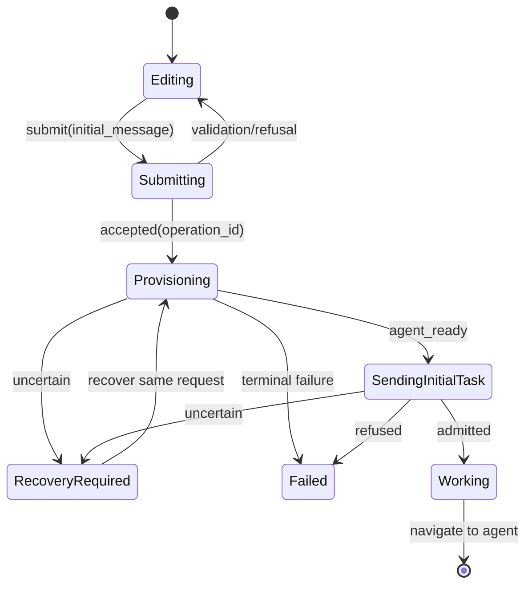

# CMA 页面优化技术设计

状态：Draft

日期：2026-11-02

输入设计：[CMA 界面改版方案](https://aelfblockchain.sg.larksuite.com/docx/WoIrdo1NKovP5ixXWiPlJZnRgih)

关联规范：`CLAUDE.md`、`docs/Web_Style.md`、`docs/CMA_Agent_Manager_API.md`

## 1. 设计目标

把 Agent Manager 的主路径从“先配置一个 Agent，再开始输入”改成“先说任务，再逐步看到 Agent 的工作和成果”，同时保留 CMA 现有的 Agent、Workspace、Sandbox 和权限边界。

本设计覆盖改版方案中的六项变化：

1. 首页任务输入和常见任务入口。
2. 运行中的计划、当前步骤和折叠工具调用。
3. Agent 的电脑面板和回放入口。
4. 回答下方的交付物卡片、预览和下一步建议。
5. 以任务标题和状态为主的 Agent 导航。
6. 对模型、权限、队列和耗时等工程术语做渐进披露。

同时覆盖设计文档新增的回答反馈和建议回复，但将二者与任务发送严格分开：反馈只记录反馈，建议回复才会发起新一轮 Agent turn。

## 2. 当前实现基线

当前前端已经有几条可以直接复用的 seam：

| 能力 | 当前入口 | 现状 | 设计结论 |
| --- | --- | --- | --- |
| 首页 | `web/src/ConsoleViews.tsx` 的 `WelcomeView` | 只有欢迎语和 `New agent` 按钮 | 替换中心空状态，保留侧边栏入口作为兼容入口 |
| Agent 创建 | `web/src/create/CreationFlow.tsx`、`AgentLifecycleCard.tsx`、`NewAgentCard.tsx` | 生命周期创建是异步、可恢复的；旧创建接口支持 `firstMessage`，新生命周期请求不支持用户任务文本 | 首页直达任务必须先补充生命周期接口的初始任务字段 |
| 会话 | `web/src/agent/AgentSurface.tsx`、`MessageStream.tsx` | 已有 optimistic message、队列、停止、恢复和权限状态 | 首页提交和建议回复必须复用同一发送控制器，不实现第二套发送逻辑 |
| 计划 | `web/src/agent/PlanCard.tsx`、`plans.ts`、`streamTimeline.ts` | 已能消费 `plan_set`，每次报告替换同一 turn 的计划 | 增强展示和派生计算，不从工具调用虚构计划 |
| 工具调用 | `web/src/agent/ToolCallRows.tsx` | 连续工具调用已经折叠 | 只补充当前活动摘要和可访问文案 |
| 文件 | `web/src/agent/AgentSidePanel.tsx`、`web/src/agent/files`、`web/src/api/agentFiles.ts` | 支持目录、预览、下载和写入 | 交付物卡片复用文件客户端，增加回答关联和选中文件预览 |
| 反馈 | `web/src/agent/MessageFooter.tsx`、`useMessageFeedback.ts`、`api/rest/messageFeedback.ts` | 已支持消息级 up/down/null、撤销、切换和失败重试 | 基础反馈可直接列为第一版；原因标签需要接口扩展 |
| 导航 | `web/src/shell/PersonalAgentTree.tsx`、`treePresentation.tsx`、`ManagerNavigation.tsx` | 已有标题、状态点和状态过滤；仍暴露 Agent/Sandbox 视图切换 | 默认主路径只展示 Agent；Sandbox 入口保留在详情和设置路径 |
| 设计规范 | `docs/Web_Style.md` | 已定义 Agent 对话轴、反馈、工具折叠和状态语义 | 新组件先追加规范和 changelog，再写 CSS |

## 3. 关键决策

### 3.1 创建和首条任务必须是一个可恢复的业务操作

首页发送时不能先创建一个空 Agent，再依赖前端收到 `agent_id` 后补发任务。当前生命周期创建返回的是异步 operation receipt，期间 Agent ID 可能尚未可用；拆成两个请求会产生“Agent 已创建但首条任务丢失”以及不确定重试重复发送的问题。

为生命周期创建请求增加可选的 `initial_message`，并把它和创建请求一起写入幂等记录：

```json
{
  "name": "正在准备任务",
  "workspace_id": "optional-workspace-id",
  "repository": {
    "url": "https://github.com/org/repo",
    "ref": "main"
  },
  "initial_message": "比较三个项目管理工具，写一页推荐"
}
```

服务端在同一条生命周期记录中保存原始文本和发送目的。创建 worker 在 Agent 可用后，使用已有的首条消息 durable delivery 机制发送该文本。`initial_message` 必须参与 request fingerprint 和 idempotency replay；不允许重试时重新读取前端当前草稿。

兼容旧客户端时，字段缺省表示没有用户首条任务，保留现有 setup message 行为。旧 `NewAgentCard` 继续支持已有 `firstMessage`，直到新的生命周期请求在所有部署中可用。

### 3.2 计划只显示已被协议报告的事实

当前 `ConversationState.plans` 已经按 turn 保存最新 `plan_set`。新增的进度条和“第 N 步 / 共 M 步”由计划条目状态派生：

- `completed` 计入已完成数量。
- 第一个 `in_progress` 是当前步骤。
- 没有 `in_progress` 时，不猜测当前步骤。
- 没有 `plan_set` 时，显示当前工具活动或普通 Thinking，不显示虚构的步骤。
- 预计剩余时间只有在协议或可靠的历史统计提供依据时显示；否则隐藏，不把经过时间当作预计时间。

这样保留 `plan_set` 的事实边界，也避免把工具名称包装成 Agent 的计划承诺。

### 3.3 “Agent 的电脑”是能力驱动的面板

右侧面板不直接读取浏览器或终端的内部实现。它依赖一个可选的 `AgentEnvironmentClient` 能力：

- `browser`：当前浏览器画面或安全的截图/帧流。
- `terminal`：经过权限过滤的终端输出。
- `files`：现有 `AgentFilesClient` 的文件树和预览。
- `replay`：按操作序号读取历史回放。
- `takeover`：运行时明确支持时才显示接管按钮。

若能力不存在，面板展示“当前 Agent 未启用环境画面”，不使用工具日志伪造浏览器画面，也不显示没有后端支持的接管控件。第一版可以只交付 `files` 和工具输出的可读摘要，浏览器帧、终端流和接管按独立能力上线。

### 3.4 交付物必须有稳定的回答关联

从 Markdown 中猜测所有文件名会把普通文本误认为交付物。新增 `AgentArtifact` 读取契约，至少包含：

```ts
interface AgentArtifact {
  readonly id: string;
  readonly agentId: string;
  readonly answerId: string;
  readonly path: string;
  readonly name: string;
  readonly kind: 'document' | 'image' | 'archive' | 'data' | 'code' | 'other';
  readonly sizeBytes: number;
  readonly sha256?: string;
  readonly preview: 'supported' | 'unsupported';
}
```

第一版可以由服务端在回答完成时，根据该 turn 的写入记录生成 artifact 列表；不能用“当前目录所有文件”代替回答关联。列表、预览和下载都必须校验 `agentId`、`answerId` 和授权。选中的文件由现有文件预览能力加载，失败时保留卡片并显示可重试状态。

### 3.5 自动命名由服务端确认，前端只负责渐进展示

前端继续使用 `agentDisplayTitle`，但创建时显示稳定的临时标题，例如“新任务”。首条任务被接受后，服务端生成任务标题并通过 Agent detail/hierarchy 刷新返回。用户手动重命名后，自动标题不能覆盖手动标题。

建议在 Agent detail 增加标题来源：`user`、`generated` 或 `fallback`。如果本期不扩展该字段，服务端至少要保证手动更新后的 title 在后续 hierarchy 刷新中优先于生成标题。

### 3.6 建议回复和回答反馈使用不同的数据生命周期

建议回复绑定最近一条已完成 Assistant answer，反馈绑定任意一条已记录 Assistant message：

- 建议回复发送后立即失效，不留在下一轮回答下方。
- 切换 Agent、账号、回答或重新生成时，旧建议请求必须 abort 或被 scope 丢弃。
- 反馈操作永远不触发 turn。
- 发送建议必须调用现有 composer/controller admission，不直接调用底层 transport。

## 4. 目标组件结构

```text
Console
├── Sidebar
│   └── ManagerNavigation
│       └── PersonalAgentTree
└── route: home
    └── TaskHome
        ├── TaskComposer
        ├── TaskContextOptions
        └── SuggestedTaskTemplates

route: agent
└── AgentSurface
    ├── OwnerAgentHeader
    │   └── RunStatusPill
    ├── AgentAlerts
    ├── ConversationViewport
    │   ├── ProgressSummary
    │   ├── MessageStream
    │   │   ├── PlanCard
    │   │   ├── ToolCallGroup
    │   │   ├── Message
    │   │   │   ├── ArtifactStrip
    │   │   │   ├── SuggestedReplies
    │   │   │   └── MessageFooter
    │   │   └── ActiveThinking
    │   └── QueuedMessages
    ├── Composer
    └── AgentSidePanel
        └── AgentEnvironmentPanel
```

`AgentSurface` 仍然拥有会话和权限的组合，但每个新增区域只接收已整理好的 view model。不要让 `MessageStream` 直接请求建议、文件列表或环境帧；请求和取消应位于对应 hook/client adapter，组件只在 answer scope 改变时渲染新状态。

## 5. 状态模型

### 5.1 首页创建



用户的输入草稿属于 `TaskCreationDraft`，以 viewer 及当前创建请求为 scope 保存于内存；任何失败或路由切换都不能用空值覆盖它。恢复只能重放原始请求体和原始 idempotency key。

### 5.2 计划和运行状态

定义纯函数 `presentPlan(plan, run)`，输出：

```ts
interface PlanPresentation {
  readonly visible: boolean;
  readonly completed: number;
  readonly total: number;
  readonly currentIndex?: number;
  readonly currentTitle?: string;
  readonly currentActivity?: string;
  readonly progress: 'unknown' | 'in_progress' | 'complete' | 'blocked';
}
```

`RunStatusPill` 只使用已有 Agent 状态和 `activeRunId`；停止、等待审批、失败和暂停必须沿用 `statusTone` 的现有语义，不创建第二套颜色映射。

### 5.3 建议回复

```ts
interface SuggestedReply {
  readonly id: string;
  readonly agentId: string;
  readonly answerId: string;
  readonly text: string;
  readonly rank: number;
}

type SuggestedReplyState =
  | { readonly kind: 'hidden' }
  | { readonly kind: 'loading'; readonly answerId: string }
  | { readonly kind: 'ready'; readonly answerId: string; readonly items: readonly SuggestedReply[] }
  | { readonly kind: 'editing'; readonly answerId: string; readonly id: string }
  | { readonly kind: 'sending'; readonly answerId: string; readonly id: string }
  | { readonly kind: 'failed'; readonly answerId: string; readonly id: string; readonly message: string };
```

建议最多展示三条；空列表和生成失败均隐藏区域。`answerId` 必须同时出现在读取请求、React key 和发送前校验中。

### 5.4 回答反馈

保留现有 `MessageFeedbackControls` 的 up/down/null 基础状态，新增原因时将服务端模型扩展为：

```ts
interface MessageFeedbackDetail {
  readonly messageId: string;
  readonly vote: 'up' | 'down' | null;
  readonly reasons: readonly (
    | 'inaccurate'
    | 'did_not_answer'
    | 'unusable_steps'
    | 'incomplete'
    | 'unclear'
    | 'other'
  )[];
  readonly note?: string;
  readonly updatedAt: string;
}
```

原因提交必须是独立 mutation：原因失败不能回滚已经确认的 vote；撤销或切换到 up 时清空服务端负向原因。

## 6. API 和后端改动

### 必需改动

1. 扩展 `AgentLifecycleCreateRequest` 和前端 `AgentLifecycleCreateInput`，增加受限长度的 `initial_message`。
2. 把 `initial_message` 写入生命周期 operation 的 request fingerprint、恢复记录和 first-message delivery；补充 public contract、OpenAPI 和 Rust 生命周期测试。
3. 提供回答关联的 artifact read API，返回 `AgentArtifact[]`，并定义回答完成、文件写入尚未完成、文件删除和权限变化时的行为。
4. 提供 suggested replies 的读取/生成 API，至少支持 `agent_id`、`answer_id`、稳定建议 ID、排序和取消后的过期校验。
5. 扩展 message feedback API 支持原因和说明；保留只有 vote 的旧请求以兼容已发布客户端。
6. 若交付 Agent 电脑，提供 capability discovery 和受权限约束的 browser/terminal/replay 数据接口。没有能力时前端不得启用该面板的操作按钮。

### 可复用现有接口

- `/api/v1/agents/{id}/messages` 仍是建议回复的唯一正常发送入口。
- 现有 `agentTransport`、`useOptimisticMessages`、队列和 pending recovery 负责发送确认及不确定恢复。
- 现有 `AgentFilesClient` 负责文件树、预览和下载；artifact client 只负责回答关联和权限。
- 现有 `/message-feedback` 负责基础 vote 的读取和写入。
- 现有 Agent preferences title update 负责用户手动重命名。

### 不在本期假设的能力

- 不假设 Codex 一定会发送计划事件；上线前必须用真实 runtime 证据确认 `plan_set` 覆盖率。
- 不假设文件名能从回答文本可靠解析。
- 不假设已有屏幕录制、浏览器控制或终端快照 API。
- 不假设动态建议已经存在；在接口未确认前只实现展示 contract 和 fixture，不把模板称为智能建议。

## 7. TDD 设计与验证 seam

遵循 `tdd` skill：测试用户可观察行为，先确认 seam，再按一个垂直 slice 执行 red → green。测试不直接 mock React 私有 state、DOM 细节或内部 reducer；期望值来自本设计的稳定契约和具体业务例子。

以下 seam 是实现前需要确认的测试边界：

| seam | 测试行为 | 捕获的问题 |
| --- | --- | --- |
| `TaskHome` / creation client | 提交任务产生带同一文本和幂等 key 的生命周期请求；拒绝和不确定状态保留草稿 | 首条任务丢失、重复创建、晚到回调清空输入 |
| `AgentLifecycleCard` / operation reader | operation 进入 ready、connection required、失败和 recovery 时显示正确状态 | 异步创建被误判为失败或成功 |
| `PersonalAgentTree` | 任务标题、Working/Needs approval/Ready/Needs attention 状态和选中项正确显示 | 工程 ID 泄露、状态和颜色不一致 |
| `presentPlan` / `PlanCard` | 完成数、当前步骤、空计划、未知状态和没有计划时的展示 | 虚构进度、把未知状态错误映射为完成 |
| `MessageStream` | 只有最新已完成回答显示建议；流式回答、用户消息、工具日志和失败提示不显示 | 建议串回答、过早出现或遮挡输入 |
| `SuggestedReplies` + controller | 点击发送只调用一次正常发送入口；编辑不覆盖已有草稿；发送失败可重试 | 重复消息、静默覆盖草稿、建议绕过权限 |
| `ArtifactStrip` / artifact client | 只显示当前 `answerId` 的文件；预览/下载失败保留可恢复状态 | 文件串回答、越权读取、下载不可重试 |
| `MessageFooter` / feedback client | vote 可撤销/切换；原因单独提交；原因失败不影响已保存 vote | 反馈触发 turn、失败状态伪成功、原因残留 |
| `AgentEnvironmentPanel` / environment client | capability 缺失时隐藏操作；切换 tab 不重挂载会话；回放范围稳定 | 假画面、失去会话状态、越权接管 |

### 垂直 slice 顺序

#### Slice 1：术语和导航

先让侧边栏显示真实任务标题和现有状态，默认隐藏 Sandbox 视图切换，保留进入 Sandbox 详情的路径。测试 `PersonalAgentTree`、`ManagerNavigation` 和 `treePresentation` 的公开渲染结果。

#### Slice 2：首页任务输入

先写 `TaskHome` 的失败测试：提交内容必须进入生命周期请求；再扩展客户端契约和后端 operation；最后接入页面跳转。验证空文本、长度限制、创建拒绝、不确定恢复和刷新后的草稿保留。

#### Slice 3：运行中计划

先写 `presentPlan` 的红测试，再扩展 `PlanCard` 的进度摘要和当前活动；工具调用折叠沿用现有 `ToolCallGroup`。不在这一 slice 加环境面板。

#### Slice 4：完成页交付物

先用固定 `AgentArtifact` fixture 测试 answer scope、下载和预览失败，再接后端 artifact API。完成后把 `ArtifactStrip` 放到最新回答正文与 footer 之间。

#### Slice 5：基础建议回复

先实现静态 contract 和状态机测试，再接读取 API。发送路径必须通过 `AgentSurface` 现有 `onSend`，并测试快速切换 Agent、切换 answer、重复点击和不确定响应。

#### Slice 6：反馈原因

基础 up/down/null 现有能力保持绿色；先扩展 API adapter 的 red test，再加入原因面板。原因提交、撤销和切换分别验证，不把原因表单作为 vote 保存的前置条件。

#### Slice 7：Agent 的电脑

最后实现 capability adapter 和面板。先测 capability 缺失、权限变化、tab 切换和回放边界；真实浏览器帧或接管能力必须有端到端证据后才开启对应按钮。

## 8. 文件级改动计划

### 第一批：前端可独立交付

- 新增 `web/src/home/TaskHome.tsx`、`TaskHome.css` 和 `TaskHome.test.tsx`。
- 新增 `web/src/create/taskCreation.ts`，统一草稿、幂等 key 和恢复状态。
- 扩展 `web/src/create/CreationFlow.tsx` 与 `web/src/api/client.ts` 的 lifecycle 输入。
- 调整 `web/src/shell/ManagerNavigation.tsx`、`PersonalAgentTree.tsx` 和 `treePresentation.tsx` 的默认主路径。
- 调整 `web/src/agent/AgentHeader.tsx`、`Composer.tsx` 的用户文案，保留 wire value 和控制行为。
- 在 `docs/Web_Style.md` 追加首页任务输入、状态药丸和移动端触控尺寸规则及 changelog。

### 第二批：回答成果和反馈

- 新增 `web/src/agent/artifacts.ts`、`ArtifactStrip.tsx`、`ArtifactPreview.tsx` 及对应 client adapter。
- 新增 `web/src/agent/suggestedReplies.ts`、`SuggestedReplies.tsx` 和状态测试。
- 扩展 `web/src/agent/useMessageFeedback.ts`、`MessageFooter.tsx` 和 message feedback REST adapter。
- 后端新增 artifact、suggestion、feedback detail 的契约、认证和 public contract tests。

### 第三批：运行时可见性

- 扩展 `AgentSidePanel.tsx` 为可选的 `AgentEnvironmentPanel`，不改变现有 details/files panel 的生命周期。
- 新增 `web/src/agent/environment/` client、capability model、tab presentation 和 replay controls。
- 由运行时提供 browser/terminal/replay 数据后，分别开启对应 tab；没有服务端 capability 时只显示说明状态。

## 9. 验收标准

### 首页和创建

- 用户能在首页输入任务并直接提交，常见任务只填充输入，不隐式创建。
- 创建请求包含原始任务文本；创建、连接、启动和发送中的失败都能恢复同一请求。
- 任何不确定结果都不能自动生成第二个 Agent 或发送第二条首任务。
- 既有通过侧边栏打开的创建流程继续可用。

### 运行和完成

- 有真实计划时显示完成数、当前步骤和折叠工具操作；无计划时不制造步骤。
- Agent 运行中的输入区仍支持停止、排队、打断、审批和 pending recovery。
- 已完成回答的交付物只来自当前回答关联的 artifact；预览和下载失败可独立重试。
- 只有最新已完成回答显示建议回复；建议发送、编辑发送和手动输入共用相同的 controller。

### 反馈和权限

- vote 不触发 Agent turn；保存失败显示重试，不把点击当作成功。
- 负向原因可独立提交；原因失败不丢失已保存 vote，也不覆盖未提交草稿。
- 只读、分享、权限切换和账号切换不会显示可保存但实际不可保存的控件。

### 响应式和可访问性

- 桌面和移动端覆盖空、加载、可用、编辑、发送中、失败和只读状态。
- 建议、反馈、计划和环境 tab 都有语义化名称、键盘操作和 `role="status"` 的结果播报。
- 移动端可操作控件触控热区至少 44 × 44 px；不因展开区域遮挡 composer 或改变用户草稿。
- 状态颜色只来自现有 vocabulary/design tokens，支持 reduced motion。

## 10. 发布顺序和风险

| 阶段 | 交付 | 依赖 | 风险 |
| --- | --- | --- | --- |
| P0 | 术语、侧边栏状态、首页任务输入 | 生命周期初始任务接口 | 中；需要处理创建与首条任务的原子恢复 |
| P1 | 计划摘要、完成页 artifact 卡片 | `plan_set` 覆盖验证、artifact API | 中；不能用推测替代协议事实 |
| P1 | 基础建议回复、现有反馈入口统一 | suggestion read/send contract | 中；建议 scope 和重复发送容易出错 |
| P2 | 反馈原因 | feedback schema migration | 低到中；旧客户端兼容 |
| P3 | 浏览器/终端/接管/回放 | runtime environment capability | 高；涉及资源、权限和实时数据 |

每个阶段拆成独立 PR，保留改前改后截图和对应 seam 测试。生产开关按能力和账号逐步放量；任何后端能力缺失时，前端隐藏该能力，而不是以静态内容模拟成功状态。

## 11. 实现前必须确认的事项

1. **测试 seam**：确认首页创建、回答建议、artifact 和环境面板是否按本文边界测试；确认是否需要把后端 operation contract 作为跨层 seam。
2. **初始任务语义**：确认 `initial_message` 是否与现有 setup message 共存，以及 first-message delivery 的 `purpose` 是否扩展为 `task`。
3. **计划协议覆盖**：用真实 Codex runtime 样本确认 `plan_set` 的发送频率、状态值和重新连接后的重放行为。
4. **artifact 来源**：确定由回答响应附带结构化 artifacts，还是由独立 API 读取 turn 写入记录；在决定前不实现文件名猜测。
5. **建议生成方式**：确定完成响应附带建议还是独立请求；确定服务端是否持久化建议，以及答案失效后的过期策略。
6. **环境能力**：确认 browser/terminal/replay/takeover 是否已有公共接口、权限 scope 和资源成本；没有证据的 tab 不进入默认布局。
7. **自动命名**：确定服务端生成标题的触发时机、失败回退和手动重命名优先级。

本文是实现前的技术设计，不在测试 seam 确认前新增测试文件，也不在接口契约确认前写入模拟成功的 UI 流程。
