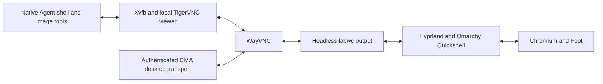

# Omarchy machine runtime

The normal CI workflow now runs `Images (runtime-omarchy)` on PRs and develop
pushes. It builds the current checkout's desktop tool donor and supervisor,
executes the existing runtime and three desktop environments, scans the image,
and exports tested native bytes only after success. It does not use the retained
prototype donor described in the historical evidence below. Its artifact follows
the one-day `ci-native-image-runtime-omarchy-<sha>-<run>-<attempt>` contract.
Provider acceptance and production image adoption still require a separate
release decision. Existing explicit-image Machine updates remain tracked in
[#1416](https://github.com/ChronoAIProject/cma/issues/1416).

The reopen fixture selects and closes Chromium through Hyprland before invoking
the shared launcher from the native Agent tool. Startup closure preserves the
normal window state; closure after the input probe restores fullscreen first.
Both paths wait for the window and the desktop profile process to exit. The
fixture regressions run before the image build, and the image gate still requires
native tools and the turn to finish while the reopened page stays visible.

The image pins package `hyprland 0.56.2-4` and rebuilds the compositor from
[Hyprland v0.56.2](https://github.com/hyprwm/Hyprland/tree/v0.56.2) with CMA's
rendering patch. With its Lua config, `hyprctl dispatch` evaluates a Lua
dispatcher expression: both the fixture and the shared launcher's reuse path
use `hl.dsp.focus({window = "address:0x..."})`. The legacy `focuswindow address:...`
form is rejected. The fixture verifies the active window before sending close.
The other audited calls are `instances -j`, `-j monitors`, `-j clients` and
`-j activewindow`, including the launcher's explicit `-i` instance selection;
these query forms do not use the Lua dispatch parser.

Production preparation on 2026-10-31 exposed a filesystem difference from the
isolated microVM: Arch already owns `/tmp/.X11-unix` as root with mode 1777.
Unconditionally running `chmod` as the runtime user stopped the launcher before
graphics startup. The launcher now changes permissions only when it owns the
directory and verifies that an existing directory is usable with mode 1777.
The desktop workflow additionally exercises the image's original temporary
directory, all seven native/manual control checks, and container replacement
with the retained home. Its export admission includes that additional gate.

The explicit `omarchy` Docker target packages the actual Omarchy Hyprland and
Quickshell desktop on Arch Linux. Production Machine Included allocations now
use its verified immutable image; agent-only allocations retain their separate
Codex runtime. The Dockerfile's ordinary Debian target is independent of that
explicit production machine selection.

## Production evidence, 1 November 2026 SGT

PR [1250](https://github.com/ChronoAIProject/cma/pull/1250), source
`4281b81dc27e5df895fd26a93652422bcc80d597`, passed graphics workflow
[41216119511](https://github.com/ChronoAIProject/cma/actions/runs/41216119511)
and full application CI
[41216170142](https://github.com/ChronoAIProject/cma/actions/runs/41216170142).
The promoted machine image is
`asia-southeast1-docker.pkg.dev/example-project-02/example-registry-01/cma-runtime-omarchy@sha256:71746483245eb16c9502a114677e9f18e25ede191f2f08edd64f7666689e2792`.

A disposable production microVM passed without `/dev/dri`, using the untouched
image temporary directory, runtime home initialization, assignment fencing and
a production-equivalent 64 GiB ReadWriteOncePod home. Its Pod, PVC and isolated
canary resources were subsequently removed.

An actual production Create Agent journey then established live Codex desktop
control: the Agent opened Foot, executed a command, inspected the screenshot,
and typed and clicked in Chromium while the conversation remained visible
beside the desktop. Separate manual keyboard input created a second proof file.
Fullscreen, reconnect, panel close/reopen and Agent-driven browser closure all
passed. The Stop response button and interrupt-with-message cancelled bounded
long-running test turns in 2.253 and 2.875 seconds respectively.

Pause/revival retained the same Agent, Sandbox, PVC/home, image, lineage, both
proof-file hashes and every prior durable conversation event. A different Pod
and boot identity returned a rendered desktop. Retained production demos were
checked without mutation and survived the runtime-default and API rollouts.

Both current image classes have independent warm and prepared targets of two.
The Agent Manager ConfigMap records those four targets and the same immutable
runtime pins used in production. The Agent-only runtime is
`asia-southeast1-docker.pkg.dev/example-project-02/example-registry-01/cma-runtime@sha256:a04af1f9c1e70be28674ac13c3804dd9d8df970df34c82ba649f70819c72e9c0`.
Native pool ready counts describe unclaimed members; prepared capacity is held
separately and replenished after claims. Exhausting either prepared pool falls
back to normal provisioning. A target of two does not guarantee two available
prepared Agents at every instant or a five-second creation time.

The five-second creation target is still under verification: two instrumented
agent-only UI trials measured 5.090 and 4.683 seconds. Earlier machine trials
exposed a first-load viewer race, so a reload was needed and those trials do not
establish machine creation latency. Pool readiness and successful desktop
control must not be reported as a passing creation-time budget.

## Earlier isolated-container evidence, 31 October 2026

[Run 41181999176](https://github.com/ChronoAIProject/cma/actions/runs/41181999176)
uses source `83e06de5098d53fd700bafc4f677aa9ba4ca7b34` and image
`sha256:48cfc1848275151cfb15c9c799a4770ccf524e8dcb90b65fe6e5b944c5e25ce7`.
With a VKMS primary DRM node mapped into a disposable Linux container, it proves:

- Actual Omarchy, native Wayland Chromium and Foot render at 1280×800.
- The real Codex 0.165 executable and patched ACP bridge open a terminal, type
  and run a command, and return its screenshot through the native image tool.
- Native shell/image tools click, type and inspect the browser.
- User input through CMA's authenticated framebuffer relay changes that same
  browser after the native Agent interaction.
- Closing the browser through Omarchy leaves the desktop and ghost wallpaper
  visible. Chromium exits completely before the container restarts.
- After restart on the retained home, the browser contains the user's saved
  state and all seven native-tool/framebuffer interaction checks pass again.
- Both test containers and their home volumes are removed after verification.
- All 34 CMA runtime contract checks pass, including nonroot/read-only operation,
  empty-home initialization, credential/installation gates, native executable
  identity, checkpoint fencing/recovery and persistent bootstrap restart.

Model responses are deterministic local fixtures; no live inference or customer
Agent is involved. These results prove execution of native tools against the
real desktop and transport, not an autonomous live model demonstration.

The VKMS desktop report records `result: pass`, `browserClosed: true` and
`cleanup: true`, with seven interaction checks both before and after restart.
The first and retained terminal screenshot hashes match their retained PNGs.
The configured image vulnerability scan also passes for this exact candidate.
This establishes clean-restart persistence; abrupt termination while the browser
is active is a separate unverified case. The prototype still displays Hyprland's
direct-launch notice because CMA supervises its compositor process.

For that earlier candidate, startup without a graphics device failed. Its
workflow did not establish device-free operation or production admission.
That image export retained `admission: blocked`, `productionValidated: false`.

The subsequent candidate at source `1e14344010d534411a85e7b7525cda8dbc345e2a`
initializes surfaceless EGL and the nested SHM display without a DRM device, but
aborts while destroying a cursor renderbuffer: its cleanup attempts a pixel
copy after the underlying SHM buffer has expired. The subsequent fix completes
cursor and output copies before submission, and performs no copy from a
destructor. The promoted candidate above passed the no-device acceptance. The
same candidate's VKMS, runtime-contract and configured scan checks passed;
those passes do not override its failed no-device check.

## Display integration

The owner transport and local Agent viewer share the same Wayland seat and
1280×800 output. WayVNC and Websockify listen only on loopback; CMA's existing
authenticated runtime desktop endpoint is the remote entry point. No separate
computer-use service or provider tool was added.

VKMS supplies virtual graphics buffers, while Mesa llvmpipe renders in software.
This does not require a physical GPU, but it does require an accessible DRM
primary node. The disposable runner loads VKMS on its own host and maps only the
identified node and its group into the container. A disposable production
microVM inventory found no `/dev/dri` device or available VKMS/vgem driver.
Production uses the separately verified device-free path.

The implementation includes four targeted graphics adaptations:

1. DRM driver discovery uses `DRM_IOCTL_VERSION`, including Linux 7's faux VKMS
   devices. It does not assume a particular sysfs driver symlink.
2. The pinned wlroots 0.20.2 library accepts a primary node only when its actual
   driver is `vkms`. Other primary nodes remain refused. This enables Mesa's
   GBM/DMA-BUF rendering path while preserving nonroot operation.
3. Aquamarine 0.15.1 includes the pinned upstream
   [configure-order fix](https://github.com/hyprwm/aquamarine/commit/7bb8bdf4e8fedaf4dfae58512bc4c728671727df)
   and an explicit `AQ_WL_FULLSCREEN=1` option used for CMA's nested output.
   The first fixes a buffer commit before the host acknowledged its surface;
   the second negotiates the stream's size before rendering, avoiding a centered
   720-pixel output and offset pointer coordinates in an 800-pixel stream.
4. With no DRM device, `AQ_WL_SHM=1` selects bounded, sealed memfd buffers in
   Aquamarine and surfaceless Mesa rendering in Hyprland. Completed output and
   cursor framebuffers are copied to the shared-memory Wayland buffers before
   submission. This path must pass the same desktop controls and restart checks.

Readiness requires a live `WAYLAND-*` monitor of the expected dimensions and a
Chromium client. A compositor running only on its fallback headless output is
not accepted. The local viewer uses X11 explicitly, fills the Xvfb screen without
FLTK fullscreen window recreation, and is located by its process ID.

The supervisor owns the process group. Acceptance runs as UID 10001, with a
read-only root, all capabilities dropped, no external network, and a persistent
home. Login/power services and systemd are not started. CMA manages browser
startup/profile storage and image updates. These are adaptations of the real
Omarchy desktop for a hosted runtime, not a stock workstation OS installation.

## Build inputs and provenance

The Dockerfile's ordinary target is unchanged; select `--target omarchy`
explicitly. Arch is pinned to
`archlinux:base@sha256:e82623936fa1a69700b48e98b058df6eaab18b737c27473a7234a40fdecb9413`.
Omarchy tag `v4.0.6` resolves to
`237f1b4071a0bff2296c6d740ba2b9fd695ebfa0`, which is downloaded with a pinned archive
checksum. Its upstream `version` file still prints `4.0.0.alpha`; the build retains
that file and records the actual source identity rather than rewriting it.

The branch-only workflow uses a retained experimental image solely as a CMA
runtime binary donor because the original Debian desktop export expired. It
pins the outer artifact checksum, source, workflow and image ID, verifies its
archive checksum and 34 passing runtime checks, and preserves the original
successful base provenance and executable hashes. The donor's failed desktop
admission remains explicit in `binary-donor.json`; it is not a deployment input.
The new image must pass its own checks.

Installed package versions and package archive hashes are recorded under
`/usr/share/cma-omarchy`. `patched-graphics.txt` records graphics source, patch
and library hashes. The signed Arch/Omarchy repositories remain rolling inputs;
the build refuses unexpected wlroots/Aquamarine versions rather than applying
patches to an unverified library version. The resulting image ID identifies the
exact candidate and must accompany acceptance evidence.

## Acceptance and security

The workflow retains logs, image identity, runtime contract results, graphics
device inventory and screenshots before scanning/exporting. Candidate archives
are retained for seven days even when a check fails; archive availability is not
a readiness claim. Screenshots from completed native-tool checks are retained
when a later input or restart check fails. Test containers and home volumes are
removed and cleanup is recorded in each result.

The configured Trivy scan checks HIGH/CRITICAL findings with fixes available.
It does not provide complete Arch OS package coverage. Build-only Python tools
are removed; bundled Gum/captree are rebuilt with pinned patched Go tools and
dependencies. No findings are suppressed to admit an image. The scan result must
be bound to the exact candidate, alongside its runtime and desktop results.

A passing VKMS Docker test does not prove compatibility with the production
Sandbox provider or a browser journey through CMA's public API. That requires a
separate disposable microVM using the pinned registry digest without a graphics
device, followed by the actual CMA creation and conversation journey. Promotion
must preserve retained user runtimes and homes. Independent machine warm and
prestarted pools are described in [Machine warm pools](CMA_Machine_Warm_Pools.md);
their five-second acceptance remains separate from graphics readiness.
