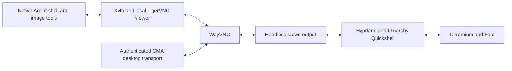

# Omarchy runtime prototype

The explicit `omarchy` Docker target packages the actual Omarchy Hyprland and
Quickshell desktop on Arch Linux. It remains experimental. The default image
target remains Debian/XFCE, and this prototype has not been deployed or verified
through the production CMA UI.

## Verified scope, 31 October 2026

[Run 41181999176](https://github.com/ChronoAIProject/cma/actions/runs/41181999176)
uses source `83e06de5098d53fd700bafc4f677aa9ba4ca7b34` and image
`sha256:48cfc1848275151cfb15c9c799a4770ccf524e8dcb90b65fe6e5b944c5e25ce7`.
With a VKMS primary DRM node mapped into a disposable Linux container, it proves:

- Actual Omarchy, native Wayland Chromium and Foot render at 1280×800.
- The real Codex 0.165 executable and patched ACP bridge open a terminal, type
  and run a command, and return its screenshot through the native image tool.
- Native shell/image tools click, type and inspect the browser.
- User input through CMA's authenticated framebuffer relay changes that same
  browser after the native Agent interaction.
- Closing the browser through Omarchy leaves the desktop and ghost wallpaper
  visible. Chromium exits completely before the container restarts.
- After restart on the retained home, the browser contains the user's saved
  state and all seven native-tool/framebuffer interaction checks pass again.
- Both test containers and their home volumes are removed after verification.
- All 34 CMA runtime contract checks pass, including nonroot/read-only operation,
  empty-home initialization, credential/installation gates, native executable
  identity, checkpoint fencing/recovery and persistent bootstrap restart.

Model responses are deterministic local fixtures; no live inference or customer
Agent is involved. These results prove execution of native tools against the
real desktop and transport, not an autonomous live model demonstration.

The VKMS desktop report records `result: pass`, `browserClosed: true` and
`cleanup: true`, with seven interaction checks both before and after restart.
The first and retained terminal screenshot hashes match their retained PNGs.
The configured image vulnerability scan also passes for this exact candidate.
This establishes clean-restart persistence; abrupt termination while the browser
is active is a separate unverified case. The prototype still displays Hyprland's
direct-launch notice because CMA supervises its compositor process.

Startup without a graphics device still fails. The overall prototype workflow
therefore does not establish device-free operation or production admission.
The image export remains `admission: blocked`, `productionValidated: false`.

## Display integration

The owner transport and local Agent viewer share the same Wayland seat and
1280×800 output. WayVNC and Websockify listen only on loopback; CMA's existing
authenticated runtime desktop endpoint is the remote entry point. No separate
computer-use service or provider tool was added.

VKMS supplies virtual graphics buffers, while Mesa llvmpipe renders in software.
This does not require a physical GPU, but it does require an accessible DRM
primary node. The disposable runner loads VKMS on its own host and maps only the
identified node and its group into the container. Production Kata compatibility
and the provider's device provisioning remain unverified.

The implementation includes three targeted graphics adaptations:

1. DRM driver discovery uses `DRM_IOCTL_VERSION`, including Linux 7's faux VKMS
   devices. It does not assume a particular sysfs driver symlink.
2. The pinned wlroots 0.20.2 library accepts a primary node only when its actual
   driver is `vkms`. Other primary nodes remain refused. This enables Mesa's
   GBM/DMA-BUF rendering path while preserving nonroot operation.
3. Aquamarine 0.15.1 includes the pinned upstream
   [configure-order fix](https://github.com/hyprwm/aquamarine/commit/7bb8bdf4e8fedaf4dfae58512bc4c728671727df)
   and an explicit `AQ_WL_FULLSCREEN=1` option used for CMA's nested output.
   The first fixes a buffer commit before the host acknowledged its surface;
   the second negotiates the stream's size before rendering, avoiding a centered
   720-pixel output and offset pointer coordinates in an 800-pixel stream.

Readiness requires a live `WAYLAND-*` monitor of the expected dimensions and a
Chromium client. A compositor running only on its fallback headless output is
not accepted. The local viewer uses X11 explicitly, fills the Xvfb screen without
FLTK fullscreen window recreation, and is located by its process ID.

The supervisor owns the process group. Acceptance runs as UID 10001, with a
read-only root, all capabilities dropped, no external network, and a persistent
home. Login/power services and systemd are not started. CMA manages browser
startup/profile storage and image updates. These are adaptations of the real
Omarchy desktop for a hosted runtime, not a stock workstation OS installation.

## Build inputs and provenance

The Dockerfile's ordinary target is unchanged; select `--target omarchy`
explicitly. Arch is pinned to
`archlinux:base@sha256:e82623936fa1a69700b48e98b058df6eaab18b737c27473a7234a40fdecb9413`.
Omarchy tag `v4.0.6` resolves to
`237f1b4071a0bff2296c6d740ba2b9fd695ebfa0`, which is downloaded with a pinned archive
checksum. Its upstream `version` file still prints `4.0.0.alpha`; the build retains
that file and records the actual source identity rather than rewriting it.

The branch-only workflow uses a retained experimental image solely as a CMA
runtime binary donor because the original Debian desktop export expired. It
pins the outer artifact checksum, source, workflow and image ID, verifies its
archive checksum and 34 passing runtime checks, and preserves the original
successful base provenance and executable hashes. The donor's failed desktop
admission remains explicit in `binary-donor.json`; it is not a deployment input.
The new image must pass its own checks.

Installed package versions and package archive hashes are recorded under
`/usr/share/cma-omarchy`. `patched-graphics.txt` records graphics source, patch
and library hashes. The signed Arch/Omarchy repositories remain rolling inputs;
the build refuses unexpected wlroots/Aquamarine versions rather than applying
patches to an unverified library version. The resulting image ID identifies the
exact candidate and must accompany acceptance evidence.

## Acceptance and security

The workflow retains logs, image identity, runtime contract results, graphics
device inventory and screenshots before scanning/exporting. Candidate archives
are retained for seven days even when a check fails; archive availability is not
a readiness claim. Screenshots from completed native-tool checks are retained
when a later input or restart check fails. Test containers and home volumes are
removed and cleanup is recorded in each result.

The configured Trivy scan checks HIGH/CRITICAL findings with fixes available.
It does not provide complete Arch OS package coverage. Build-only Python tools
are removed; bundled Gum/captree are rebuilt with pinned patched Go tools and
dependencies. No findings are suppressed to admit an image. The scan result must
be bound to the exact candidate, alongside its runtime and desktop results.

A passing VKMS Docker test does not prove compatibility with the production
Sandbox provider or a browser journey through CMA's public API. That requires a
separate disposable CMA Sandbox using a pinned registry digest and the required
graphics device. Existing Agents, Sandbox images and production defaults must
remain untouched during prototype verification.
