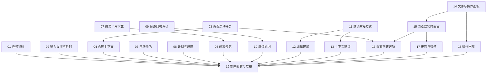

# CMA 页面优化：任务拆分评审稿

日期：2026-11-02（Asia/Singapore）

状态：2026-11-03 用户已确认全部 19 张票的粒度、依赖和测试边界；使用本目录作为本地 tracker，进入 implement-spec 执行。各票正文记录当前状态。

依据：[技术设计 Draft](../../CMA_UI_Optimization_Tech_Design.md)，以及当前工作树 `677c27440` 上的代码和未提交改动。此次交付只拆解任务，没有实现功能。

## 交付范围与使用方式

覆盖首页、导航与命名、输入设置与耗时、计划、文件成果、回答反馈、建议回复、Agent 电脑、接管及操作回放。共 19 张票，每张票单独成文，包含验收标准、候选测试边界和第一条 red → green 行为。

票号是标识及拓扑排序，不是必须串行执行的顺序。Blocked by 只列直接的功能依赖；共同编辑一个组件是集成风险，不自动构成阻塞。每张实现票同时完成所需的公开契约、持久化、用户入口和验证，不另拆“全部后端”“全部前端”“最后补测试”。当前未发现需要先做的大范围机械重构；必要的小幅整理在其功能票内完成。

用户明确指定本目录为本地 tracker；每票一文件，依赖以 Blocked by 为准。状态按 ready-for-agent → in-progress → done 记录，缺少验收证据时保留 in-progress 或 blocked，并说明具体缺口。本次允许创建集成分支、独立 worktree 和提交，原工作区未提交改动须保留。执行与验证记录见 [实施记录](IMPLEMENTATION.md)。

## 本次核实后需要修正的设计假设

| 设计中的说法或空白 | 当前证据与拆分处理 |
| --- | --- |
| 任务命名需从零新增后端支持 | 已有 ownerTitle、provider title、prompt preview 及 setup 标识。05 补齐真实任务标题的持久化/回读与覆盖规则，先验证复用能力，不默认新增标题生成服务。 |
| 计划数据接入尚不存在 | 已有 ACP Plan 到 PlanSet、前端 durable/live plan 合并。06 验证实际固定 runtime 版本并改善展示，不重复实现一套协议。 |
| artifact 读取能力全部需要新建 | 已有批准发布的 Agent artifacts、独立持久文档与实时文件读取；缺少可靠的最终回答关联。07 扩展关联及来源证明，保留三类资源各自授权，不能把所有文件自动发布为共享成果。 |
| 建议回复只能发送到设计中列出的 messages REST 路由 | 当前会话使用 AG-UI 或 Responses v2；11/12 复用当前 Agent 已选择的发送与恢复路径。实现前核对真实公开契约，不能据设计示例假造路由。 |
| 首页请求保存于内存，同时要求刷新恢复 | 当前创建 intent 已保存于浏览器会话存储，普通会话草稿在内存。03 区分未提交首页草稿、已发出的不确定请求、已受理的服务端操作，明确同一标签页刷新恢复及账号隔离。 |
| 首消息 purpose 需要增加 task | 当前类型已区分 setup/task；03/04 解决实际任务与自动准备的时序，不把 readiness 当成用户任务执行成功。 |
| 终端 tab 可直接复用 PTY | 当前规范和公开接口明确不支持 PTY。14 交付只读“终端活动（操作输出）”，不承诺命令输入。15/17 分别新增并验证浏览器画面与接管能力。 |
| 设置或旧创建入口的兼容方式 | 03 将普通首页、侧栏 New agent、快捷入口导向任务输入；上下文内创建仍可用。兼容保留旧协议，不让旧配置弹窗继续成为正常主路径。 |
| ready 可以直接叫完成 | ready 也包含从未执行的 Agent。01/02 仅依据最后一轮真实终态展示完成，资源就绪、停止、失败分别呈现。 |

以上是评审建议，不把源设计中的提案当作已存在的产品能力。每票实现时先落实本票所需决策，不增加一个阻塞所有工作的“大设计票”。

## 候选共用测试边界

| 编号 | 边界 | 能证明 | 不能单独证明 |
| --- | --- | --- | --- |
| U | 用户操作完整页面与正常客户端 | 可见内容、发送/反馈结果、草稿和焦点、权限变化、路由与移动端行为 | fixture 页面不能证明真实后端持久化或 runtime 能力 |
| A | 认证后的公开命令和查询 | 身份归属、精确重试、服务端拒绝、刷新/重启后可通过公开读取恢复；多协议一致性 | 不能证明浏览器布局、可访问性或真实画面质量 |
| R | 固定 runtime 版本，经公开入口到真实环境再回到页面 | 实际输入执行、计划观测、资源访问、浏览器帧、控制交接及持久日志 | 单一环境样本不能代表所有版本或未采样的资源成本 |

每张票列出使用哪些边界及遗漏。U 的大部分行为可用现有组件集成测试，布局/焦点/移动端用真实浏览器；A 使用真实服务与测试持久化，通过公开查询断言，不偷查数据库当成功证据；R 在隔离的测试 Agent 上运行，注明版本和能力。只在外部网络、模型、时间等系统边界替换依赖，不 mock 自己的 reducer/controller 来证明自己的行为。

这些 seam 已于 2026-11-03 经用户确认。每次只写一个真实会失败的行为测试，再实现最小链路使其通过，然后进入下一个行为；不先批量写完所有测试。每张票保存最小代表性验收证据，不将验证延期到 19。

## 编号任务清单

1. [01 任务导航与状态](issues/01-task-navigation.md) — Blocked by：无。默认任务列表可读，Sandbox 管理入口移至设置路径，保留访问范围。
2. [02 输入设置与真实耗时](issues/02-composer-language.md) — Blocked by：无。收起模型/权限细节，保留发送、排队、打断与停止的实际语义。
3. [03 首页直接启动任务](issues/03-task-home.md) — Blocked by：无。空工作区任务从输入到 durable admission、运行与异常恢复完整可用。
4. [04 带仓库上下文启动](issues/04-repository-context.md) — Blocked by：03。可选仓库/ref、授权和准备失败恢复串成同一创建操作。
5. [05 任务自动命名](issues/05-task-titles.md) — Blocked by：无。真实任务标题跨刷新一致，手动命名优先。
6. [06 计划、活动与进度](issues/06-plan-progress.md) — Blocked by：无。真实步骤、当前活动、折叠操作和完成摘要，无计划时诚实降级。
7. [07 回答成果与下载](issues/07-answer-deliverables.md) — Blocked by：无。经过验证的回答关联文件/文档成为可下载卡片。
8. [08 成果联动预览](issues/08-deliverable-preview.md) — Blocked by：07。点卡片在右侧预览对应版本，移动端可返回原会话。
9. [09 最终回答评价](issues/09-answer-feedback.md) — Blocked by：无。仅最终回答提供有帮助/需改进，保存、撤销、切换和失败均可信。
10. [10 负向原因与说明](issues/10-feedback-reasons.md) — Blocked by：09。多选原因、500 字说明独立保存，晚到请求不会复活已清除原因。
11. [11 场景建议与直接发送](issues/11-suggested-reply-send.md) — Blocked by：无。明确适用场景下提供 0—3 条模板建议，精确发送与恢复。
12. [12 编辑建议并保留草稿](issues/12-suggested-reply-edit.md) — Blocked by：11。编辑入口、合并/替换选择及失败恢复不丢已有输入。
13. [13 上下文建议生成](issues/13-contextual-suggestions.md) — Blocked by：11。异步生成、保存和读取上下文建议；严格过滤错误、重复及失效内容。[实现证据](13-EVIDENCE.md)、[实际样本](13-MODEL-SAMPLES.md) 和 12 编辑整合已交付；[独立 parent AI 评审](13-PARENT-AI-REVIEW.md) 通过五个 v3 样本。仅 literal human 质量验收留待整套交付评审；实际费用未知，不虚构账单或阻塞后续票。
14. [14 Agent 电脑的文件与操作输出](issues/14-computer-files-activity.md) — Blocked by：无。宽屏常驻能力面板，保留文件功能，真实只读终端活动。
15. [15 浏览器实时画面](issues/15-browser-live.md) — Blocked by：14。支持的环境提供真实浏览器帧、Live 状态与断线恢复。
16. [16 首页桌面选项](issues/16-desktop-creation.md) — Blocked by：03、15。选项进入创建与恢复契约，创建出的浏览器环境可以实际观察。
17. [17 接管与归还浏览器](issues/17-browser-takeover.md) — Blocked by：15。显式控制权交接、互斥、断线处理和真实输入证明。
18. [18 按操作记录回放](issues/18-operation-replay.md) — Blocked by：14。按 turn/事件游标检视历史操作并返回 Live，不重执行历史指令。
19. [19 整套体验验收与分批发布](issues/19-integrated-release.md) — Blocked by：01、02、04、05、06、08、10、12、13、16、17、18。完成跨功能场景、兼容性和回滚验证。

## 功能依赖图

实线全部代表必需的直接依赖；入边为空的票在评审确认后可独立开始。19 的全部前置已在任务正文列出，图不隐含额外依赖。

| 直接依赖 | 必要性 |
| --- | --- |
| 03 → 04 | 仓库选项复用首页任务原文、创建身份和恢复动作，否则会出现第二套创建流程。 |
| 07 → 08 | 预览必须接收已经核实的回答资源身份和版本，不能按文字猜文件。 |
| 09 → 10 | 原因附属于已确认负向评价，需复用同一回答与评价身份。 |
| 11 → 12、13 | 编辑和生成接入已有建议身份、过期规则及正常发送路径；12 与 13 可并行。 |
| 14 → 15、18 | 共享已授权的环境面板与当前 Agent/turn scope，15 与 18 可并行。 |
| 03、15 → 16 | 需要可恢复的首页创建及实际可观察的浏览器能力，避免只保存开关却无环境。 |
| 15 → 17 | 接管真实可观察的浏览器，必须已能验证环境身份、帧来源和能力。 |
| 各功能分支叶子 → 19 | 19 验收全范围组合，功能自身测试仍必须在各票内完成。 |

05 使用现有发送流程，可先于 03；06 使用现有事件，不依赖浏览器；11 不依赖成果卡片，因为没有文件的回答也应能有建议；08 使用已有侧栏可先于 14；18 是操作记录回放，不需要 15 的浏览器录像。评审时应重点检查这些没有设置的依赖。

## 推荐推进顺序与并行冲突

初始可执行集合（仅在评审通过后）：01、02、03、05、06、07、09、11、14。优先把 03 的可靠创建链路做成可演示版本；同时可推进导航或反馈。其余前置完成即解锁，P0/P1/P2/P3 是发布优先级，不额外增加依赖边。

19 是全套交付门槛；经过单票验收的能力可以先灰度。11 的模板版本只是阶段成果，13 的动态生成仍在完整范围内；14 的静态文件/活动面板也不能代替 15—17 的真实浏览器能力。

集成时需要协调的共享区域：01/05 的任务列表，02/06 的顶栏，03/04/16 的创建入口，07/08/09/11 的回答尾部，08/14/15/18 的侧栏容器。并行实现前分配明确写入范围；同一区域冲突时顺序合并或合票，不为避免冲突捏造功能依赖。保留当前已有未提交的会话性能和后端改动，不在 ticket 分支里回退它们。

## 所有票共同的完成条件

- 先把本票新增视觉和交互写入 Web Style，追加 changelog，再实现页面；沿用颜色、字体、状态、44px 触控和 reduced-motion 规范。该动作随每票交付，不另建文档阻塞票。
- 完成默认、空、加载、失败、权限变化、账号切换及窄屏状态中适用于本票的部分；保留输入、附件、滚动位置与焦点，避免切换面板重挂载会话。
- 公开接口扩展包含契约、兼容读取、SDK 适配及所需迁移；未知能力是显式不可用，未知结果需要核实原请求，禁止静默降级为重复操作。
- 先通过本票行为测试与相关类型/构建检查；有 UI 改动保留桌面/移动端前后对比；涉及运行时的能力附隔离 Agent 与固定版本证明。
- feature flag 关闭保留已受理操作和原 transport，不取消工作、不清空历史；协议/存储回滚采用兼容演进。
- 不在任务中加入新 Chat/Session 模型、不重建已存在的资源子系统、不开发交互式 PTY、不把手工文本或测试 fixture 当成线上能力。

## 需求覆盖与验收落点

| 需求 | 负责票 | 关键验收证据 |
| --- | --- | --- |
| 首页输入、常见任务、取消常规创建弹窗 | 03 | 浏览器从首页发送到同一 Agent 第一条用户任务，刷新与响应丢失仍可恢复 |
| 仓库与共享桌面作为可选上下文 | 04、16 | 原文与选项绑定同一操作；实际仓库准备/真实浏览器可见 |
| 自动任务名、状态、Sandbox 管理迁移 | 01、05 | 列表/标题/刷新一致，手动名称优先，未运行 Agent 不叫完成 |
| 模型权限收起、发送语义、顶栏耗时 | 02 | 真实队列/打断行为不变；未知时间不显示零或猜测 |
| 计划进度、当前步骤、活动、完成折叠 | 06 | 固定版本事件→回放→页面，异常/无计划不伪造完成；无依据时隐藏 ETA |
| 文件卡片、下载、右侧预览 | 07、08 | 回答与资源版本对应；下载授权与实际字节验证；危险内容隔离 |
| 最终回答反馈，撤销/切换/恢复 | 09 | 消息反馈公开回读，conversation 没有新增 turn |
| 六种负向原因、500 字说明、失败重试 | 10 | 服务端保存后回读；切赞后晚到原因不得覆盖 |
| 最新回答 0—3 建议、直接发送与去重 | 11 | 可见文本与一条用户消息一致；已受理后才收起；只读无入口 |
| 编辑建议、已有草稿冲突、失败恢复 | 12 | 替换/合并/取消均不静默丢草稿，键盘与触屏可操作 |
| 结合上下文生成、保存和过期 | 13 | 独立生成不阻塞答案；刷新读同一建议；过时结果丢弃 |
| 电脑面板、文件、终端操作输出 | 14 | 已有文件读写授权继续成立，真实日志按 turn 展示且只读 |
| 浏览器 Live、接管与归还 | 15—17 | 实际帧与真实输入效果、控制权互斥、资源/权限变化拒绝 |
| 按操作回放与返回 Live | 18 | 稳定游标、历史缺口可见、回放无副作用；不冒充录屏 |
| 完整旅程、可访问性、兼容和发布 | 各票、19 | 分票行为证据与整套桌面/移动端验收记录 |

源技术设计第 11 节的七项待决事项分别落到：测试 seam→本总览及各票；初始任务语义→03/04；计划覆盖→06；artifact 来源→07；建议生成→11/13；环境能力→14—17；自动命名→05。风险在相应票内先核实，不把它们作为全局阻塞。

可选产品指标随对应票记录事件：09/10 的有效评价率与原因提交率，11—13 的有效曝光、发送确认、编辑发送与后续任务结果。定义去重键和分母；未评价不算负向，点击成功不等于任务成功。不为本次改版新建独立分析平台。

## 证据索引

这些定位供评审核实基线，不作为实现必须按文件拆分的约束。

- [仓库边界与工作保护](../../../CLAUDE.md)：公开接口、没有 terminal plane、文档目录、设计规范与现有工作保护。
- [标题优先级](../../../web/src/agent/presentation.ts)、[运行时标题观测](../../../api/crates/layer3-adapter/src/codex/runtime_observations.cjs)。
- [PlanSet 投影](../../../api/crates/layer2-core/src/sandbox/conversation_fold.rs)、[计划重放行为](../../../web/src/agent/plans.test.ts)。
- [公开 Agent Manager 路由](../../../api/crates/layer1-public/src/rest/openapi/agent_manager.rs)、[现有 artifacts 元数据](../../../api/crates/layer2-core/src/sandbox/agent_artifacts/types.rs)、[持久文档](../../Document_Artifacts.md)。
- [生命周期请求](../../../api/crates/layer1-public/src/rest/agent_lifecycle.rs)、[创建 intent](../../../web/src/create/lifecycleIntent.ts)、[会话草稿](../../../web/src/agent/draft.ts)。
- [反馈服务](../../../api/crates/layer2-core/src/sandbox/message_feedback.rs)、[当前反馈展示](../../../web/src/agent/StreamEntry.tsx)、[终端拒绝契约](../../API_PTY.md)。

## 评审结论

2026-11-03 用户确认全部 19 张票的拆分、依赖和测试边界，指定现有本地文件为 tracker，并授权按 implement-spec 创建集成分支、worktree 和提交；保留原工作区未提交改动。

拆分评审已完成；后续以逐票验收证据和依赖图推进实现。
